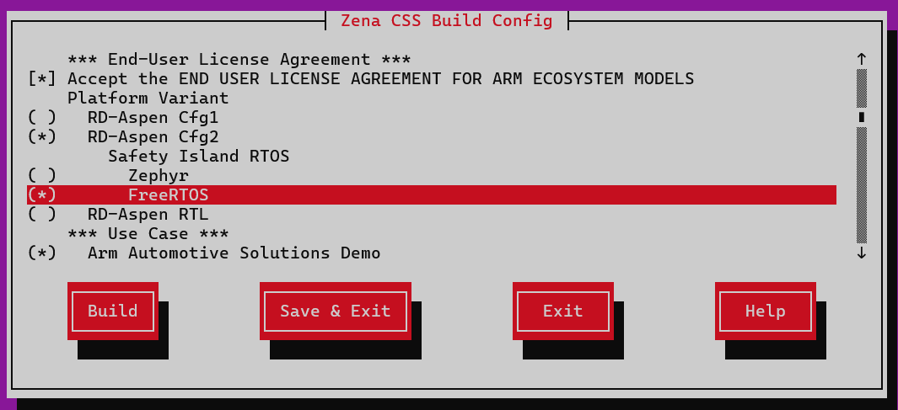
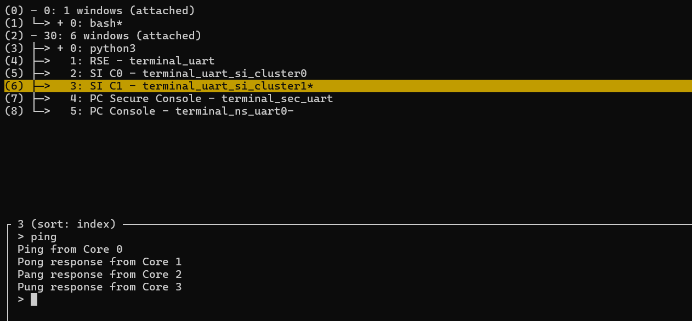

## Build the FreeRTOS application in Yocto

You manually replaced the Safety Island Cluster 1 (SI CL1) payload. Doing so proved that FreeRTOS can meet the Zena CSS secure boot requirements. Runtime Security Engine (RSE) authenticates the image, copies it to SI CL1 low-latency RAM (LLRAM), and releases the cluster through the standard platform boot flow.

You'll now build the FreeRTOS application in Yocto.

You'll learn a reusable Yocto investigation method. Start from a known build output and trace its dependencies. Identify the interface between recipes, implement a compatible replacement, and validate the complete path.

### Apply the FreeRTOS integration patch

The [`freertos-yocto-integration.patch`](../freertos-yocto-integration.patch) file combines the FreeRTOS recipe with the GCC 13 compatibility patch, machine configuration, and Kconfig selection changes. It applies to a clean Zena CSS v2.2 source tree. Follow the [Zena CSS source-download instructions](https://arm-zena-css.docs.arm.com/en/latest/user_guide/reproduce.html) to download and clone it.

Exit your existing `tmux` session and return to your SSH shell on the Ubuntu host. 

Stop your `tmux` processes and move the existing checkout to `arm-auto-solutions-BAK` before creating a clean checkout:

```bash
cd $HOME
pkill '^tmux'
mv arm-auto-solutions arm-auto-solutions-BAK
mkdir -p $HOME/arm-auto-solutions
cd $HOME/arm-auto-solutions
git clone https://git.gitlab.arm.com/automotive-and-industrial/arm-auto-solutions/arm-zena-css.git --branch v2.2.1
kas checkout arm-zena-css/yocto/kas/repos.yml
```

Copy all contents from [`freertos-yocto-integration.patch`](../freertos-yocto-integration.patch) and save them on your Ubuntu build host as `$HOME/freertos-yocto-integration.patch`. From the root of the Zena CSS checkout, check that the patch applies before changing the source tree:

```bash
PATCH_FILE=$HOME/freertos-yocto-integration.patch
cd $HOME/arm-auto-solutions
git apply --verbose --check "$PATCH_FILE"
```

If the check passes, apply the patch:

```bash
PATCH_FILE=$HOME/freertos-yocto-integration.patch
cd $HOME/arm-auto-solutions
git apply --verbose "$PATCH_FILE"
```

Open a new `tmux` session:

```bash
cd $HOME/arm-auto-solutions
tmux new-session -s arm-auto-solutions
```

Within the `tmux` session, open the build configuration menu:

```bash
kas menu arm-zena-css/Kconfig
```

Select **RD-Aspen Cfg2**, either **Baremetal** or **Virtualization**, and then **FreeRTOS** under **Safety Island RTOS**:



Select **Save & Exit**, then build the complete software stack:

```bash
kas build
```

Launch the model after the build completes:

```bash
kas shell -c '../layers/meta-arm/scripts/runfvp -t tmux'
```

At the SI CL1 console, enter `ping`. A successful four-core exchange confirms that the patched Yocto configuration built, signed, packaged, and booted FreeRTOS through the standard Zena CSS flow.



The patch integrates FreeRTOS into the Yocto build. Next, you'll examine how the integration works.

### Investigate how the patch works

The preceding patch already implements FreeRTOS into Yocto. You'll now learn how the changes were made. Treat the directions to remove, add, and create files as explanations of what the patch did. Inspect the corresponding files instead of repeating the edits. After reviewing the changes, continue to [Build and run the integrated image](/learning-paths/automotive/freertos-zena-css/5_yocto-integration/#build-and-run-the-integrated-image) for validation.

[`yocto/meta-zena-css-bsp/recipes-bsp/images/firmware-fvp-rd-aspen.bb`](https://gitlab.arm.com/automotive-and-industrial/arm-auto-solutions/arm-zena-css/-/blob/release-v2.2/yocto/meta-zena-css-bsp/recipes-bsp/images/firmware-fvp-rd-aspen.bb) was identified as the recipe that creates the RSE flash image.

Its dependencies include the recipe named by `SAFETY_ISLAND_CL1_RECIPE`:

```bitbake
DEPENDS += "\
    ${SAFETY_ISLAND_CL1_RECIPE} \
"
```

By default, [`arm-zena-css/yocto/meta-zena-css-bsp/conf/machine/fvp-rd-aspen.conf`](https://gitlab.arm.com/automotive-and-industrial/arm-auto-solutions/arm-zena-css/-/blob/release-v2.2/yocto/meta-zena-css-bsp/conf/machine/fvp-rd-aspen.conf?ref_type=heads#L92) selects the minimal bare-metal `si-hello-world` recipe:
```bitbake
SAFETY_ISLAND_CL1_RECIPE ??= "si-hello-world"
```

When you select **Arm Automotive Solutions Demo** in the menu, [`arm-zena-css/yocto/meta-zena-css-safety-island/conf/machine/include/fvp/fvp-rd-aspen-zephyr.inc`](https://gitlab.arm.com/automotive-and-industrial/arm-auto-solutions/arm-zena-css/-/blob/release-v2.2/yocto/meta-zena-css-safety-island/conf/machine/include/fvp/fvp-rd-aspen-zephyr.inc?ref_type=heads#L15) sets the variable to `zephyr-demos-cl1`:
```bitbake
SAFETY_ISLAND_CL1_RECIPE ??= "zephyr-demos-cl1"
```

This immediately suggests the main integration approach: create a `freertos-demos-cl1.bb` recipe and select it instead of [`zephyr-demos-cl1.bb`](https://gitlab.arm.com/automotive-and-industrial/arm-auto-solutions/arm-zena-css/-/blob/release-v2.2/yocto/meta-zena-css-safety-island/recipes-kernel/zephyr-kernel/zephyr-demos-cl1.bb).

The following investigation explains how the top-level image reaches `firmware-fvp-rd-aspen.bb` and how the machine configuration selects Zephyr. If you're already familiar with the Yocto dependency flow, continue to [How the patch adds FreeRTOS machine configuration](/learning-paths/automotive/freertos-zena-css/5_yocto-integration/#how-the-patch-adds-freertos-machine-configuration).

When integrating a component into an unfamiliar Yocto build, start with information that the build must resolve: its target and machine. Following those two values is more reliable than searching every layer for a guessed component name.

From `arm-zena-css`, determine how the Zephyr demo is added to the build:

```bash
grep -rn -B1  fvp-rd-aspen-zephyr.inc
```

The output is similar to:

```output
yocto/meta-zena-css-safety-island/conf/machine/include/fvp/fvp-rd-aspen-extras.inc-7-require ${@bb.utils.contains('DISTRO_FEATURES', 'zephyr', 'conf/machine/include/fvp/fvp-rd-aspen-zephyr.inc', '', d)}
```

The Zephyr recipe is used when `DISTRO_FEATURES` contains `zephyr`. 

From `sw-ref-stack`, determine where and when it is set:

```bash
grep -nr DISTRO_FEATURES | grep zephyr
```

The output is similar to:

```output
yocto/kas/arm-auto-solutions.yml:73:    DISTRO_FEATURES:append = " cassini-dev zephyr"
```

The [`yocto/kas/arm-auto-solutions.yml`](https://gitlab.arm.com/automotive-and-industrial/arm-auto-solutions/sw-ref-stack/-/blob/release-v2.2/yocto/kas/arm-auto-solutions.yml?ref_type=heads#L73) file therefore adds `zephyr` unconditionally to `DISTRO_FEATURES`.

From `sw-ref-stack`, find the build configurations that include this kas file:

```bash
grep -nr arm-auto-solutions.yml
```

The output is similar to:

```output
yocto/kas/virtualization.yml:11:    - ../sw-ref-stack/yocto/kas/arm-auto-solutions.yml
yocto/kas/baremetal.yml:11:    - ../sw-ref-stack/yocto/kas/arm-auto-solutions.yml
```
The build uses `arm-auto-solutions.yml` for both the `baremetal` and `virtualization` configurations.

#### How the patch adds FreeRTOS machine configuration

To add a FreeRTOS build option, the patch removes the unconditional `zephyr` distro feature. Then, it adds a menu entry that selects either FreeRTOS or Zephyr.

The patch removes the unconditional `zephyr` setting from `yocto/kas/arm-auto-solutions.yml`:
```diff
 local_conf_header:
   cassini: |
     CASSINI_GENERIC_ARM64_FILESYSTEM = "0"
     DISTRO_FEATURES:remove = "cassini-security cassini-ota cassini-parsec"
-    DISTRO_FEATURES:append = " cassini-dev zephyr"
+    DISTRO_FEATURES:append = " cassini-dev "
     KERNEL_CLASSES:remove = "containers_kernelcfg_check"
```

For more details about the kas YAML file, see the [kas project configuration](https://kas.readthedocs.io/en/4.8.1/userguide/project-configuration.html).

In [`arm-zena-css/Kconfig`](https://gitlab.arm.com/automotive-and-industrial/arm-auto-solutions/arm-zena-css/-/blob/release-v2.2/Kconfig?ref_type=heads), the patch adds a kas menu entry that selects either Zephyr or FreeRTOS:
```diff
+choice
+    prompt "Safety Island RTOS"
+    depends on RD_ASPEN_CFG2 && USE_CASE_DEMOS
+    default SI_CL1_RTOS_ZEPHYR
+
+config SI_CL1_RTOS_ZEPHYR
+    bool "Zephyr"
+
+config SI_CL1_RTOS_FREERTOS
+    bool "FreeRTOS"
+
+endchoice
+
+config KAS_INCLUDE_SI_CL1_RTOS
+    string
+    default "../sw-ref-stack/yocto/kas/si-cl1-zephyr.yml" if SI_CL1_RTOS_ZEPHYR
+    default "../sw-ref-stack/yocto/kas/si-cl1-freertos.yml" if SI_CL1_RTOS_FREERTOS
+
```
The choice appears only when `RD_ASPEN_CFG2` and `USE_CASE_DEMOS` are enabled. It allows either Zephyr or FreeRTOS to be selected, but not both. Zephyr remains the default to preserve the existing build behavior.
`KAS_INCLUDE_SI_CL1_RTOS` is an internal string option with no visible prompt. Its conditional defaults map the selected RTOS to the corresponding kas configuration file. The build configuration can then include the selected YAML file without duplicating the RTOS-selection logic.

For more information about choices, dependencies, and conditional defaults, see the [Kconfig language documentation](https://docs.kernel.org/kbuild/kconfig-language.html).

#### How the patch adds kas configuration fragments

The patch creates `sw-ref-stack/yocto/kas/si-cl1-freertos.yml` and adds the following content:
```diff
+local_conf_header:
+  si-cl1-freertos: |
+    DISTRO_FEATURES:append = " freertos"
```

It creates `sw-ref-stack/yocto/kas/si-cl1-zephyr.yml` and adds the following content:
```diff
+local_conf_header:
+  si-cl1-zephyr: |
+    DISTRO_FEATURES:append = " zephyr"
```


In [`yocto/meta-zena-css-safety-island/conf/machine/include/fvp/fvp-rd-aspen-extras.inc`](https://gitlab.arm.com/automotive-and-industrial/arm-auto-solutions/arm-zena-css/-/blob/release-v2.2/yocto/meta-zena-css-safety-island/conf/machine/include/fvp/fvp-rd-aspen-extras.inc), it adds a conditional include for the `freertos` distro feature:

```diff
 require ${@bb.utils.contains('DISTRO_FEATURES', 'zephyr', \
     'conf/machine/include/fvp/fvp-rd-aspen-zephyr.inc', '', d)}
+
+require ${@bb.utils.contains('DISTRO_FEATURES', 'freertos', \
+    'conf/machine/include/fvp/fvp-rd-aspen-freertos.inc', '', d)}
```


The patch creates `yocto/meta-zena-css-safety-island/conf/machine/include/fvp/fvp-rd-aspen-freertos.inc` with the FreeRTOS defaults:

```bitbake
# Safety Island FreeRTOS defaults.
SAFETY_ISLAND_CL1_RECIPE ??= "freertos-demos-cl1"
SAFETY_ISLAND_CL1_IMAGE ??= "${SAFETY_ISLAND_CL1_RECIPE}"
```

BitBake uses these values only when `DISTRO_FEATURES` contains `freertos`. The two assignments tell the existing firmware recipe which recipe to build and which image name to sign.

However, the referenced `freertos-demos-cl1` recipe doesn't exist yet. You'll build that recipe by following the behavior of `zephyr-demos-cl1` and other bare-metal recipes.

The patch also adds the referenced `freertos-demos-cl1` recipe. Its design follows `zephyr-demos-cl1` and other bare-metal recipes.

#### How the patch creates the FreeRTOS recipe

The patch makes `freertos-demos-cl1.bb` build the FreeRTOS application and expose its binary under the name expected by the signing flow.

The patch uses `yocto/meta-zena-css-bsp/recipes-bsp/si-hello-world/si-hello-world.bb` as a bare-metal example. Inspect `zephyr-environment.txt` to understand the expanded `do_install` and `do_deploy` behavior. If you update the provided patch, build the recipe after each meaningful addition so that BitBake can report any missing requirements.

The patch creates the recipe directory in `arm-zena-css/`:

```bash
mkdir -p yocto/meta-zena-css-safety-island/recipes-kernel/freertos-kernel
```

Begin by identifying the recipe inputs:

- `SRC_URI` fetches the Cortex-R82AE demo and FreeRTOS Kernel repositories.
- `inherit cmake` supplies the native CMake dependency and standard configure and compile tasks.
- `DEPENDS` supplies the AArch64 bare-metal compiler.
- `EXTRA_OECMAKE` maps the CMake configuration into the standard `cmake` class.
- `do_compile:append` converts the ELF file to the raw binary required by the RSE image.
- `do_install` and `do_deploy` implement the `/firmware` interface discovered from Zephyr.

When the required compiler recipe is uncertain, search the existing metadata:

```bash
grep -R -n 'gcc-aarch64-none-elf.*-native' yocto
```

The `scp-firmware-fvp-rd-aspen.inc` file depends on `gcc-aarch64-none-elf-native`, so the patch uses the same dependency for FreeRTOS.

The patch creates `yocto/meta-zena-css-safety-island/recipes-kernel/freertos-kernel/freertos-demos-cl1.bb` and adds the source, dependency, and build tasks.

If you want to test the patch directly, run:

```bash
kas shell -c 'bitbake freertos-demos-cl1'
```
The first build might expose recipe requirements that aren't visible in the CMake build.

{}

Consider the following guidance to troubleshoot issues that you might encounter:

- A fetched source doesn't have license metadata.

  The output is similar to:

  ```output
  ERROR: freertos-demos-cl1-1.0-r0 do_populate_lic: QA Issue: freertos-demos-cl1: Recipe file fetches files and does not have license file information (LIC_FILES_CHKSUM) [license-checksum]
  ```

  To fix this, add the source license and checksum with `LICENSE` and `LIC_FILES_CHKSUM`. `LICENSE = "CLOSED"` can isolate a license-checksum problem during local diagnosis, but the completed recipe must declare the actual source license.


- The signing task can then report that no package version was recorded.

  The output is similar to:

  ```output
  ERROR: firmware-fvp-rd-aspen-1.0-r0 do_sign_images: pv_tracker: No PV recorded for freertos-demos-cl1
  ```

  To fix this, add `inherit pv_tracker` because the Zena CSS signing flow records the versions of its firmware inputs.


- If `do_package` reports files that were installed but not shipped, set `PACKAGES = ""` because this firmware isn't installed in a Linux root file system. Add `/firmware` to `SYSROOT_DIRS` so that `firmware-fvp-rd-aspen.bb` can read the binary from its recipe sysroot.

{}

The compiler dependency reveals another issue. The version of `gcc-aarch64-none-elf-native` provided by Zena CSS is GCC 13, which doesn't recognize `-mcpu=cortex-r82ae`.

The patch replaces that option with the supported `cortex-r82` name in both the C and assembly flags:

```diff
-set(CMAKE_C_FLAGS "-mcpu=cortex-r82ae ...")
-set(CMAKE_ASM_FLAGS "-mcpu=cortex-r82ae ...")
+set(CMAKE_C_FLAGS "-mcpu=cortex-r82 ...")
+set(CMAKE_ASM_FLAGS "-mcpu=cortex-r82 ...")
```

This change allows the image to compile, but runtime validation reveals another GCC 13 problem. The SI CL1 UART becomes unresponsive before you can enter `ping`. Arm Development Studio debugger reports `ESR_EL1=0x96000061` and a fault address of `0x1404321f8`.

The generated code contains `stp q0, q0, [x1]`. This SIMD store needs 16-byte alignment, but the destination is only 8-byte aligned. GCC 13 generated the instruction while optimizing the replacement `memset`.

The patch keeps alignment checking enabled in `SCTLR_EL1`. Disabling the check would hide the invalid access instead of fixing the generated code.

The compatibility patch disables the built-in `memset` only for `crt_replacements.c`:

```cmake
set_source_files_properties(crt_replacements.c PROPERTIES
    COMPILE_OPTIONS "$<$<C_COMPILER_ID:GNU>:-fno-builtin-memset>"
)
```

After applying the packaging, version-tracking, and compiler fixes, the completed `freertos-demos-cl1.bb` recipe is:


<details>

<summary>Show the complete freertos-demos-cl1.bb recipe.</summary>

```bitbake
# SPDX-License-Identifier: MIT

SUMMARY = "FreeRTOS Demo on Safety Island Cluster 1"
DESCRIPTION = "FreeRTOS demo application for Zena CSS SI CL1"

LICENSE = "MIT"
LIC_FILES_CHKSUM = " \
    file://LICENSE.md;md5=5d1c92c2ddf8acf8480e3c18f3ab890b \
    file://${FREERTOS_KERNEL_DIR}/LICENSE.md;md5=7ae2be7fb1637141840314b51970a9f7 \
"

inherit cmake deploy
inherit pv_tracker

SRC_URI = " \
    git://github.com/JulienJayat-Arm/FreeRTOS-Partner-Supported-Demos.git;protocol=https;branch=R82AE-demo;name=demos;destsuffix=demos \
    git://github.com/JulienJayat-Arm/FreeRTOS-Kernel.git;protocol=https;branch=R82AE-demo;name=kernel;destsuffix=kernel \
    file://0001-toolchain-use-gcc-13-cortex-r82-name.patch \
"
SRCREV_demos = "27962d523fa4d96e643e4f225dd3cd49bb7829de"
SRCREV_kernel = "def452c440997856806ed9a20058bd3c4acde315"
SRCREV_FORMAT = "demos_kernel"

S = "${UNPACKDIR}/demos/CORTEX_R82AE_SMP_FVP_MPU_GCC_ARMCLANG"
FREERTOS_KERNEL_DIR = "${UNPACKDIR}/kernel"

MULTIMACH_TARGET_SYS = "${MACHINE}_safety_island_c1-freertos"

DEPENDS += "gcc-aarch64-none-elf-native"

CMAKE_BUILD_TYPE = "Debug"
OECMAKE_BUILD_TYPE = "${CMAKE_BUILD_TYPE}"
EXTRA_OECMAKE = " \
    -DCMAKE_TOOLCHAIN_FILE=${S}/gnu_toolchain.cmake \
    -DKERNEL_DIR_PATH=${FREERTOS_KERNEL_DIR} \
    -DR82AE_PLATFORM=zena_css_fvp \
    -DFREERTOS_SOURCE_PREFIX_MAP=-ffile-prefix-map=${UNPACKDIR}=/usr/src/debug/${PN}/${PV} \
"

FREERTOS_ELF = "${B}/r82ae_smp_fvp_gcc_armclang.elf"
FREERTOS_BINARY = "${B}/r82ae_smp_fvp_gcc_armclang.bin"

do_compile:append() {
    ${STAGING_BINDIR_NATIVE}/aarch64-none-elf-objcopy -O binary \
        "${FREERTOS_ELF}" "${FREERTOS_BINARY}"
}

do_install() {
    install -d "${D}/firmware"
    install -m 0644 "${FREERTOS_BINARY}" "${D}/firmware/${PN}.bin"
}

PACKAGES = ""
SYSROOT_DIRS += "/firmware"

do_deploy() {
    install -m 0644 "${D}/firmware/${PN}.bin" "${DEPLOYDIR}/${PN}.bin"
}
addtask deploy after do_install
```

{}
Both `SRCREV` values are pinned to commits that have been tested with this integration. To test the latest commits from each branch instead, replace the commit hashes with `${AUTOREV}`.

`${AUTOREV}` doesn't provide a reproducible build because the selected source can change over time.
{}
</details>

If you later edit the recipe or update its source revision and the build doesn't reflect the change, clean and rebuild the recipe:

```bash
kas shell -c 'bitbake -c cleanall freertos-demos-cl1'
kas shell -c 'bitbake freertos-demos-cl1'
```

The menu option provides a controlled user selection that adds `freertos` to `DISTRO_FEATURES`.


### Build and run the integrated image

With the GCC 13 compatibility patch and recipe available, you can build `freertos-demos-cl1` directly with BitBake.

First, you'll build the complete stack and inspect the dependency graph. Then, you'll check the artifacts. Finally, you'll boot the image to confirm that signing and loading also work.

Build either the baremetal or virtualization stack with the FreeRTOS selection:

```bash
kas build
```

Depending on the selected configuration, this builds `baremetal-image` or `virtualization-image` and its firmware dependencies. A successful build ends with a task summary reporting that all tasks succeeded.

Check the recipe dependency graph. `pn-buildlist` must contain `freertos-demos-cl1` instead of `zephyr-demos-cl1`:


  
kas shell -c 'bitbake -g baremetal-image'
grep -E 'freertos-demos-cl1|zephyr-demos-cl1' build/pn-buildlist
  
  
kas shell -c 'bitbake -g virtualization-image'
grep -E 'freertos-demos-cl1|zephyr-demos-cl1' build/pn-buildlist
  


The dependency graph proves that BitBake selected the FreeRTOS producer.

Next, inspect the deployed FreeRTOS artifacts and final RSE flash image:


  
ls build/tmp_baremetal/deploy/images/fvp-rd-aspen/freertos-demos-cl1.bin
ls build/tmp_baremetal/deploy/images/fvp-rd-aspen/rse-flash-image.img
  
  
ls build/tmp_virtualization/deploy/images/fvp-rd-aspen/freertos-demos-cl1.bin
ls build/tmp_virtualization/deploy/images/fvp-rd-aspen/rse-flash-image.img
  


Old artifacts can remain in the deploy directory. File presence alone doesn't prove which recipe was selected. Use the resolved `DISTRO_FEATURES` and `pn-buildlist` checks as the authoritative evidence.

The deploy directory proves that the build produced files. It doesn't prove that the binary was signed correctly or accepted by RSE. Launch the Zena CSS Fixed Virtual Platform (FVP) through the standard runner:

```bash
kas shell -c '../layers/meta-arm/scripts/runfvp -t tmux'
```

No additional FVP configuration, such as `core_power_on_by_default`, or `--data` override is needed. RSE authenticates the integrated payload, copies it to the SI CL1 LLRAM, and then releases the cluster.

At the SI CL1 console, enter `ping`. 

The expected output is:

```output
> ping
Ping from Core 0
Pong response from Core 1
Pang response from Core 2
Pung response from Core 3
>
```

This confirms that Yocto built the FreeRTOS application. The firmware recipe signed and packaged the application, and RSE started it through the normal boot flow.

The CLI also accepts `pong`, `pang`, and `pung`. Each command starts the same four-hop exchange from the corresponding fixed-affinity task. You can use any of the four commands to repeat the multicore validation from a different starting core.

Finally, return to `kas menu`, select Zephyr, and rebuild. Verify that the original SI CL1 firmware still boots. This last check matters because the integration adds a choice to an existing product configuration. Testing both branches confirms that FreeRTOS works without regressing the default Zephyr path.

## What you've accomplished 

The Cortex-R82AE FreeRTOS port is now integrated as a reproducible Yocto recipe and selectable as the Zena CSS SI CL1 firmware. You traced the working Zephyr flow and identified the interface between its producer and consumer recipes. You then implemented FreeRTOS against the same interface.

You verified menu selection, distro features, and recipe dependencies separately. You also verified the deployed artifact, signed flash image, and runtime output. Use the same investigation pattern to replace or add other firmware components without manually modifying their consuming image recipes.

The next platform-integration step is to add Message Handling Unit (MHU) communication backed by a shared-memory buffer. This provides communication between the FreeRTOS Safety Island application and the primary compute domain. It replaces the equivalent inter-processor communication path used by the Zephyr application.
