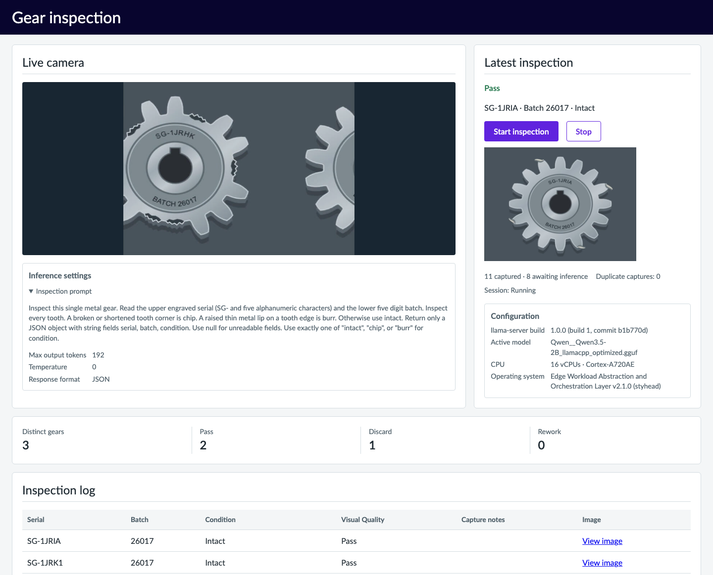

## Start the application

In the **guest shell**, start the services from the application directory. Use a fresh inspection session. Shutting down the services clears active captures. If you already have results to keep, archive them from the dashboard first.

```bash
cd /root/gear-inspection-demo
./scripts/manage-services.sh start
./scripts/manage-services.sh status
```

Look for `RUNNING` beside each service. Once the model has loaded, check its health endpoint.

```bash
wget -qO- http://127.0.0.1:8081/health
```

```text
{"status":"ok"}
```

## Open the local dashboard

Run `exit` to return to the **local shell** where you set `SSH_PORT`. Keep the original ANA tunnel running. Start the following forward and leave this terminal open while you use the dashboard.

```bash
ssh -N \
  -L 8090:127.0.0.1:8090 \
  -L 8091:127.0.0.1:8091 \
  -L 8093:127.0.0.1:8093 \
  -L 8094:127.0.0.1:8094 \
  -p "${SSH_PORT}" \
  root@127.0.0.1
```

Open [the local dashboard](http://127.0.0.1:8090). Confirm the preview shows gears moving across the belt, then select **Start inspection**. If the preview stays black, check playback in ANA. Calibration needs the exposed belt in the upper part of the frame before the detector can capture a gear.

Wait for a completed entry in the inspection log. Open its crop and compare the engraved serial, five-digit batch, and visible teeth with the model's reading. The worker maps an intact gear to **Pass**, a chip to **Discard**, and a burr to **Rework**. The disposition is a prediction and can differ from what you see.



## Finish the session

Select **Stop** to pause capture and inference. Select **Reset** after stopping to archive the session under `/tmp/gear-inspection/history/` and clear the dashboard. Copy any archive you want to keep before rebooting the guest.

Press `Ctrl+C` in the dashboard tunnel terminal. With the original ANA tunnel still running, shut down the services from your local shell.

```bash
ssh -p "$SSH_PORT" root@127.0.0.1 /root/gear-inspection-demo/scripts/manage-services.sh stop
```

You have run an industrial vision pipeline from camera input to an image-backed inspection result. For your own application, select another recording or live feed in ANA. The inspection prompt, accepted labels, and request settings live in `dashboard/backend/qwen_worker.py`. The model, projector, and server inference settings are in `scripts/manage-services.sh`. The gear-specific capture logic is in `inspection/gear_capture.cpp`.
