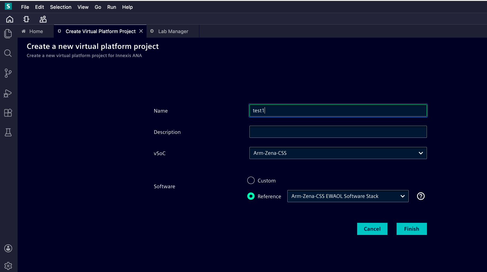
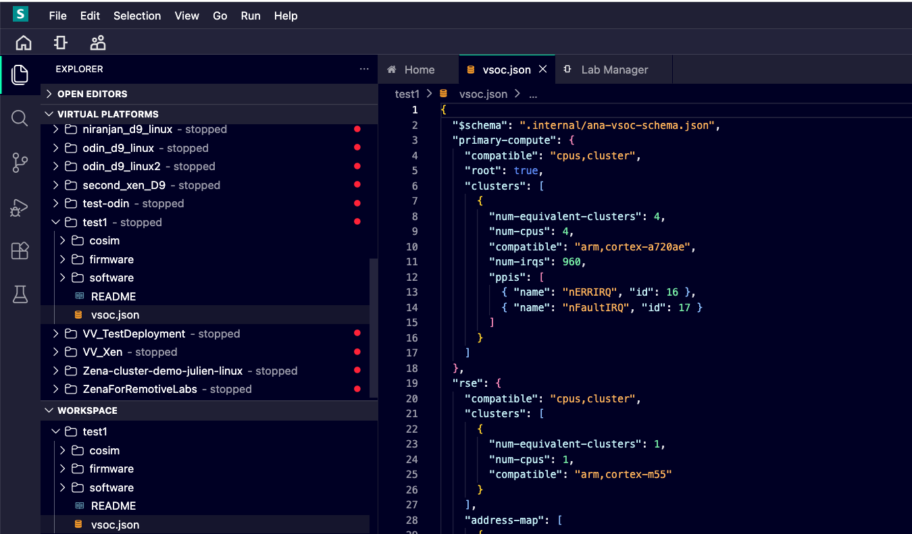
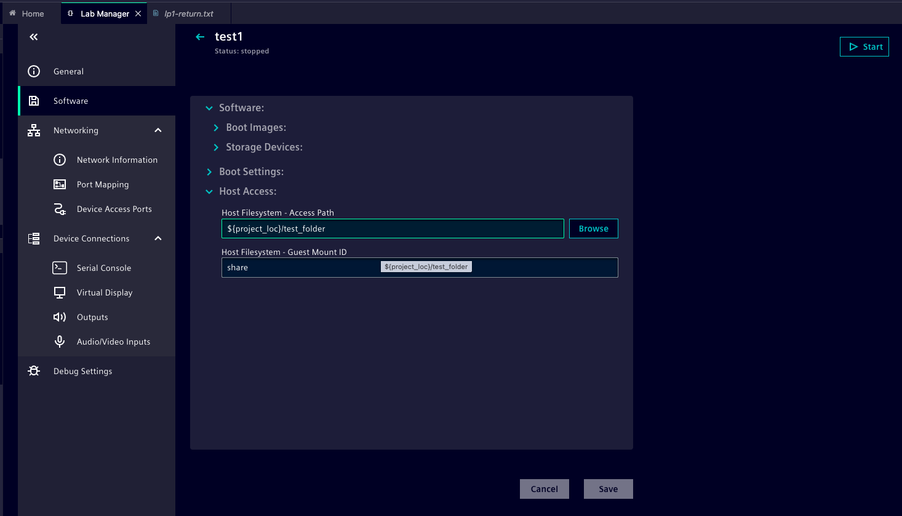
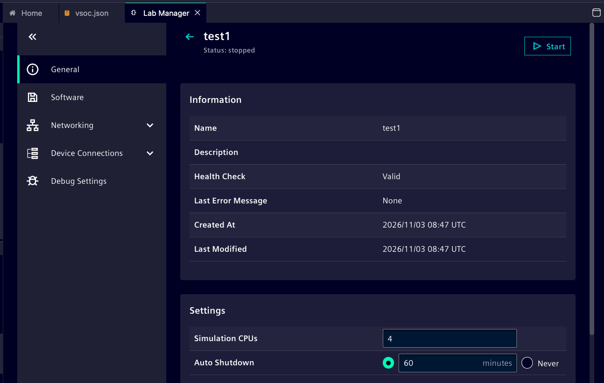
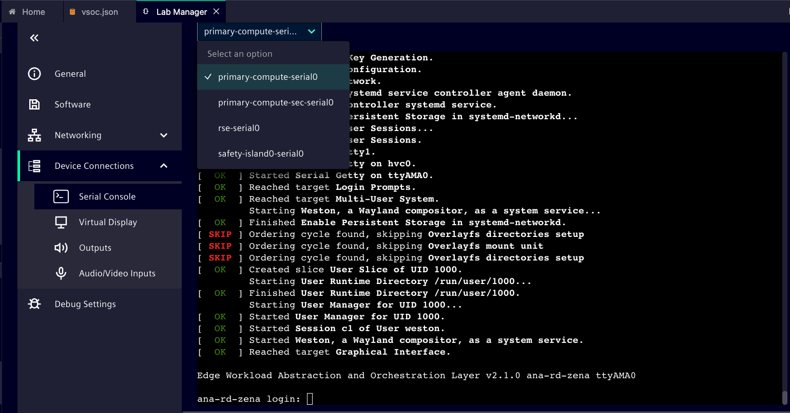

## Create and start a Zena CSS virtual platform

Use the ANA Web IDE to create a new virtual-platform project. This Learning Path uses the supplied EWAOL images, so you do not need to build software before the first boot.

## Create the project

1. Sign in to the ANA chamber provided by your administrator and open the **Web IDE**.
2. Start the **Create a New Virtual Platform Project** workflow described in your Innexis ANA User Guide.
3. Select **Arm-Zena-CSS** as the vSoC.
4. Select **Arm-Zena-CSS EWAOL Software Stack** as the software stack.
5. Give the project a recognizable name and finish the creation workflow. Record any configuration option you change from its default.

The new project appears in the Web IDE with a Zena CSS virtual platform and its selected EWAOL software. Verify both selections before starting. Project creation alone does not show that Linux can boot.

{}
If the project workflow offers a different Zena or EWAOL variant, record its full name and check with the chamber administrator before continuing. The prebuilt software must match the chamber host and vSoC configuration.
{}

## Configure Host Access before starting

Set up the folder for the file-sharing exercise while the virtual platform is stopped. ANA disables **Host Filesystem - Access Path** and **Browse** while a VP is running.

1. In the Web IDE **Explorer**, create a folder in your new project for the shared files, such as **test_folder**. The **New Folder** control is in the **WORKSPACE** section of Explorer.
2. Open **Lab Manager**, select the new virtual platform, and expand **Software > Host Access**.
3. Next to **Host Filesystem - Access Path**, choose **Browse**. The directory selector shows the ANA project workspace, not folders on your local computer. Select the shared folder in your project.
4. Set **Host Filesystem - Guest Mount ID** to **share** and choose **Save**.

Confirm that **Access Path** shows the selected project folder and **Guest Mount ID** is **share** before choosing **Start**. You will use this folder and mount ID in the file-sharing exercise.

## Start the virtual platform

1. Open **Lab Manager** from the Web IDE.
2. Select the virtual platform you just created.
3. Choose **Start**.
4. Open the **Serial Console** view and select the primary-compute console.

Lab Manager shows that the selected virtual platform is starting or running, and the primary-compute console begins displaying boot messages. Boot may take time; wait for a Linux login prompt before treating it as complete.

{}
If the virtual platform stops before reaching a login prompt, record its Lab Manager state and the last visible console messages before retrying. Check the selected vSoC, software stack, and chamber compatibility.
{}

## Record the starting configuration

Keep a short record of the ANA release, chamber host type, project name, vSoC selection, software-stack name, and any memory setting you changed.

You are ready to continue when you can open the console for the **same project** that you started.
