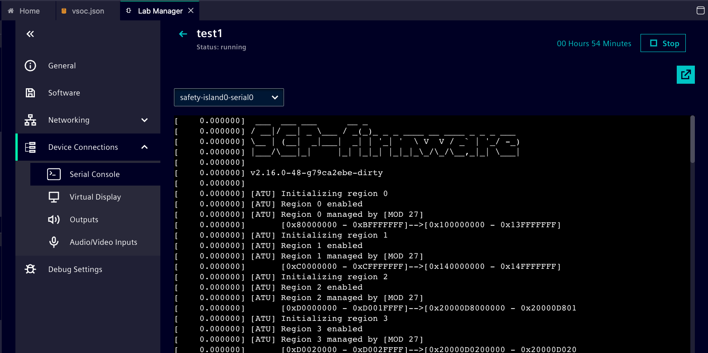

## Observe Zena CSS boot and inspect Linux

Zena CSS exposes separate consoles for its RSE, Safety Island, and primary-compute software. Check each view before entering commands in the Linux guest.

## Follow the boot handoff

Use this sequence to connect the console views to the [Arm Zena CSS boot process](https://arm-zena-css.docs.arm.com/en/latest/design/boot_process.html):

1. The Runtime Security Engine (RSE) starts first and prepares the Safety Island firmware and the Primary Compute boot image.
2. SCP firmware on the Safety Island starts and powers on the Primary Compute.
3. Trusted Firmware-A (TF-A) starts in the Primary Compute secure world. OP-TEE provides secure-world services, while U-Boot continues the normal-world boot.
4. U-Boot starts systemd-boot, which starts the Linux kernel and EWAOL userspace.

The Primary Compute Secure and Primary Compute views do not represent separate sets of CPUs. The secure-world software and Linux use the same application processor cores. This sequence describes the handoff; console timestamps from different views are not a single synchronized timeline.

## Inspect the boot consoles

In ANA's **Serial Console** view, select each console for your virtual platform:

1. **RSE:** look for TF-M or RSE firmware messages.
2. **Safety Island:** look for an SCP firmware startup message.
3. **Primary Compute Secure:** look for TF-A or OP-TEE boot messages.
4. **Primary Compute:** wait for EWAOL Linux to finish booting.



The primary-compute console reaches a Linux login prompt. The other consoles show messages from different parts of the system; do not expect the Linux shell on those views.

Record one identifying line from each console and the exact text of the Linux login prompt. If early firmware messages are no longer visible, record what is available instead of inferring that the stage did not run. A firmware message does not replace a Linux boot check or prove that image authentication succeeded.

## Log in and inspect the guest

Use the login details supplied for your chamber and software image. The Siemens reference guide uses the root account for its EWAOL example.

Run the following commands in the **primary-compute Linux console**:

```bash
cat /etc/os-release; uname -m; uname -r; grep -E '^(MemTotal|MemAvailable):' /proc/meminfo; df -h /
```

`uname -m` reports the Linux guest architecture, commonly `aarch64`. The other commands report this guest's actual OS release, kernel, memory, and root-filesystem capacity. The author's Zena guest returned:

```output
ID=ewaol
NAME="Edge Workload Abstraction and Orchestration Layer"
VERSION="v2.1.0 (styhead)"
VERSION_ID=v2.1.0
VERSION_CODENAME="styhead"
PRETTY_NAME="Edge Workload Abstraction and Orchestration Layer v2.1.0 (styhead)"
CPE_NAME="cpe:/o:openembedded:ewaol:v2.1.0"
aarch64
6.6.54-yocto-standard
MemTotal:        8120232 kB
MemAvailable:    7857784 kB
Filesystem      Size  Used Avail Use% Mounted on
/dev/root        28G  1.3G   25G   5% /
```


## Check which CPUs Linux can use

In the same **Primary Compute Linux console**, inspect the CPUs present and online in this guest:

```bash
cat /sys/devices/system/cpu/present
cat /sys/devices/system/cpu/online
grep -c '^processor' /proc/cpuinfo
lscpu
```

The `present` file lists CPUs Linux identifies as present. The `online` file lists CPUs available to the scheduler. The count from `/proc/cpuinfo` shows the processor entries in this Linux guest; it is not a count of every processing element in the Zena CSS vSoC.

The author's Zena Linux guest returned these relevant lines. Your values can differ if your virtual platform uses another CPU configuration:

```output
0-15
0-15
16
Architecture:             aarch64
CPU(s):                   16
  On-line CPU(s) list:    0-15
  Model name:             Cortex-A720AE
  Core(s) per cluster:  16
  Cluster(s):           1
```

Linux sees 16 online Cortex-A720AE CPUs in this run. The Cortex-R82AE Safety Island and Cortex-M55 RSE run separate firmware and do not appear as extra Linux CPUs. The secure-world console also does not represent another set of CPUs. Compare the reported count with the CPU configuration selected for your VP.

The cluster fields describe the topology presented to this Linux guest. They do not, by themselves, establish the vSoC's internal cluster layout or the topology of a future physical device.

The vSoC's configured DRAM and the RAM usable by its Linux image can differ. Compare the Linux-visible **MemTotal** with the project configuration when you document the environment.

If the login prompt does not appear, return to the primary-compute console and inspect its last boot messages. If a command is unavailable in your image, record the command and error and use the available files under **/proc** to inspect the same property.

You are ready to continue when you can log in, identify the guest OS and resources, and explain why the RSE and Safety Island cores are absent from the Linux CPU list. The CPU output shown here comes from the author's Zena guest; record the values from your own VP.
