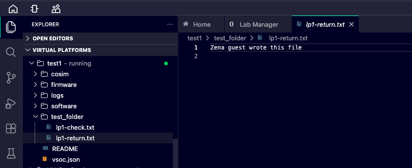

## Share a file with the Zena CSS guest

Before starting the VP, you configured **Lab Manager > Software > Host Access** and set **Host Filesystem - Guest Mount ID** to **share** in the previous step. The **Access Path** points to a folder in the ANA project workspace. ANA disables **Browse** while the VP is running, so set Host Access before the first start.

This exercise uses that 9p share to exchange a small file between the ANA workspace and the EWAOL Linux guest. If you skipped Host Access, stop the VP, complete the configuration in the previous step, and start it again before mounting the share.

## Prepare a known test file

On your local computer, create a text file named **lp1-check.txt** containing this single line:

```text
ANA Zena LP1 file exchange
```

In the Web IDE **Explorer**, right-click the folder selected as **Access Path**, choose **Upload Files...**, and select **lp1-check.txt** from your local computer. Confirm that the file appears in that ANA workspace folder. The Host Access folder selector browses the ANA workspace; it does not browse your local computer.

## Mount the share in Linux

Run these commands in the **primary-compute Linux console**:

```bash
mkdir -p /mnt/ana-share
mount -t 9p -o trans=virtio share /mnt/ana-share
mount | grep ' /mnt/ana-share '
cat /mnt/ana-share/lp1-check.txt
```

The `cat` command printed `ANA Zena LP1 file exchange` in the tested Zena guest.

{}
In the tested ANA 2026.2 environment, `ls -l /mnt/ana-share` displayed the filenames but returned `Protocol error` and exit status `2`. The directory listing failed, although the known file remained readable. Verify the file with `cat` and the exact-content check below.
{}

```output
ls: reading directory '/mnt/ana-share': Protocol error
```

Check the exact contents:

```bash
grep -Fx 'ANA Zena LP1 file exchange' /mnt/ana-share/lp1-check.txt && echo 'File check passed'
```

The tested guest printed **File check passed**. This confirms that the guest can read the selected file. It does not test guest networking or application execution.

```output
File check passed
```

Create a second small file from the **guest** and inspect it in the ANA workspace:

```bash
printf 'Zena guest wrote this file\n' > /mnt/ana-share/lp1-return.txt
cat /mnt/ana-share/lp1-return.txt
```

In the Web IDE **Explorer**, confirm that **lp1-return.txt** appears in the shared folder. Right-click the file and choose **Download**. Open the downloaded file on your local computer and confirm that it contains `Zena guest wrote this file`. The tested Zena share supported this guest-to-workspace write.



If the file does not appear, check that the Web IDE shared the folder containing **lp1-check.txt** and that the mount ID is **share**. If an individual file operation fails transiently, retry that operation once and record the error if it repeats.

## Stop and check the virtual platform

Before stopping, save the boot marker, guest environment output, SSH check, file checks, and any permitted screenshots on your local computer. Return to **Lab Manager**, select this virtual platform, and choose **Stop**. Confirm that its state changes from running to stopped; a disconnected SSH session alone is not a stop check. Keep the project so you can use it for a later exercise.

For a persistence check, start the **same project** again. In the tested run, the shared folder and files remained in the ANA workspace, but Linux needed the 9p mount command again after the VP restarted. Remount the share and read **lp1-check.txt** to confirm it is still available. Stop the virtual platform again when you finish this check.

## What you have accomplished

You have completed this Learning Path when you have a recorded Linux boot, guest environment details, a successful SSH connection, a verified file round trip, and a stopped virtual platform. These results establish a boot and guest-access baseline on this virtual platform. They do not measure physical-silicon performance or validate its security properties.