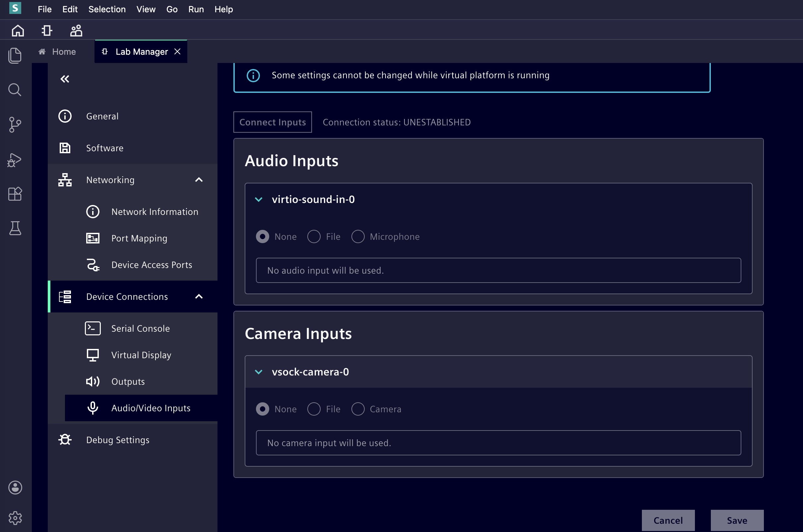

## Configure and check the virtual camera

We will create a 3 second H.264 MP4 clip from a public photograph of parked car available under CC0 1.0 on Wikimedia Commons. The short clip gives you a recognizable scene for this single-frame exercise. You will download the source photograph yourself. To test the complete virtual-camera-to-model workflow, you will turn a still photograph into a short video and use it as ANA’s camera input. You will then capture one frame through the guest’s camera device and pass it to the VLM. Repeating the same photograph makes the expected camera image easy to verify.

### Download the source and create the camera video

On your local machine, create a media directory:

{}
This Learning Path was tested with an Apple® Silicon Mac as the local machine. Commands, file paths, and interface details may differ on other operating systems. You will need to install `ffmpeg` on your local machine. For example on Mac using the `brew` package manager with the following command. 

```sh
brew install ffmpeg
```
{}

```bash
MEDIA_DIR="$HOME/zena-camera-media" ; mkdir -p "$MEDIA_DIR"
```

Open the [source photograph on Wikimedia Commons](https://commons.wikimedia.org/wiki/File:Car_parking_(25737623545).jpg), select **Original file** under the download button, and save it in that directory as `parked-cars-original.jpg`.

```bash
MEDIA_DIR="$HOME/zena-camera-media" ; SOURCE_IMAGE="$MEDIA_DIR/parked-cars-original.jpg"
```

On your local machine, crop the photograph and create a three-second camera video. Run the following commands together:

```bash
MEDIA_DIR="$HOME/zena-camera-media" ; SOURCE_IMAGE="$MEDIA_DIR/parked-cars-original.jpg" ;
PREVIEW_IMAGE="$MEDIA_DIR/parked-cars-preview.jpg" ;
CAMERA_VIDEO="$MEDIA_DIR/automotive-parked-cars-640x480.mp4" ;
ffmpeg -hide_banner -loglevel error -i "$SOURCE_IMAGE" \
    -vf 'scale=640:480:force_original_aspect_ratio=increase,crop=640:480' \
    -frames:v 1 -y "$PREVIEW_IMAGE" &&
ffmpeg -hide_banner -loglevel error -loop 1 -framerate 30 -i "$PREVIEW_IMAGE" \
    -t 3 -vf 'scale=in_range=pc:out_range=tv,format=yuv420p' \
    -c:v libx264 -pix_fmt yuv420p -color_range tv -crf 18 \
    -preset veryfast -an -movflags +faststart -y "$CAMERA_VIDEO" &&
ffprobe -v error -select_streams v:0 \
    -show_entries stream=codec_name,width,height,r_frame_rate \
    -of default=noprint_wrappers=1 "$CAMERA_VIDEO" &&
shasum -a 256 "$CAMERA_VIDEO" ;
printf 'Video preparation status: %s\n' "$?"
```

You should see output similar to the following.

```output
codec_name=h264
width=640
height=480
r_frame_rate=30/1
7a053923146ab81ae6c8bd991cf3620411a3ca664e40196ba2c9d1963bc4767e  /Users/kiehej01/zena-camera-media/automotive-parked-cars-640x480.mp4
Video preparation status: 0
```

Confirm the command reports h264 at 640 × 480 and 30 fps. You can open the MP4 and confirm that it shows parked cars.

In ANA Web IDE, open **Explorer** and drag `automotive-parked-cars-640x480.mp4` into the root of your VP folder under **Virtual Platforms**. Confirm that it appears beside `README` and `vsoc.json`. ANA then makes it available as `${project_loc}/automotive-parked-cars-640x480.mp4`.

### Select the ANA camera input

In **Lab Manager → Device Connections → Audio/Video Inputs**, find `vsock-camera-0` under **Camera Inputs**. Confirm the **None** is currently selected. The screenshot below was captured while the VP was running, so the controls are greyed out.



If not, stop the VP, select **None**, click **Save**, and restart the VP.

{}

If you restart the VP, you may need to restablish SSH tunnelling as per the instructions in the [introductory learning path](../innexis_ana_zena/).

{}

### Start the guest bridge and choose the file

In the **Zena guest shell**, start the virtual camera bridge:

```bash
systemctl start virtualcam-bridge@1.service ; printf 'Bridge start status: %s\n' "$?" ; systemctl is-active virtualcam-bridge@1.service
```

Continue when the command returns status `0` and `active`. The frame capture on the next page checks whether the intended image arrives.

Discover this VP's camera command port. Its value can change after a restart:

```bash
CMD_PORT=$(printf 'vsock-camera-0:cmd\n' | socat -T5 - VSOCK-CONNECT:2:5000) ; LOOKUP_STATUS=$? ; printf 'Command port: <%s>\nLookup status: %s\n' "$CMD_PORT" "$LOOKUP_STATUS" ; if [ "$LOOKUP_STATUS" -eq 0 ] && [ -n "$CMD_PORT" ]; then printf 'INPUT\n' | socat -T5 - "VSOCK-CONNECT:2:$CMD_PORT" ; printf 'Input query status: %s\n' "$?" ; fi
```

In the reported run, the lookup returned port `6001` and initial input `NONE`. Continue only if your lookup succeeds and returns a number. Set the file using that port. Keep `${project_loc}` literal so ANA resolves the VP workspace path:

```bash
printf '%s\n' 'INPUT=${project_loc}/automotive-parked-cars-640x480.mp4' | socat -T5 - "VSOCK-CONNECT:2:$CMD_PORT" ; printf 'Set input status: %s\n' "$?" ; printf 'INPUT\n' | socat -T5 - "VSOCK-CONNECT:2:$CMD_PORT" ; printf 'Readback status: %s\n' "$?"
```

The set command returned `OK`, and `INPUT` read back the selected file path. The next page checks the actual guest image.

## What you have learned

You have selected a repeatable camera input. Next, capture and inspect a frame from `/dev/video0`.
