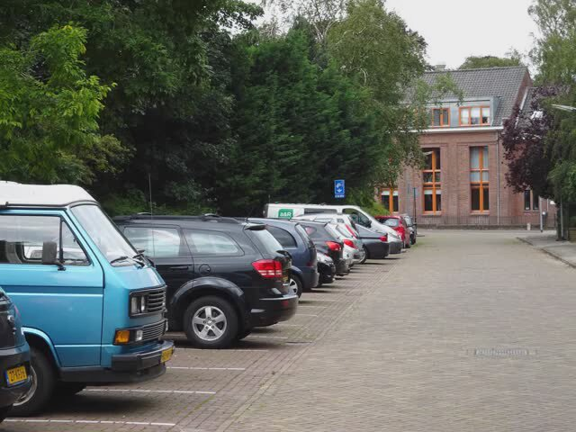

## Capture a JPEG frame from the virtual camera

Now that you've prepared a camera input video, you can capture one frame as a still image.

First, check whether the guest has GStreamer installed:

```bash
for element in v4l2src videoconvert jpegenc filesink waylandsink; do
    if gst-inspect-1.0 "$element" >/dev/null 2>&1; then
        printf 'Available: %s\n' "$element"
    else
        printf 'Missing: %s\n' "$element"
    fi
done
```

GStreamer is a multi-media framework that's required to capture a JPEG from an MP4 file.

In the Zena guest that was used to validate the Learning Path, all five elements were available:

```output
Available: v4l2src
Available: videoconvert
Available: jpegenc
Available: filesink
Available: waylandsink
```

Capture a single frame in the guest shell. Keep the commands together so that the pipeline result, file size, and hash appear in one terminal output. The `timeout` command prevents the capture from waiting indefinitely if no frame arrives:

```bash
WORK_DIR=/root/zena-camera-vlm ; FRAME_FILE="$WORK_DIR/frames/file-after-control.jpg" ; command -v timeout ; timeout 15s gst-launch-1.0 -e v4l2src device=/dev/video0 num-buffers=1 ! videoconvert ! jpegenc ! filesink location="$FRAME_FILE" ; CAPTURE_STATUS=$? ; printf 'Capture status: %s\n' "$CAPTURE_STATUS" ; if [ -s "$FRAME_FILE" ]; then ls -lh "$FRAME_FILE" ; sha256sum "$FRAME_FILE" ; else printf 'No nonempty frame captured\n' ; fi
```

The example Zena run reached EOS, returned status `0`, and wrote a nonempty JPEG with the following SHA-256:

```output
Got EOS from element "pipeline0".
EOS received - stopping pipeline...
Capture status: 0
-rw-r--r-- 1 root root 70K Nov  5 21:49 /root/zena-camera-vlm/frames/file-after-control.jpg
632e0ade2f7827eb33d9d099a615069a94f8254104f7770694a48b1dace3798a  /root/zena-camera-vlm/frames/file-after-control.jpg
```

Transfer the captured camera frame to your local computer. If the shared directory from the [Arm Zena CSS setup Learning Path](/learning-paths/automotive/innexis_ana_zena/) is still mounted, run the following command in the guest shell:

```bash
cp /root/zena-camera-vlm/frames/file-after-control.jpg /mnt/ana-share/
```
The command copies the frame to that directory. 

## Inspect the JPEG frame 

After copying the frame, find the file in the Innexis Architecture Native Acceleration (ANA) Web IDE. Right-click the file and select **Download**.

After transfer to the local machine, ensure that the frame shows the row of parked vehicles from the selected source video. This confirms that the video passed through the virtual camera. It also confirms that a frame was successfully captured in the guest OS.



## What you've accomplished and what's next

You've captured and inspected a single JPEG frame and can verify which camera image the model will receive. 

Next, you'll prepare a model that accepts images.
