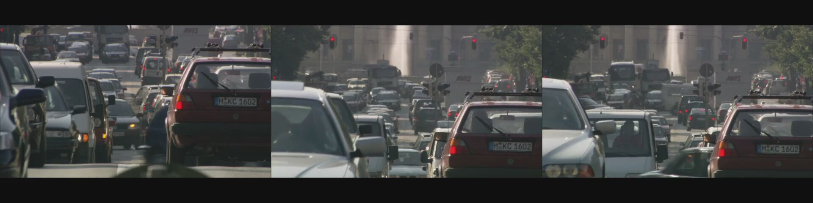

## Analyze a moving automotive scene with a larger VLM

The preceding pages validate one camera frame and one local vision-model response. This optional extension uses a clip with actual vehicle movement. You will check that changing images reach the Zena CSS guest, then run the existing 500M model and a 2.2B model on the **same selected frame**. This is a functional comparison of recorded responses, not a real-time perception or accuracy benchmark.

The source is [Video Codec Test rush hour 1080p25.y4m.webm](https://commons.wikimedia.org/wiki/File:Video_Codec_Test_rush_hour_1080p25.y4m.webm) by Taurus Media Technik. Wikimedia Commons describes it as a fixed-camera view of moving traffic in Munich and marks it CC0 1.0, with a recorded license review. Download the original video from Wikimedia Commons to your computer. This Learning Path does not distribute a converted video.

### Download and convert the moving video

On your **Mac**, download the original WebM video from Wikimedia Commons. Check its SHA-256 before conversion:

<!-- VERIFY: Rerun this reader-formatted download command and hash check before publication. The original source and hash passed in the author run. -->
```bash
MEDIA_DIR="$HOME/zena-camera-media" ; SOURCE_VIDEO="$MEDIA_DIR/rush-hour-source.webm" ; mkdir -p "$MEDIA_DIR" ; curl -fL --retry 2 --retry-delay 3 -o "$SOURCE_VIDEO.part" 'https://upload.wikimedia.org/wikipedia/commons/a/a3/Video_Codec_Test_rush_hour_1080p25.y4m.webm' && printf 'bb587147edb58630b0025b1e86cc2bdfe85fc7caf1f2c8f179e4226749963e76  %s\n' "$SOURCE_VIDEO.part" | shasum -a 256 -c - && mv "$SOURCE_VIDEO.part" "$SOURCE_VIDEO" ; printf 'Source download status: %s\n' "$?"
```

If Wikimedia Commons rate-limits the command, open the [source file page](https://commons.wikimedia.org/wiki/File:Video_Codec_Test_rush_hour_1080p25.y4m.webm), select **Original file**, and save it as `rush-hour-source.webm` in the same local directory. Check its hash before continuing:

```bash
MEDIA_DIR="$HOME/zena-camera-media" ; SOURCE_VIDEO="$MEDIA_DIR/rush-hour-source.webm" ; printf 'bb587147edb58630b0025b1e86cc2bdfe85fc7caf1f2c8f179e4226749963e76  %s\n' "$SOURCE_VIDEO" | shasum -a 256 -c -
```

Convert the WebM to the 640 × 480, 30 fps H.264 MP4 used as ANA camera input. The black bars retain the full widescreen scene:

<!-- VERIFY: Run this reader-formatted conversion command verbatim. The same ffmpeg settings reproduced the reported output hash from the saved source video. -->
```bash
MEDIA_DIR="$HOME/zena-camera-media" ; SOURCE_VIDEO="$MEDIA_DIR/rush-hour-source.webm" ; CAMERA_VIDEO="$MEDIA_DIR/automotive-moving-traffic-640x480.mp4" ; ffmpeg -hide_banner -loglevel error -i "$SOURCE_VIDEO" -vf 'fps=30,scale=640:360,pad=640:480:0:60:color=black,format=yuv420p' -c:v libx264 -crf 21 -preset veryfast -an -movflags +faststart -y "$CAMERA_VIDEO" && ffprobe -v error -select_streams v:0 -show_entries stream=codec_name,width,height,r_frame_rate -of default=noprint_wrappers=1 "$CAMERA_VIDEO" && shasum -a 256 "$CAMERA_VIDEO" ; printf 'Conversion status: %s\n' "$?"
```

The reported conversion produced a 20-second MP4 with H.264 video at 640 × 480 and 30 fps; its SHA-256 was `bff8e05cee14244b64dc7d75e4605814d45f961a9253667fe6e178369013f86f`. A different `ffmpeg` version might produce different bytes. Continue when the output format is correct and the MP4 visibly shows moving vehicles; keep your own file hash.

## Send the moving clip through ANA

Reuse the camera path you configured earlier. Upload the verified MP4 to the root of your ANA virtual-platform workspace, as on page 2. Confirm that its filename appears beside the VP's `README` and `vsoc.json`. In **Lab Manager → Device Connections → Audio/Video Inputs**, leave `vsock-camera-0` set to **None** while the VP is stopped, then start the VP. Start `virtualcam-bridge@1.service` in the guest. Check that it remains active before setting the file input.

```bash
systemctl start virtualcam-bridge@1.service ; printf 'Bridge start status: %s\n' "$?" ; systemctl is-active virtualcam-bridge@1.service ; CMD_PORT=$(printf 'vsock-camera-0:cmd\n' | socat -T5 - VSOCK-CONNECT:2:5000) ; LOOKUP_STATUS=$? ; printf 'Command port: <%s>\nLookup status: %s\n' "$CMD_PORT" "$LOOKUP_STATUS"
```

In the reported `test3` run, the bridge start status was `0`, the service was `active`, and the command-port lookup returned `6001` with status `0`. The port is specific to this VP session.

Continue only when the bridge is active and the name service returns a nonempty command port. Discover the port again after a VP restart; its previous value may no longer apply.

Set `INPUT` to the uploaded MP4 using the discovered command port. Preserve the literal `${project_loc}` syntax for ANA. Replace the filename below if the verified clip has a different name.

```bash
if [ -n "$CMD_PORT" ]; then INPUT_REPLY=$(printf '%s\n' 'INPUT=${project_loc}/automotive-moving-traffic-640x480.mp4' | socat -T5 - "VSOCK-CONNECT:2:$CMD_PORT") ; SET_STATUS=$? ; printf 'Set input response: <%s>\nSet input status: %s\n' "$INPUT_REPLY" "$SET_STATUS" ; printf 'INPUT\n' | socat -T5 - "VSOCK-CONNECT:2:$CMD_PORT" ; printf 'Readback status: %s\n' "$?" ; printf 'CAPS\n' | socat -T5 - "VSOCK-CONNECT:2:$CMD_PORT" ; printf 'CAPS status: %s\n' "$?" ; else printf 'No camera command port was discovered.\n' ; fi
```

In the reported `test3` run, the set request returned `OK`, `INPUT` read back the moving MP4 path, and `CAPS` returned `video/x-raw,format=I420,width=640,height=480,framerate=30/1`; all command statuses were `0`. These are control-interface observations. Capture and inspect guest frames to check the delivered image content.

## Capture frames that show motion

Capture frames from `/dev/video0` at several recorded points while the clip plays. The following guest command saves three JPEGs approximately six seconds apart. It records capture time, exit status, file size, and SHA-256 for each image.

```bash
WORK_DIR=/root/zena-camera-vlm ; mkdir -p "$WORK_DIR/frames" "$WORK_DIR/results" ; for n in 1 2 3; do FRAME_FILE="$WORK_DIR/frames/moving-traffic-$n.jpg" ; rm -f "$FRAME_FILE" ; printf 'Frame %s capture time: ' "$n" ; date -u '+%Y-%m-%d %H:%M:%S UTC' ; timeout 15s gst-launch-1.0 -e v4l2src device=/dev/video0 num-buffers=1 ! videoconvert ! jpegenc ! filesink location="$FRAME_FILE" > "$WORK_DIR/results/moving-capture-$n.log" 2>&1 ; CAPTURE_STATUS=$? ; printf 'Frame %s capture status: %s\n' "$n" "$CAPTURE_STATUS" ; if [ "$CAPTURE_STATUS" -ne 0 ] || [ ! -s "$FRAME_FILE" ]; then tail -n 20 "$WORK_DIR/results/moving-capture-$n.log" ; break ; fi ; ls -lh "$FRAME_FILE" ; sha256sum "$FRAME_FILE" ; if [ "$n" -lt 3 ]; then sleep 6 ; fi ; done
```

In the reported `test3` run, captures at 10:47:07, 10:47:14 and 10:47:20 UTC all returned `0` and created nonempty 640 × 480 JPEGs. Transfer the three images through your authorized chamber route and inspect them side by side. The transferred hashes matched the guest output, and visual inspection showed vehicles in changing positions against the fixed road view. Different SHA-256 values alone do not establish motion.



## Prepare and run the larger model

Compare the 500M and 2.2B models on **the same captured JPEG**. Use the same prompt and inference settings for both runs, then save each response, log, exit status, and elapsed time. This checks what the two models report for one frame; it does not measure continuous video inference or physical-hardware performance.

### Check the frame and rerun the 500M model

Select a captured frame that shows the moving traffic scene. The reported run used `moving-traffic-2.jpg`, which passed its SHA-256 check. Run the 500M model from page 4 on this frame:

```bash
WORK_DIR=/root/zena-camera-vlm ; FRAME_FILE="$WORK_DIR/frames/moving-traffic-2.jpg" ; MODEL_FILE="$WORK_DIR/models/SmolVLM2-500M-Video-Instruct-Q8_0.gguf" ; MMPROJ_FILE="$WORK_DIR/models/mmproj-SmolVLM2-500M-Video-Instruct-Q8_0.gguf" ; LLAMA_CLI=/root/zena-llamacpp/llama.cpp/build/bin/llama-cli ; mkdir -p "$WORK_DIR/results" ; START_TIME=$(date +%s) ; timeout 180s "$LLAMA_CLI" -m "$MODEL_FILE" --mmproj "$MMPROJ_FILE" --no-mmproj-offload --image "$FRAME_FILE" -ngl 0 -t 4 -tb 4 -c 4096 -n 96 --temp 0 --seed 42 --single-turn --simple-io -p 'Describe what you can see in this image in one short sentence.' > "$WORK_DIR/results/moving-500m.log" 2>&1 ; RUN_STATUS=$? ; END_TIME=$(date +%s) ; printf '%s\n' "$RUN_STATUS" > "$WORK_DIR/results/moving-500m.exit" ; printf '500M run status: %s\nElapsed wall seconds: %s\n' "$RUN_STATUS" "$((END_TIME - START_TIME))" ; tail -n 40 "$WORK_DIR/results/moving-500m.log"
```

The reported 500M run exited `0` after nine seconds and described a traffic jam with cars and trucks. The model received one JPEG; its use of “in motion” does not establish video understanding.

### Download and verify the 2.2B model

Check the guest's free disk space, available memory, and remaining VP run time before downloading. In the reported Zena run, the guest had 23 GB free on `/`, `MemAvailable: 7836192 kB`, and an executable `llama-cli` from commit `b86d2f075`. Your current values may differ.

Use the pinned [SmolVLM2-2.2B-Instruct-GGUF revision](https://huggingface.co/ggml-org/SmolVLM2-2.2B-Instruct-GGUF/tree/1bc3c9f74ceafd4c8d4411cc9cf188bba3798f91) to download this pair:

- [Q4_K_M model](https://huggingface.co/ggml-org/SmolVLM2-2.2B-Instruct-GGUF/blob/1bc3c9f74ceafd4c8d4411cc9cf188bba3798f91/SmolVLM2-2.2B-Instruct-Q4_K_M.gguf)
- [Q8_0 multimodal projector](https://huggingface.co/ggml-org/SmolVLM2-2.2B-Instruct-GGUF/blob/1bc3c9f74ceafd4c8d4411cc9cf188bba3798f91/mmproj-SmolVLM2-2.2B-Instruct-Q8_0.gguf)

Together, the files are about 1.7 GB. Each download command checks its SHA-256 before moving the file to its final path:

```bash
WORK_DIR=/root/zena-camera-vlm ; MODEL_REV=1bc3c9f74ceafd4c8d4411cc9cf188bba3798f91 ; MODEL_FILE="$WORK_DIR/models/SmolVLM2-2.2B-Instruct-Q4_K_M.gguf" ; wget -nv -c -O "$MODEL_FILE.part" "https://huggingface.co/ggml-org/SmolVLM2-2.2B-Instruct-GGUF/resolve/$MODEL_REV/SmolVLM2-2.2B-Instruct-Q4_K_M.gguf" && printf '0cf76814555b8665149075b74ab6b5c1d428ea1d3d01c1918c12012e8d7c9f58  %s\n' "$MODEL_FILE.part" | sha256sum -c - && mv "$MODEL_FILE.part" "$MODEL_FILE" && ls -lh "$MODEL_FILE" ; printf 'Model download status: %s\n' "$?"
```

In the reported guest run, the downloaded Q4_K_M file passed SHA-256 and the final status was `0`. `ls -lh` showed 1.1G.

```bash
WORK_DIR=/root/zena-camera-vlm ; MODEL_REV=1bc3c9f74ceafd4c8d4411cc9cf188bba3798f91 ; MMPROJ_FILE="$WORK_DIR/models/mmproj-SmolVLM2-2.2B-Instruct-Q8_0.gguf" ; wget -nv -c -O "$MMPROJ_FILE.part" "https://huggingface.co/ggml-org/SmolVLM2-2.2B-Instruct-GGUF/resolve/$MODEL_REV/mmproj-SmolVLM2-2.2B-Instruct-Q8_0.gguf" && printf 'ae07ea1facd07dd3230c4483b63e8cda96c6944ad2481f33d531f79e892dd024  %s\n' "$MMPROJ_FILE.part" | sha256sum -c - && mv "$MMPROJ_FILE.part" "$MMPROJ_FILE" && ls -lh "$MMPROJ_FILE" ; printf 'Projector download status: %s\n' "$?"
```

In the reported guest run, both files passed their SHA-256 checks with status `0`. The model was 1.1G and the projector was 566M. Save the hash results with the inference log.

### Run the 2.2B model on the same frame

Use the JPEG and prompt from the 500M run. The inference settings are the same; the larger model has a longer timeout to allow it to finish:

```bash
WORK_DIR=/root/zena-camera-vlm ; FRAME_FILE="$WORK_DIR/frames/moving-traffic-2.jpg" ; MODEL_FILE="$WORK_DIR/models/SmolVLM2-2.2B-Instruct-Q4_K_M.gguf" ; MMPROJ_FILE="$WORK_DIR/models/mmproj-SmolVLM2-2.2B-Instruct-Q8_0.gguf" ; LLAMA_CLI=/root/zena-llamacpp/llama.cpp/build/bin/llama-cli ; START_TIME=$(date +%s) ; timeout 300s "$LLAMA_CLI" -m "$MODEL_FILE" --mmproj "$MMPROJ_FILE" --no-mmproj-offload --image "$FRAME_FILE" -ngl 0 -t 4 -tb 4 -c 4096 -n 96 --temp 0 --seed 42 --single-turn --simple-io -p 'Describe what you can see in this image in one short sentence.' > "$WORK_DIR/results/moving-2b.log" 2>&1 ; RUN_STATUS=$? ; END_TIME=$(date +%s) ; printf '%s\n' "$RUN_STATUS" > "$WORK_DIR/results/moving-2b.exit" ; printf '2.2B run status: %s\nElapsed wall seconds: %s\n' "$RUN_STATUS" "$((END_TIME - START_TIME))" ; tail -n 45 "$WORK_DIR/results/moving-2b.log"
```

### Record execution time

The commands read `date +%s` in the guest immediately before and after `llama-cli`. The difference is a whole-second wall-clock observation for the entire command, including model loading, image processing and text generation. Downloads are outside the timed interval. Both runs use the same `moving-traffic-2.jpg` image, prompt, four inference threads, context size 4096 and 96-token output limit.

| Model and quantization | Guest wall time (one run) | Exit status |
| --- | ---: | ---: |
| SmolVLM2-500M Q8_0 | 9 seconds | 0 |
| SmolVLM2-2.2B Q4_K_M | 29 seconds | 0 |

These are observations from one ANA virtual platform run. The models use different quantizations and may generate different answer lengths, so the elapsed times alone do not isolate the effect of model size. They are not physical-silicon performance measurements.

The 2.2B log excerpt reported: “A traffic jam on a busy city street with cars and a fountain in the background.” This describes visible content in the selected frame. The 500M response described traffic, cars and trucks; the 2.2B response mentioned the fountain. A single frame cannot establish which model is generally more accurate.

The raw logs and exit files were transferred to the author workspace. Both log hashes matched the guest values, and both saved exit files contained `0`. The logs confirm that the same image and prompt were used. A separate 2.2B run completed in `33.72` seconds. Peak memory was not reliably measured in this guest, so no memory-use value is reported.

Compare what each response actually says about the captured scene. Describe differences in the answers without claiming that one model is more accurate from a single example. VP timing and memory observations apply only to the tested virtual environment. This exercise does not validate continuous video inference or physical-silicon performance.

## What you have learned

You can use a recorded moving scene to check that the virtual camera supplies changing images, then inspect how two local vision models describe the same captured input.
