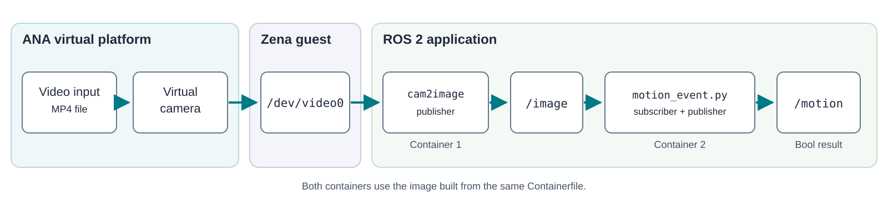

## Prepare the Zena CSS ROS 2 environment

This Learning Path uses the virtual camera setup in [Build a Camera-to-VLM Pipeline on Arm Zena CSS](/learning-paths/automotive/innexis_zena_camera_vlm/), including its [moving-traffic video preparation](/learning-paths/automotive/innexis_zena_camera_vlm/6_analyze_moving_scene/). You need the camera input and a checked guest frame from those steps; you do not need to run the vision-language model for this tutorial. Keep the same VP running and continue in its **EWAOL Linux guest**. This tutorial starts when `/dev/video0` is receiving that video; it does not repeat ANA installation or video preparation.

The application path is shown below. ANA supplies video to the Zena guest camera device. A ROS 2 publisher turns those frames into `/image` messages, and your application publishes the result on `/motion`.



You will build and check a standard ROS 2 application on the virtual target. The result demonstrates software functionality in this VP configuration. It does not establish behavior or performance on physical Zena hardware.

The 60-minute completion time is an estimate. It has not been measured from start to finish in a fresh chamber. Check the VP's Auto Shutdown setting before beginning.

### Build the ROS 2 container image

In the **Zena guest**, create a work directory and a Containerfile. The Containerfile is the recipe for the container image used by both ROS 2 nodes in this tutorial. It starts from the ROS 2 Jazzy base image and adds the official [`image_tools` package](https://github.com/ros2/demos/tree/jazzy/image_tools), which supplies `cam2image`. Keeping this setup in a file lets you rebuild the same application environment without installing ROS 2 packages into the EWAOL guest OS.

```bash
mkdir -p /root/zena-ros-camera/results
cat > /root/zena-ros-camera/Containerfile <<'EOF'
FROM docker.io/library/ros:jazzy-ros-base
RUN apt-get update && apt-get install -y --no-install-recommends ros-jazzy-image-tools && rm -rf /var/lib/apt/lists/*
EOF
```

`--no-install-recommends` avoids extra suggested packages. Removing the APT lists at the end avoids retaining their download data in the image.

This tutorial uses Podman because it was available and tested in the Zena EWAOL guest. The `docker.io` prefix identifies the image registry; it does not require the Docker daemon. Docker was not tested for this run. Build the container:

```bash
podman build -t zena-ros-camera:jazzy -f /root/zena-ros-camera/Containerfile /root/zena-ros-camera
```

The tested build ended with output similar to:

```output
COMMIT zena-ros-camera:jazzy
Successfully tagged localhost/zena-ros-camera:jazzy
```

The reported run installed `ros-jazzy-image-tools 0.33.11-1noble.20261105.204646`. Package versions and image IDs can change when the base image or package repository changes.

## What you have learned

You have prepared a ROS 2 container in the Zena guest. Next, use it to publish frames from the existing virtual camera.
