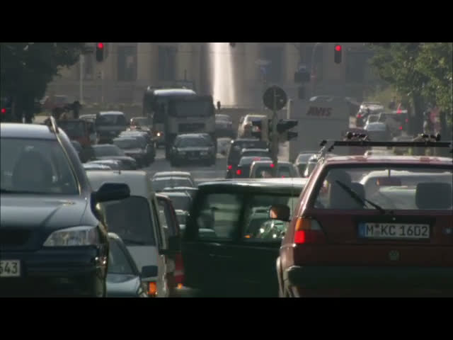

## Develop a ROS 2 motion event node

The image publisher from the previous page must still be running. In the **Zena guest**, use your text editor to create `/root/zena-ros-camera/motion_event.py` with the complete program below:

```python
import hashlib

import rclpy
from rclpy.node import Node
from sensor_msgs.msg import Image
from std_msgs.msg import Bool

DEFAULT_THRESHOLD = 8.0


class MotionEvent(Node):
    def __init__(self):
        super().__init__('motion_event')
        self.previous = None
        self.frame_count = 0
        self.saved_frame = False
        self.publisher = self.create_publisher(Bool, '/motion', 10)
        self.subscription = self.create_subscription(Image, '/image', self.on_image, 10)
        self.get_logger().info(f'threshold={DEFAULT_THRESHOLD}')

    def on_image(self, msg):
        if msg.encoding not in ('rgb8', 'bgr8') or msg.step < msg.width * 3:
            self.get_logger().error(
                f'Unsupported image encoding or step: {msg.encoding}, {msg.step}'
            )
            return

        data = msg.data
        if not self.saved_frame:
            with open('/work/results/ros-first-frame.ppm', 'wb') as output:
                output.write(f'P6\n{msg.width} {msg.height}\n255\n'.encode())
                for y in range(msg.height):
                    row = bytearray(data[y * msg.step:y * msg.step + msg.width * 3])
                    if msg.encoding == 'bgr8':
                        row[0::3], row[2::3] = row[2::3], row[0::3]
                    output.write(row)
            self.saved_frame = True

        samples = bytearray()
        for y in range(0, msg.height, max(1, msg.height // 30)):
            offset = y * msg.step
            for x in range(0, msg.width, max(1, msg.width // 40)):
                i = offset + x * 3
                samples.append((data[i] + data[i + 1] + data[i + 2]) // 3)

        if self.previous is not None and len(samples) == len(self.previous):
            delta = sum(
                abs(a - b) for a, b in zip(samples, self.previous)
            ) / len(samples)
            moving = delta >= DEFAULT_THRESHOLD
            self.publisher.publish(Bool(data=moving))
            self.frame_count += 1
            if self.frame_count % 10 == 0:
                digest = hashlib.sha256(samples).hexdigest()[:12]
                self.get_logger().info(
                    f'frame={self.frame_count} mean_delta={delta:.2f} '
                    f'motion={moving} sample_sha256={digest}'
                )
        self.previous = samples


def main():
    rclpy.init()
    node = MotionEvent()
    try:
        rclpy.spin(node)
    finally:
        node.destroy_node()
        rclpy.shutdown()


if __name__ == '__main__':
    main()
```

The node receives `/image` as `sensor_msgs/msg/Image`. It samples pixels from adjacent frames, calculates their average grayscale difference, and publishes `std_msgs/msg/Bool` on `/motion`. `DEFAULT_THRESHOLD = 8.0` decides when the sampled difference counts as motion. The program also writes its first received frame to `/work/results/ros-first-frame.ppm` so you can inspect what the ROS 2 subscriber actually received. This is a small application exercise, not a vehicle safety detector.

Check the Python syntax in the **Zena guest**:

```bash
python3 -m py_compile /root/zena-ros-camera/motion_event.py
```

### Run the node

Start the application container while the camera publisher continues to run:

```bash
podman run -d --name zena-motion-detector --net=host --ipc=container:zena-camera-publisher -v /root/zena-ros-camera:/work:rw localhost/zena-ros-camera:jazzy bash -lc 'source /opt/ros/jazzy/setup.bash ; exec python3 /work/motion_event.py'
podman logs --tail 10 zena-motion-detector
```

`-v` maps the guest directory to `/work`, so the container can read the Python file and save its result. `--ipc=container:zena-camera-publisher` shares IPC with the publisher so the two containers can exchange camera frames over Fast DDS shared memory. [Fast DDS documentation](https://fast-dds.docs.eprosima.com/en/v2.14.7/docker/shm_docker.html) explains this container setup.

The log should first show `threshold=8.0`, then entries containing `frame`, `mean_delta`, and `motion`. If the container has just started, run `podman logs --tail 10 zena-motion-detector` again after it receives frames. An entry means the callback processed an image; a visible topic endpoint alone is not enough.

### Check the application result

Enter the detector container and load ROS 2:

```bash
podman exec -it zena-motion-detector bash
source /opt/ros/jazzy/setup.bash
```

Run:

```bash
ros2 topic info /motion -v
ros2 topic echo /motion --once
exit
```

`ros2 topic info /motion -v` should report `std_msgs/msg/Bool` and one publisher named `motion_event`. `ros2 topic echo /motion --once` receives one Bool message, which can be `data: false` or `data: true` depending on the current frame.

The saved PPM is `/root/zena-ros-camera/results/ros-first-frame.ppm` in the guest. Use the file-transfer procedure from the preceding Learning Path to copy it to your local machine and view it. Inspect the image itself to confirm that it shows the moving traffic source; file existence alone does not confirm the image content. The example below shows a 640 × 480 JPEG converted from the received PPM.



The frame comes from the [CC0 rush-hour source video](https://commons.wikimedia.org/wiki/File:Video_Codec_Test_rush_hour_1080p25.y4m.webm) used in the preceding Learning Path.

## What you have learned

You have turned the virtual camera frames into a ROS 2 application output and checked an image received by the application. Next, change one decision threshold and rerun the node.
