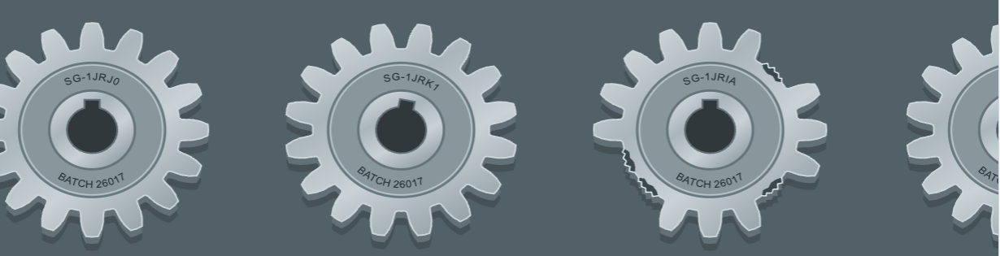
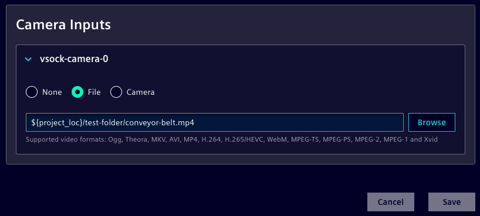
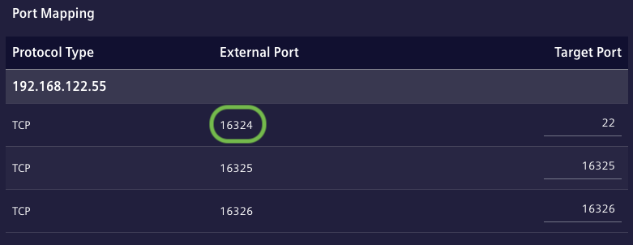

## Generate your camera input

On your **host workstation**, download [simulator.html from the example repository](https://gitlab.arm.com/learning-code-examples/code-examples/-/blob/main/learning-paths/automotive/visual-inspection-with-siemens-ana/samples/simulator.html) using GitLab’s **Download** button. The simulator generates a video of gears moving along a manufacturing line, each engraved with a serial number and a batch number. Broken teeth are the only defect in this example.

Open the downloaded file in desktop Chrome. Keep the default settings for this run: first batch number `26017`, 16 gears in total, and two gears with broken teeth.

Select **Start run** to preview the conveyor. Look for missing or shortened teeth as the gears pass.



Select **Reset**, then **Download MP4**. Wait for Chrome to save `gear-inspection-batch-26017.mp4`. Expand **Ground-truth batch manifest** to see which serials have broken teeth. You’ll compare an inspection result with this list later.

## Configure the Innexis camera

Ensure the vSoC is stopped, then upload the MP4 to your Innexis project. Under **Device Connections → Audio/Video Inputs**, expand **vsock-camera-0** in **Camera Inputs**. Select **File** and use **Browse** to choose the uploaded MP4.



Enable repeat playback, select **Save**, and start the instance. Innexis feeds the video frames into the guest’s Video4Linux2 (V4L2) device at `/dev/video0`. The inspection application reads from that device as it would from a physical camera.

## Connect the inspection dashboard

In Innexis, open **Networking → Port Mapping**. Find the TCP row with target port `22` (SSH) and note its **External Port**. In the example below, connections to external port `16324` reach port `22` on the guest. Use the external port and guest IP shown for your own instance.



As in the introductory Innexis ANA Learning Path, you may need to assign the mapped guest IP to `eth0`. In the **Zena dashboard terminal**, run:

```sh
ip -4 addr show dev eth0
```

If the address shown above the TCP rows is missing, replace `GUEST_IP_FROM_INNEXIS` with that address and run:

```sh
ip addr add GUEST_IP_FROM_INNEXIS/24 dev eth0
```

Authorize your host workstation’s SSH public key for the instance.

In **host workstation terminal 1**, run the tunnel command provided by Innexis. In **host workstation terminal 2**, replace `PORT_FROM_INNEXIS` below with the port number you noted. This second tunnel gives the browser on your host workstation access to the inspection dashboard, its controls, and its video preview.

```sh
ssh -N -o ExitOnForwardFailure=yes -p PORT_FROM_INNEXIS \
    -L 8090:127.0.0.1:8090 \
    -L 8091:127.0.0.1:8091 \
    -L 8093:127.0.0.1:8093 root@127.0.0.1
```

Keep both host workstation terminals open. For the remaining guest commands, open the **Zena vSoC terminal in the Innexis dashboard** and work as root.
