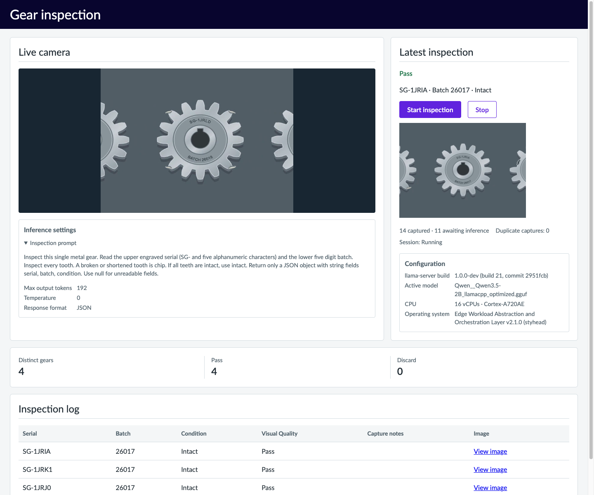

## Start the inspection services

In the **Zena dashboard terminal**, start the services from the demo directory.

```sh
cd /root/code-examples/learning-paths/automotive/visual-inspection-with-siemens-ana
./scripts/manage-services.sh start
./scripts/manage-services.sh status
```

Look for `RUNNING` beside each service. If startup fails, check the corresponding log under `scripts/logs/`.

You can also check the inspection session through its HTTP API. Run this in the same terminal:

```sh
wget -qO- http://127.0.0.1:8091/api/status
```

A fresh session reports:

```json
{"status":"READY","captured":0,"pending":0}
```

## Inspect a gear

On your **host workstation**, open the [inspection dashboard](http://127.0.0.1:8090). Confirm that gears move across the preview, then select **Start inspection**. The application calibrates against the exposed belt before capturing gears. Run the status command again to see the session enter `RUNNING`. The `captured` count shows how many gear images have been saved and `pending` shows how many are waiting for a result.

Wait for a completed entry in the inspection log. Select **View image** and compare the engraved serial, batch number, and tooth condition with the simulator’s **Ground-truth batch manifest**. The worker maps an intact gear to **Pass** and a broken tooth to **Discard**. A prediction can differ from the manifest.



You can also read the predictions from the **Zena dashboard terminal**. The results endpoint on port `8090` returns a JSON array with one entry per completed inspection, or an empty array while the first result is pending.

```sh
wget -qO- http://127.0.0.1:8090/api/results | python3 -m json.tool
```

Example response with one completed inspection:

```json
[
  {
    "id": "1795784452299148",
    "serial": "SG-1JRHZ",
    "batch": "26017",
    "condition": "intact",
    "disposition": "pass",
    "duplicate": false,
    "conflict": false,
    "error": null,
    "seconds": 8.92
  }
]
```

Here the model classified the teeth as `intact`, which the worker mapped to `pass`. Compare the prediction for your serial number with the manifest.

## Finish the session

Select **Stop** to stop capture and inference. To keep the results, select **Reset** while stopped to archive them under `/tmp/gear-inspection/history/`. Close the inspection dashboard tab. In the **Zena dashboard terminal**, shut down the services and check their status:

```sh
./scripts/manage-services.sh stop
./scripts/manage-services.sh status
```

Close the port forward and the Innexis tunnel with `Ctrl+C` in each host workstation terminal.

## Summary and Next Steps

You generated a conveyor video, ran a vision-language model on the Zena vSoC, and checked its gear inspections against the batch manifest. This minimal educational example is designed for you to adapt to your own use case under the [BSD-3-Clause-Clear license](https://gitlab.arm.com/learning-code-examples/code-examples/-/blob/main/learning-paths/automotive/visual-inspection-with-siemens-ana/LICENSE.txt).

- Change the conveyor speed, export a new MP4, and check which gears the application captures.
- Try another vision-language model from the [Arm AI Portal](https://developer.arm.com/ai/models/). Choose one compatible with llama.cpp and update the model and projector paths in `scripts/manage-services.sh`.
- Update the inspection prompt in `dashboard/qwen_worker.py` to describe the defect you want to detect. If you introduce a new condition, update the worker’s accepted labels and the dashboard labels to match.
- Try a live video feed by selecting **Camera** under the Innexis audio/video inputs. For a different part or background, adapt the detection and cropping logic in `inspection/gear_capture.cpp`.
