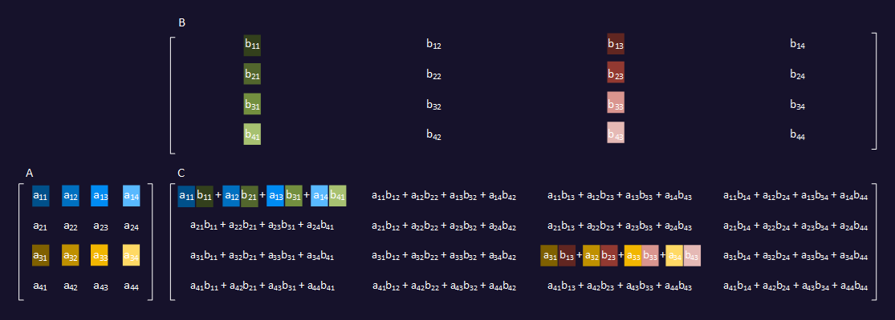
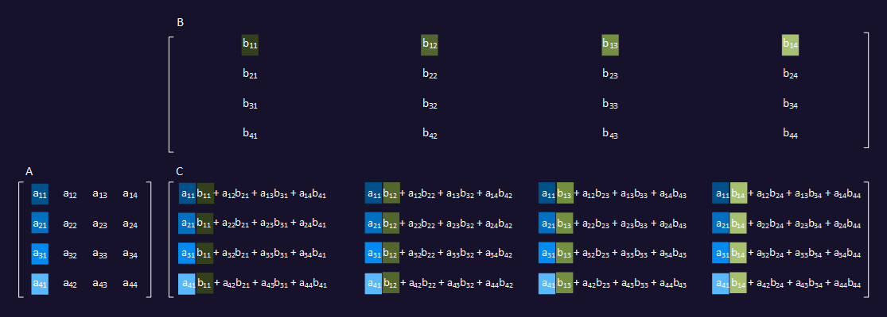
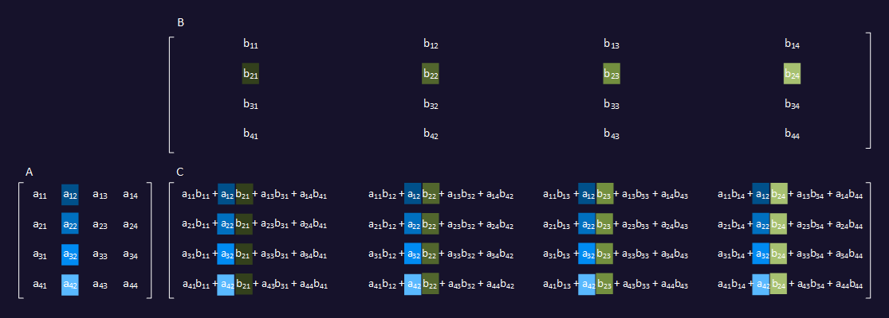
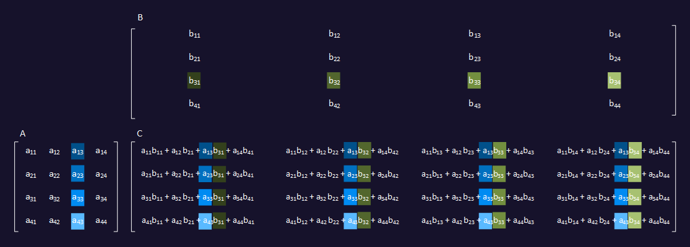
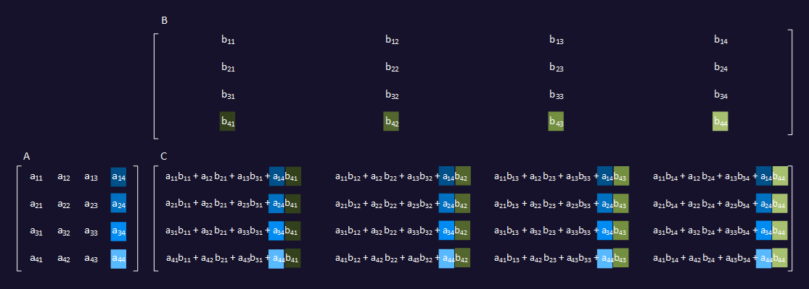
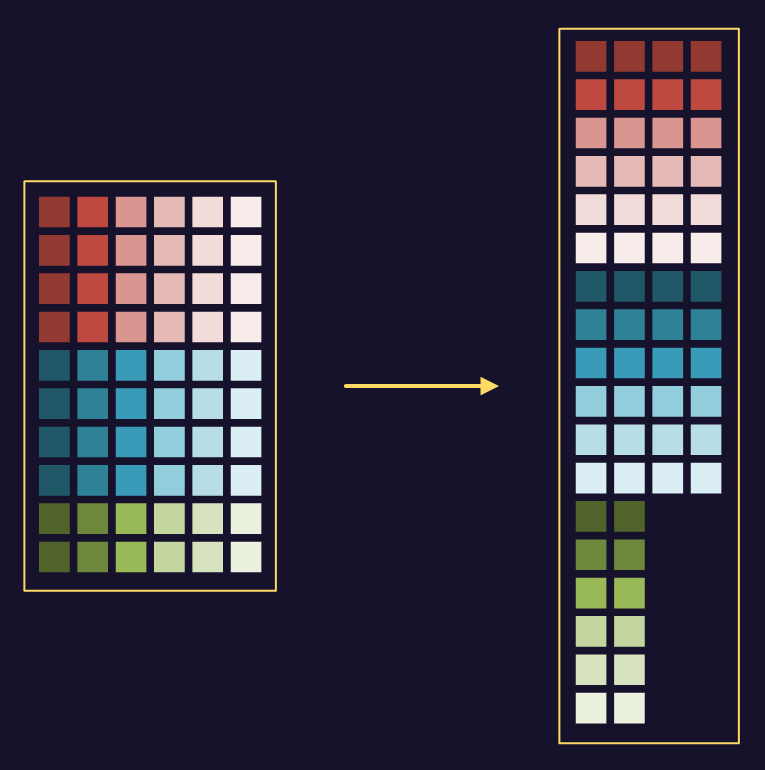
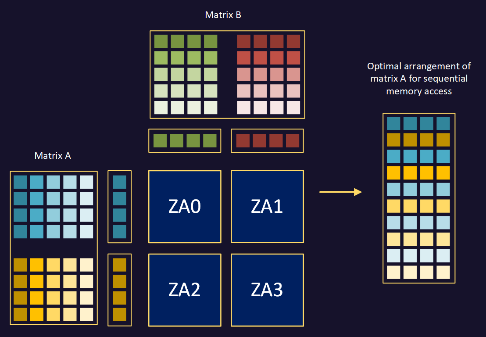

## Matrix multiplication recap

When you multiply input matrix A by input matrix B, the resulting matrix C is the sum of products of pairs of values from the rows of A and the columns of B.

## Vectorize matrix multiplication

Calculating the successive terms of each element of C isn't a good candidate for two dimensional vectorization. Instead, decompose the operation to calculate partial results for many rows and columns at a time.

This is efficient because an SME Matrix Outer Product instruction can calculate all of these values at the same time, and accumulate the result by adding it to or subtracting it from the value already in the ZA tile.

After you complete this step, move on to the second partial result.

The pattern continues for the third partial result, using the third column of A and the third row of B.

After you accumulate the fourth partial result, you have fully calculated the result values for 16 elements of the output matrix.

For smaller data types, or for devices with a larger Scalable Vector Length, more results would have been calculated from the same number of instructions.

## Optimize memory access

The input matrix B is accessed sequentially, which is efficient. However, with input matrix A you access columns of data whose elements are separated in memory by one row length. This is less efficient and can result in multiple cache misses, particularly if the row length is large. To avoid this, it is preferable to transform the input matrix A data so that it can be read sequentially. Do this by transposing strips of the matrix. Each strip contains the same number of rows as the ZA tiles of the element size that you are working with.

It is best if the input matrix data can naturally arise in this form as it emerges from some previous step, so that there is no computational cost to transform it. If that isn't possible, then it might be desirable to explicitly transform it.

Where the final strip doesn't contain the same number of rows as the others, the 'missing' rows can be padded with zero.

## Use multiple ZA tiles

For data element size larger than 8 bits, there are multiple ZA tiles available, and using all of them allows you to achieve the greatest data reuse and minimize memory system access.

In the diagram that follows, you process four tiles of results at a time. The matrix B data is accessed sequentially from memory. The matrix A data is accessed as columns within horizontal strips, shown as a blue strip and a yellow strip. The height of each strip depends on the Scalable Vector Length.

The ZA0 partial results are generated from an outer product of the blue and green data. The ZA1 partial results are generated from an outer product of the blue and red data. For the remaining tiles, you also need to load the yellow data. The ZA2 partial results are generated from an outer product of the yellow and green data. The ZA3 partial results are generated from an outer product of the yellow and red data.

As a result, the access pattern for matrix A is to alternate reading a column of blue data followed by a column of yellow data. Therefore, in addition to transposing strips of matrix A, an optimal arrangement involves interleaving the transposed rows from each strip.

Other tiling arrangements are possible, for example processing four tiles arranged horizontally, instead of two rows of two. This is slightly less efficient, however, because it would require five vector loads from memory for every four tiles of partial results processed. The two-by-two arrangement requires only four vector loads from memory per four tiles.

## What you've learned

You have reviewed how matrix multiplication works, and how it can be decomposed into vector operations. You have seen how matrix A input data can be transposed so that it is accessed sequentially in memory. You have considered the use of multiple ZA tiles to increase data reuse and minimize memory system access.

Next, prepare matrix A for multiplication.
