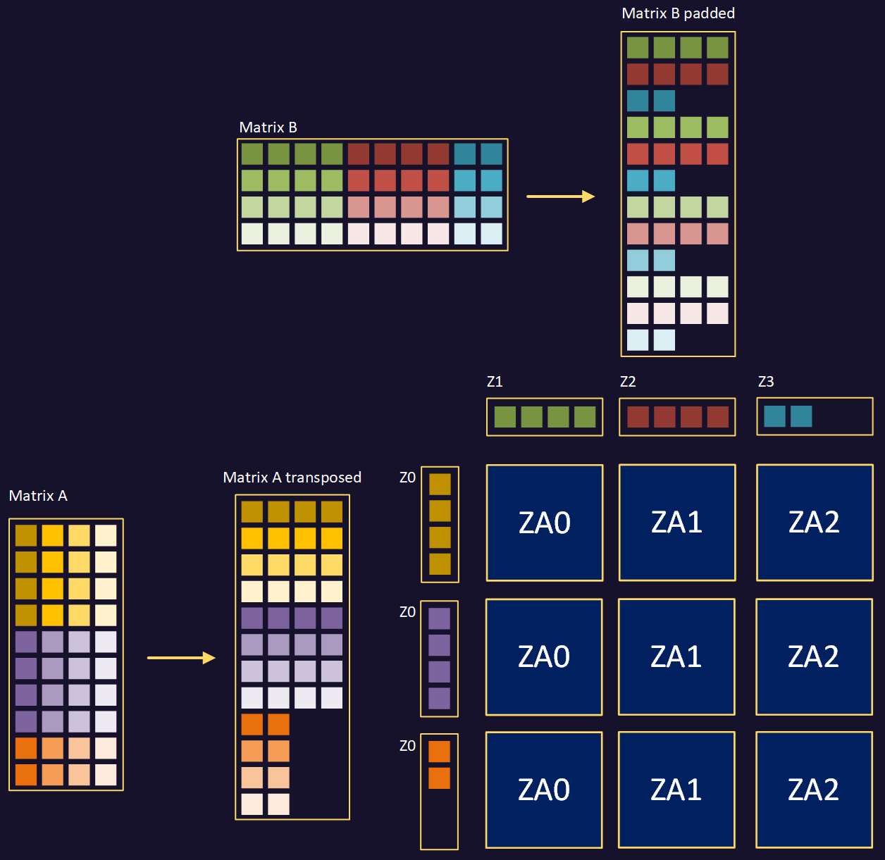

## Follow a matrix multiplication using packed and padded input matrices

This visualization multiplies Matrix A (10 x 4) and Matrix B (4 x 10), storing the resulting 10 x 10 matrix in **Output Matrix Data**.

You have seen in the previous views how Matrix A is transposed and packed, and Matrix B is padded. This packed 32-bit GEMM visualization starts with **A Transposed and Packed Data** and **B Padded Data** already in memory. GEMM means General Matrix Multiplication.

We process horizontal blocks of three ZA tiles at a time, accumulating four partial results for each tile, before writing the four rows of completed results to **Output Matrix Data**. We then reset the ZA tiles to zero before calculating three tiles for the next four rows. We store the results and reset the tiles again, to calculate the last three tiles, which cover the final two rows. In total we process nine tiles of matrix data.

## Why use a linear arrangement of three tiles? ##

For large matrices, the most efficient arrangement is to process four tiles at a time, arranged in a 2 x 2 block. This requires four vector loads per four tiles of partial results.

In this example we process three tiles at a time arranged in a 1 x 3 horizontal block. This requires four vector loads per three tiles of partial results, so for a large matrix would be slightly less efficient than 2 x 2. However, we are dealing here with a small matrix of size 10 x 10.

For SVL=128 bits and working with 32-bit data elements, using a 2 x 2 tile arrangement for a 10 x 10 matrix would require four passes. Using a 1 x 3 tile arrangement requires only three passes. For small matrices whose dimensions are known at compile time, the 2 x 2 configuration is sometimes outperformed by other tiling arrangements.

Note that for larger Scalable Vector Length, the calculus can change. For SVL=256 bits, then the 2 x 2 configuration would require only one pass, whereas the 1 x 3 configuration would require two passes. In our example, the code will be functionally correct on all devices regardless of SVL, but has been optimized for devices with SVL=128 bits.

## Use the playback controls

Select the **rightmost double-arrow button (⏩)** to advance one step and read the current-step description. The **leftmost double-arrow button (⏪)** goes back one step. The **middle Play/Pause button** runs or pauses the remaining sequence. Reload the page to return to the initial state.

## Step through the example

Follow the data from input through accumulation and storage:

1. In the first four steps, we load the first row of **A Packed Data** into Z0, and the first row of **B Padded Data** into Z1 - Z3.
2. In the next three steps, we calculate the Matrix Outer Product in ZA0 - ZA2.
3. In the next seven steps, we load the second row of **A Packed Data** into Z0, the second row of **B Padded Data** into Z1 - Z3, and we accumulate their Matrix Outer Products into ZA0-ZA2.
4. The next seven steps do the same for row three, and the following seven steps do the same for row four.
5. The next twelve steps store rows of ZA0 - ZA2 into rows of **Output Matrix Data**.
6. The following three steps zero the ZA0 - ZA2 tiles, so that we can process the next block of four rows.
7. Next, we repeat all the above steps, but using the next four rows of **A Packed Data**, whilst going back to the beginning of **B Padded Data**, since we have moved down by a tile-sized block and start again at the leftmost column of the matrix. Processing the new row of tile-sized blocks involves another 43 steps: 
4 rows x 7 steps to load data for each row and calculate the output product. 
12 steps to write the result to **Output Matrix Data** 
3 steps to zero the ZA tiles.
8. The next 34 steps deal with the final block of three tiles, as follows: 
4 rows x 7 steps to load data for each row and calculate the output product. 
6 steps to write the result to **Output Matrix Data** (since there are only two rows)



If you need more space then use the "Full screen" button at the top-right, or [open the GEMM visualization in a full browser tab](/apps/sme-visualisations/#/sme/gemm32-packed) if the embedded view does not load.

## Why is this better than scalar processing?

The visualization calculates 100 elements of the output matrix with just 120 instructions, excluding loop control instructions. This is an efficiency of 0.83 output elements per instruction.

With scalar processing and excluding loop control instructions, each output element would require eight load instructions, four multiply-accumulate instructions, and one store instruction. This is 13 instructions which is an efficiency of 0.08 output elements per instruction.

Consider a larger matrix of 12 x 12. The SME implementation would take the same 120 cycles to process 144 output elements, which is 1.44 output elements per instruction. The scalar implementation would produce the same 0.08 output elements per instruction.

For larger Scalable Vector Length, the efficiency is much higher. Every time SVL doubles, the efficiency quadruples for large matrices. For small matrices, edge effects can limit these gains. For example, for SVL=512 bits, each ZA tile is 16 x 16 elements of 32-bit data, which is 256 elements in total. The 10 x 10 matrix is only 100 elements, and therefore uses just under 40% of the available throughput of one tile.

## What you've accomplished

You have traced loads, outer product accumulations, and stores in a GEMM that uses prepared operands. Next, compare a version that loads from matrix A in a different layout. These animations model data movement; they do not measure performance or prove which instructions a processor executes.

For executable code built around the same outer-product idea, see [matrix multiplication using SME2 intrinsics in C](/learning-paths/cross-platform/multiplying-matrices-with-sme2/7-sme2-matmul-intr/). It uses its own FP32 data layout and instruction sequence.
