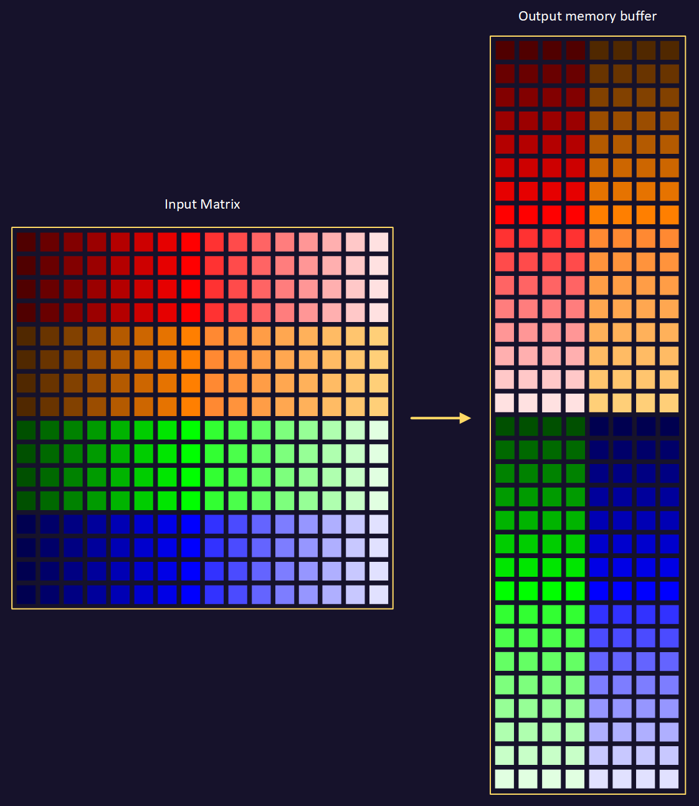
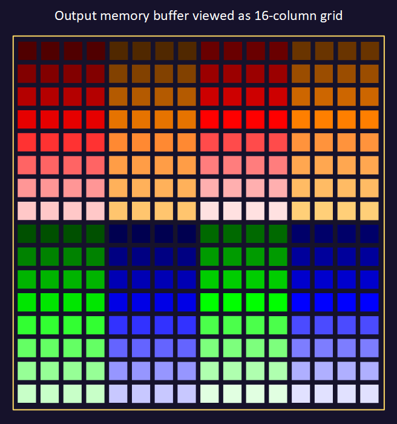

## Arrange input matrix A for adjacent loads

To eliminate the need for Gather Loads, transform the **Input Matrix**. Process four ZA tiles at a time, arranged in a 2 x 2 grid. The top ZA tiles need four rows of the first column, shown in dark red. The bottom ZA tiles need the next four rows of the first column, shown in dark orange. These rows need to be adjacent in the output memory buffer. Continue for the subsequent columns until all have been arranged contiguously in memory. Do the same for the next set of rows, shown in green and blue.

The visualization shows the output **Interleaved Matrix** as a 16 x 16 matrix. If you represent the output memory buffer as a 16 x 16 matrix, its layout is as follows:

## Follow the transpose and interleave

To keep this Learning Path open while exploring, <a href="/apps/sme-visualisations/#/sme/pack32-2x2-a" target="_blank" rel="noopener">open the A interleave visualization in a separate browser tab</a>. Move the tab to a separate window to view the visualization and Learning Path side by side.

Follow through each visualization stage to see how the **Input Matrix** becomes the **Interleaved Matrix**:

| Stage | Number of steps | Operation |
|---|---|---|
| Load the first region | 8 | Load partial rows of **Input Matrix** into rows of ZA0 and ZA1. |
| Load the next rows | 8 | Load partial rows of **Input Matrix** into rows of ZA2 and ZA3. |
| Store the first output rows | 8 | Store columns of ZA0 and ZA2 into rows of the **Interleaved Matrix** output buffer. |
| Store the next output rows | 8 | Store columns of ZA1 and ZA3 into the next two rows of the **Interleaved Matrix** output buffer. |
| Process the top-right region | 32 | Repeat the load-and-store pattern for the rest of the first horizontal strip. |
| Process the bottom-left region | 32 | Load partial rows of the next horizontal strip and write four more output rows. |
| Process the bottom-right region | 32 | Finish the strip and write the final four output rows. |

The **Input Matrix** has 16 rows and 16 columns. The first 32 steps process the top-left quadrant of the input. The remaining stages cover the other three quadrants.

&nbsp;



## What you've learned and what's next

You've followed the transpose and interleave of **Input Matrix** data. The visualization arranges it so that a General Matrix Multiplication (GEMM) can load the data it needs contiguously from memory.

Next, you'll explore a GEMM that uses this data layout for efficient matrix multiplication.
