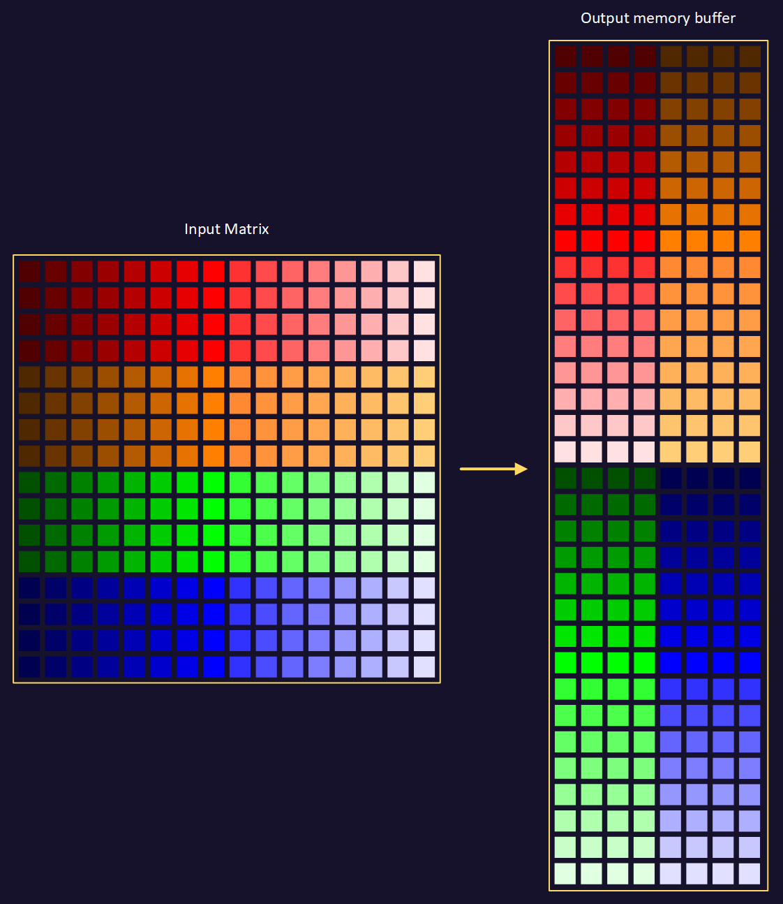
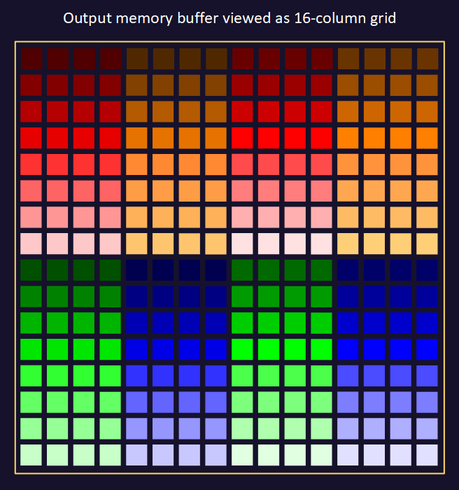

## Arrange input matrix A for adjacent loads

To eliminate the need for Gather Loads, we transform the **Input Matrix**. We will process four ZA tiles at a time, arranged in a 2 x 2 grid, so for the top ZA tiles we need to access four rows of the first column (shown in dark red) and for the bottom ZA tiles we need to access the next four rows of the first column (shown in dark orange). These need to be adjacent in the output memory buffer. We continue for the subsequent columns, until all have been arranged contiguously in memory. We then do the same for the next set of rows, shown in green and blue.

The visualization shows the output **Interleaved Matrix** as a 16 x 16 matrix. If we represent our output memory buffer as a 16 x 16 matrix then it looks like this:

## Use the playback controls

Select the **rightmost double-arrow button (⏩)** to advance one step and read the current-step description. The **leftmost double-arrow button (⏪)** goes back one step. The **middle Play/Pause button** runs or pauses the remaining sequence. Reload the page to return to the initial state.

## Follow the transpose and interleave

Follow the algorithm that transposes and interleaves the **Input Matrix** data:

1. The first eight steps load partial rows of **Input Matrix** data into rows of the ZA0 and ZA1 tiles.
2. The next eight steps load partial rows of **Input Matrix** data into rows of the ZA2 and ZA3 tiles.
3. The next eight steps store columns of ZA0 and ZA2 into rows of the **Interleaved Matrix** output buffer.
4. The next eight steps store columns of ZA1 and ZA3 into the next two rows of the **Interleaved Matrix** output buffer.
5. With the next 32 steps, we repeat this procedure for the remainder of the horizontal strip of **Input Matrix** that we are working on. Because the matrix has exactly 16 columns and 16 rows, the remainder of the horizontal strip happens to be the top-right quadrant.
6. With the first two-tile-deep horizontal strip complete, we move to the next one. With 32 steps we process the bottom-left quadrant of **Input Matrix** into four rows of the **Interleaved Matrix** output buffer.
7. The final 32 steps process the remainder of this horizontal strip which happens to be the bottom-right quadrant, into the last four rows of the **Interleaved Matrix** output buffer.



If you need more space then use the "Full screen" button at the top-right, or [open the A interleave visualization in a full browser tab](/apps/sme-visualisations/#/sme/pack32-2x2-a) if the embedded view does not load.

## What you've accomplished

You have followed the transpose and interleave of **Input Matrix** data, arranging it so that a GEMM can load the data it needs contiguously from memory.

Next, explore a GEMM that uses this data layout for efficient matrix multiplication.
