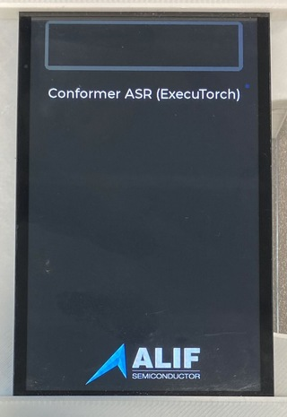
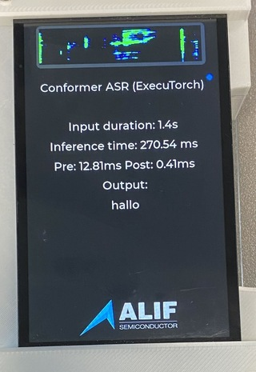

## Open the application console and start the application

You can now start the automatic speech recognition (ASR) application on the Alif Ensemble E8.

Keep the **PRG USB** cable connected. Close J-Flash and SETOOLS, then set **SW4** to **UART4**. Open a serial terminal on the board port using the following settings:

- Baud rate: `115200`
- Data bits: `8`
- Parity: `None`
- Stop bits: `1`

If the port was open before you changed **SW4**, close and reopen it. Press and release **RESET (SW1)**. The UART startup log should report `Model initialisation complete`. Wait for the display to show **Conformer ASR (ExecuTorch)** before testing audio.



## Speak a short phrase

Locate the joystick as shown in the user guide for your board: the [E8 AppKit User Guide](https://alifsemi.com/download/AUGD0028) or the [E8 DevKit support page](https://alifsemi.com/support/kits/ensemble-e8devkit/).

1. Press straight down on the center of the joystick and hold it.
2. Say a short phrase while holding it.
3. Release the joystick after you finish speaking.
4. Wait for the transcription to appear on the display and a `Decoded output:` line to appear in the console.

The display also shows the spectrogram, input duration, and processing times. Compare the text with what you said and record any errors. Repeat with a different phrase to check that another recording works.



## Confirm Ethos-U85 execution

After each inference, the console prints a `Profile for Inference:` block. Check for nonzero `NPU ACTIVE`, `NPU TOTAL`, and external-read counters. These readings come from the Ethos-U performance monitoring unit and confirm that the NPU executed the workload and read model data.

The output from the example DevKit run that follows included:

```output
INFO - NPU ACTIVE: 100079198 cycles
INFO - NPU ETHOSU_PMU_EXT_RD_DATA_BEAT_RECEIVED: 1683090 beats
INFO - NPU TOTAL: 100090084 cycles
INFO - Decoded output: this is a inch testif
```

The decoded words are the actual output of that run. Completed inference and nonzero counters verify execution but don't establish transcription accuracy.

## Compare with a measured DevKit run

The following values were observed on an E8 DevKit with an attached LCD and an `AE822FA0E5597LS0` A0 device:

| Check | Observed result |
| --- | --- |
| Spoken phrase | "this is a speech test" |
| LCD and UART transcription | "this is a inch testif" |
| Input duration shown on LCD | 2.4 s |
| Inference time shown on LCD | 267.31 ms |
| Preprocessing / postprocessing shown on LCD | 25.12 ms / 0.53 ms |
| Earlier spoken phrase / LCD transcription | "hello world" / "her low world" |
| Standalone RESET | Application restarted and completed the second phrase test |

The firmware reported a 400 MHz Cortex-M55 HP clock and an Ethos-U85 with 256 MACs per cycle in `Shared_Sram` mode. It ran bare-metal on the HP core with no debugger attached. OS thread count and CPU affinity don't apply.

These are measurements from one test session. These values are therefore not pass thresholds or a word-error-rate benchmark. The LCD timings were reported by the operator. The decoded output and NPU counters for the second phrase were captured from UART. Repeated `ARM_PDM_EVENT_ERROR` messages were also present. Their cause and relationship to the recognition errors weren't established.

The following software configuration was used for testing:

| Component | Version |
| --- | --- |
| Host | Apple Silicon, macOS 26.6.2 |
| Python / CMake | 3.12.13 / 3.30.5 from the setup environment |
| Arm GNU Toolchain | 15.3.Rel1 (GCC 15.3.1) |
| Alif MLEK | `0b6ce72c495265501f7a12eaed8e6ea71ef4bf15` |
| ExecuTorch / Vela | 1.1.0 / 5.0.0 |
| Alif SETOOLS | 1.112.00 DEV |
| SEGGER J-Link | 9.36 |

This validation used `TARGET_BOARD=DevKit-e8` with the other build settings shown earlier. The physical AppKit and Linux host commands weren't rerun as part of this DevKit validation.

## Check standalone restart

While the application is idle, confirm that no debugger is attached and press **RESET (SW1)**. The ASR title and model-initialization UART message should return. Record another phrase and confirm that the display and decoded output update. This checks that the programmed application starts from MRAM and uses the model in external flash without a debugger reload.

## Troubleshoot unsatisfactory recognition

Try the following recording conditions before assessing the model:

- Use a quiet setting and keep the microphones unobstructed.
- Press the joystick before speaking, speak clearly at a normal pace, and release it after finishing.
- Try a short complete sentence and repeat it to assess consistency.

These steps improve control over the test conditions but aren't a verified fix for recognition errors. Use repeated recordings to assess recognition quality alongside the execution checks. The example validation didn't isolate the cause of the individual recognition errors.

For an application that needs higher accuracy, evaluate representative speakers, phrases, and environments. Broader training data or an additional language model are possible development directions. For more information, see [End-to-end int8 Conformer on Arm: Training, quantization, and deployment on Ethos-U85](https://developer.arm.com/community/arm-community-blogs/b/internet-of-things-blog/posts/end-to-end-int8-conformer-on-arm-training-quantization-and-deployment-on-ethos-u85).

## Troubleshoot application problems

To fix issues with the application, consider the following guidance:

| Symptom | Check |
| --- | --- |
| Blank display | Power off before checking the display ribbon cable. Confirm that both images were programmed and the final MRAM package was ASR, not the CPU stubs. |
| No UART output | Select SW4 **UART4**, reopen the current serial port at 115200 8N1, and reset. |
| Empty or inaccurate transcription | Repeat the described recording checks and compare several phrases. Check that the build target matches your board. |
| Repeated `ARM_PDM_EVENT_ERROR` messages | Preserve the log and check the pulse-density modulation (PDM) microphone configuration and board target. Investigate the capture errors separately from model accuracy, as successful inference doesn't resolve them. |
| No completed inference or NPU counters after release | Check the UART log for model, preprocessing, or inference errors before treating the deployment as successful. |

## What you've accomplished

You've programmed the E8, captured live speech, and assessed its transcription. You've also confirmed Ethos-U85 inference through hardware counters and checked standalone restart.

You can now use the Learning Path as a starting point for evaluating offline speech recognition with your own speakers and recording conditions.
