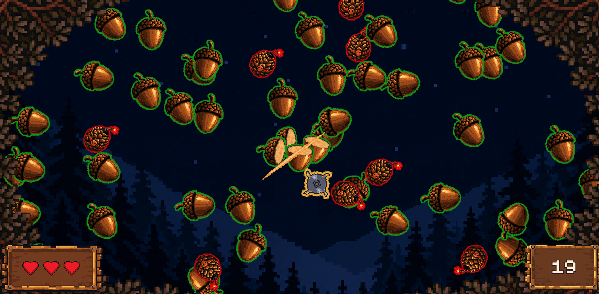
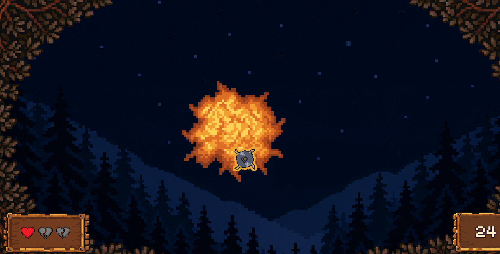

## Clone the browser application (Acorn Attack)

On your development machine, clone the game:

```bash
cd ~/cairn-lab
git clone https://github.com/Arm-Examples/composable-ai-perception-acorn-attack.git acorn-attack
cd acorn-attack
```

## Configure and deploy the game

The game's Topo metadata declares two application parameters. `OPK_HF_DETECTION_MODEL` selects the package supplied to the Cairn Perception Service, as in the console example. `DETECTION_LABEL` controls filtering in the game's Python backend; it doesn't change which detections the Perception Service publishes.

Topo saves your selections in `.env.topo`. The Compose file references those values through environment substitutions and passes them to the Docker build.

Keep the game's default face-detection model, `Arm/ultraface-rfb-320-onnx-raspberry`, and set `DETECTION_LABEL` to an empty value to use all detections from this face-only model:

```bash
topo configure OPK_HF_DETECTION_MODEL=Arm/ultraface-rfb-320-onnx-raspberry DETECTION_LABEL=""
topo deploy --target "$CAIRN_TARGET"
```

Open the game URL reported by Topo. It uses port `8000` on the target.

The start screen asks you to chop the highlighted acorn to begin:


<span class="content-image-caption centered">Acorn Attack start screen</span>

## Verify the detection-to-game connection

Position your face in the camera's view and move sideways. The game places saws using detection boxes. Check that a saw changes position as your face moves. Move out of the camera view and observe whether the corresponding saw disappears after the frontend's detection timeout.

Guide the saw across the highlighted acorn to start a round.

## Play a round

Play the game, and have fun!

Move the saw through acorns to slice them and increase your score. The counters show your remaining lives and current score:



Avoid the red-outlined hazards. Hitting one produces an explosion and costs a life.



## Inspect backend results

The game's Compose service is named `acorn-attack-web-server`. To inspect this application container's logs, select that service:

```bash
topo logs --target "$CAIRN_TARGET" --follow acorn-attack-web-server
```

The backend prints decoded detections before applying its label filter.

Press **Ctrl+C** to leave the log viewer.

## Trace one result through the application

Open `backend/detection.py`. Its `_deploy_inference_pipeline()` helper discovers a camera configuration, creates a `PerceptionWorkflow`, calls `infer()`, and deploys a session. The helper's name belongs to the game; the SDK operations inside it are the same ones you inspected in the console client. The game also chooses the same workflow name, stage name, and model ID: `detection-workflow`, `objects`, and `detection_model`.

The game defines `DetectionStream` to wrap subscription to the Cairn session's result topic. The module's `_decode_result()` helper uses the SDK's `PerceptionResult` and `BoxDetections` types, then converts each detection into a dictionary containing its label, confidence, class ID, and box coordinates. The game filters these dictionaries by label and sends them to the browser through its `/events` endpoint.

Follow the remaining application code:

| File | Role |
| --- | --- |
| `backend/labels.py` | Applies the configured label selection |
| `backend/main.py` | Sends detection dictionaries over the `/events` WebSocket |
| `frontend/src/detection/connection.ts` | Receives events, filters low-confidence boxes, and expires stale results |
| `frontend/src/main.ts` | Maps detection boxes into the game viewport and positions saws |

The frontend handles display coordinates and game behaviour. Cairn supplies the camera and inference workflow; it doesn't implement the game loop.

The frontend ignores boxes with a supplied confidence below `0.5` and expires results after 250 ms without a new event.

## (Optional) Change the model and selected class

To explore model and label selection, switch to the YOLO object-detection package used in the console example and select its `person` class:

```bash
topo configure OPK_HF_DETECTION_MODEL=Arm/yolo26n-320-int8-onnx-raspberrypi5 DETECTION_LABEL=person
topo deploy --target "$CAIRN_TARGET"
```

Refresh the browser after deployment. Move within the camera view and check that a person detection controls a saw. Check the `/events` WebSocket messages to confirm that named detections for other classes are excluded from the game's events. 

## Stop the deployment

When you've finished playing and trying any optional model changes, stop the game and its supporting services from your `acorn-attack` directory:

```bash
topo stop --target "$CAIRN_TARGET"
```

## What's next?

To build your own application, replace the console output or game logic with an action such as updating an object counter. Reuse the camera discovery, result subscription, and session cleanup you explored in these examples. See the [Cairn SDK documentation](https://github.com/arm/composable-ai-runtimes/blob/main/lib/README.md) for the APIs and the related resources on the next page for further reading.
