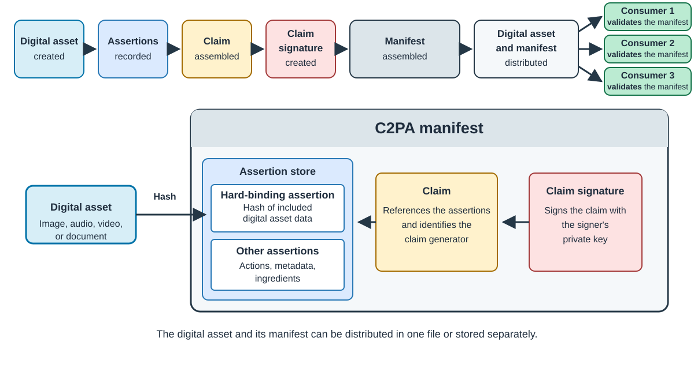

## Synthetic and untraceable media

Advances in cameras, editing software, and generative AI make digital content easy to create and
modify. Synthetic or manipulated images, video, and audio can be difficult to distinguish from
captured media by appearance alone.

This ambiguity creates opportunities for misinformation, impersonation, and fraud. It also affects
legitimate content. When origin and edit history are missing, you can't reliably trace where a file
came from. You can't identify what tools changed a file, or whether the file is being presented in its original context.

The problem isn't the existence of synthetic media. The problem is the loss of reliable context as
media moves between people, tools, and services. Media needs provenance information that remains
associated with the digital asset and can be checked for tampering.

## EU AI Act transparency requirements

[Article 50 of the EU AI Act](https://digital-strategy.ec.europa.eu/en/policies/guidelines-ai-transparency-obligations)
has applied since August 2, 2026. It requires providers of in-scope AI systems to mark synthetic audio,
image, video, and text outputs in a machine-readable format. The aim is to ensure that synthetic media can be detected as
AI-generated or manipulated.

Separate disclosure rules apply to people and organizations that deploy AI systems. Deepfakes need to
be clearly disclosed to the people who encounter them. Certain AI-generated or manipulated text
published to inform the public on matters of public interest also needs to be disclosed. 

The Act includes scope conditions and exceptions, so machine-readable provenance is one part of meeting these
transparency obligations. It's not a complete legal solution.

## How C2PA Content Credentials help

The [Coalition for Content Provenance and Authenticity (C2PA)](https://c2pa.org/) defines an open technical standard for
recording provenance information. Provenance information can include how a digital asset was created and modified. The information is bound to digital content. 

The same standard can be used across supported media types and platforms.

A Content Credential is the preferred non-technical term for a [C2PA manifest](https://spec.c2pa.org/specifications/specifications/2.4/specs/C2PA_Specification.html#_c2pa_manifest). 

The manifest packages the following statements about a digital asset:

- Its origin
- The tools used to process it
- The actions performed during its history

The manifest can travel with the digital asset or remain available separately.

A verifier can inspect these statements and verify the signature on the claim. They can check the
cryptographic binding between the manifest and the digital asset.

This gives the recipient a tamper-evident record of the claimed origin and history of the digital asset. Content
Credentials don't detect fake media or determine whether a claim is true. C2PA can provide the
digitally signed metadata layer described in the
[Article 50 Code of Practice](https://digital-strategy.ec.europa.eu/en/policies/code-practice-ai-generated-content).
For images, signatories following the Code generally combine that layer with imperceptible
watermarking. They also integrate a detection solution that meets effectiveness, reliability, robustness, and
interoperability requirements. 

In this Learning Path, you'll work with only C2PA metadata associated with a sample JPEG image. The metadata doesn't establish compliance on its own.

## Understand the C2PA workflow

The following figure shows how a C2PA workflow connects a digital asset to a signed provenance record:

The figure summarizes the model defined by the
[C2PA technical specification](https://spec.c2pa.org/specifications/specifications/2.4/specs/C2PA_Specification.html).

A claim generator records
statements about the digital asset as [assertions](https://spec.c2pa.org/specifications/specifications/2.4/specs/C2PA_Specification.html#_assertions). These assertions can describe how the digital asset was created, and
the actions applied to it. They also describe the information that was used to bind the manifest to the digital asset.

The [claim](https://spec.c2pa.org/specifications/specifications/2.4/specs/C2PA_Specification.html#_claims) references the assertions and identifies the claim generator. A [claim signature](https://spec.c2pa.org/specifications/specifications/2.4/specs/C2PA_Specification.html#claim-signature-definition) signs the
claim with the private key of the signer. The claim generator assembles the assertions, claim, and claim
signature into a verifiable unit called a C2PA manifest.

The [hard binding](https://spec.c2pa.org/specifications/specifications/2.4/specs/C2PA_Specification.html#_hard_bindings)
is itself recorded in an assertion. For the JPEG example, a data-hash assertion records a hash of the
asset byte ranges included in the binding. The signed claim references that assertion, making changes
to the recorded binding detectable.

The digital asset and manifest are distributed together, either in one file or separately. 

The consumer of the digital asset uses a validator to check the following:

- The integrity of the manifest
- The binding of the manifest to the digital asset
- The signing credential

The validator checks the structure and signature of the manifest. It evaluates the signing credential against its trust policy.

## Understand trust in Content Credentials

The [C2PA trust model](https://spec.c2pa.org/specifications/specifications/2.4/specs/C2PA_Specification.html#_trust_model) distinguishes a valid manifest from a trusted manifest. 

A manifest is valid when it meets the following criteria:

- It's well-formed.
- It hasn't changed since it was signed.
- It passes the required signature and validity-period checks.
- It hasn't been rejected because its signing credential was revoked.

A valid manifest doesn't necessarily mean that an online revocation check succeeded. A trusted manifest is valid and its signing credential is also trusted. A validator
can establish credential trust through configured trust anchors such as those anchors from the
[C2PA Trust List](https://spec.c2pa.org/specifications/specifications/2.4/specs/C2PA_Specification.html#_c2pa_trust_list). Trust can also be established through a credential that the user has explicitly added to a private credential store.

Trust applies to the signing credential and the signer identity associated with it. It doesn't prove
that every assertion is factually true. The consumer uses the signer identity, the assertions, and
other trust signals to decide whether to rely on the provenance record.

## Why stripping provenance doesn't establish trust

Digital content ecosystems are moving towards a future where verified provenance is a requirement for
acceptance. 

A digital asset, therefore, needs to meet all of these conditions to be accepted within such an ecosystem:

- The manifest passes structural, signature, and credential-validity checks.
- The content binding matches the digital asset, linking the signed provenance record to the received content.
- The signing credential is trusted under the trust policy of the consumer.
- The recorded provenance meets the acceptance requirements, such as an approved origin or permitted editing history.

Together, these checks establish the basis for acceptance. They don't guarantee factual
accuracy. For more information, see the [C2PA explainer](https://spec.c2pa.org/specifications/specifications/2.4/explainer/Explainer.html#_goals_and_non_goals).

An attacker might modify protected digital asset data, causing the content binding to fail. Then, they can
strip the manifest to hide that failure. If no manifest is available for validation, the provenance
is unknown, and the content remains untrusted in this ecosystem. Absence alone doesn't reveal whether
the manifest was stripped or never created. Neither case provides the evidence needed for acceptance.

The attacker therefore can't turn failed validation into trusted provenance by removing the
manifest. The outcome changes from a failed content-binding check to unavailable provenance, but
the digital asset still fails the acceptance requirements. Stripping the manifest doesn't bypass
provenance-based trust. An untrusted manifest means that the required evidence hasn't been established, not
that the content is necessarily false.

## C2PA Conformance Program

Verifying the provenance of a digital asset depends on whether the products that create and validate its Content Credentials adhere to the specification.

The C2PA Conformance Program evaluates products against the Content Credentials specification and
security requirements. It addresses the need for interoperable implementations that generate and
validate Content Credentials correctly, with a shared basis for certificate trust.

Production solutions participating in this trusted ecosystem are expected to be conformant.
Approved products appear on the C2PA Conforming Products List. Approved generator products can
obtain claim-signing certificates from certificate authorities on the C2PA Trust List, subject to
their enrollment requirements.

To prepare your production solution for conformance, start with the
[C2PA Conformance Program](https://c2pa.org/conformance/). It links to the technical and security
requirements, certificate policy, and application process.

## What you've learned and what's next

You've learned why digital assets need traceable provenance and how Content Credentials provide a
signed, tamper-evident record of provenance.

C2PA lets you inspect the recorded history of a digital asset. With C2PA, you can check its integrity and assess the signing credential to make informed decisions about its provenance.

Next, you'll confirm that C2PA Tool is available on your Arm device and prepare the example digital assets.
