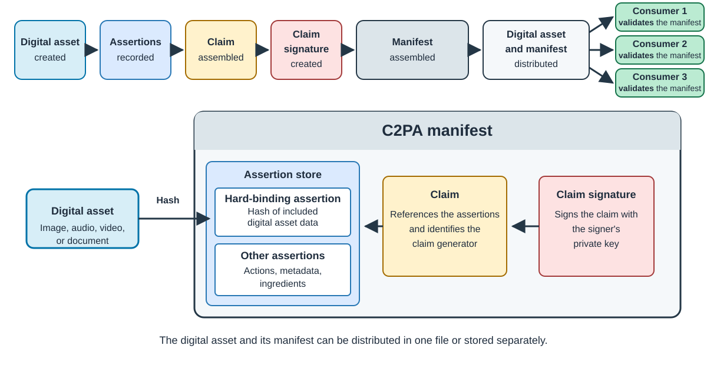

## Synthetic and untraceable media

Advances in cameras, editing software, and generative AI make digital content easy to create and
modify. Synthetic or manipulated images, video, and audio can be difficult to distinguish from
captured media by appearance alone.

This ambiguity creates opportunities for misinformation, impersonation, and fraud. It also affects
legitimate content. When origin and edit history are missing, you cannot reliably trace where a file
came from, which tools changed it, or whether it is being presented in its original context.

The problem is not the existence of synthetic media. The problem is the loss of reliable context as
media moves between people, tools, and services. Media needs provenance information that remains
associated with the digital asset and can be checked for tampering.

## EU AI Act transparency requirements

[Article 50 of the EU AI Act](https://digital-strategy.ec.europa.eu/en/policies/guidelines-ai-transparency-obligations)
has applied since 2 August 2026. It requires providers of AI systems in scope to mark synthetic audio,
image, video, and text outputs in a machine-readable format so that they can be detected as
AI-generated or manipulated.

Separate disclosure rules apply to people and organizations that deploy AI systems. Deepfakes must
be clearly disclosed to the people who encounter them. Certain AI-generated or manipulated text
published to inform the public on matters of public interest must also be disclosed. The Act includes
scope conditions and exceptions, so machine-readable provenance is one part of meeting these
transparency obligations rather than a complete legal solution.

## C2PA Content Credentials

The [Coalition for Content Provenance and Authenticity (C2PA)](https://c2pa.org/) defines an open technical standard for
recording provenance information, such as how a digital asset was created and modified, and binding that
information to digital content. The same model can be used across supported media types and
platforms.

A *Content Credential* is the preferred non-technical term for a [C2PA manifest](https://spec.c2pa.org/specifications/specifications/2.4/specs/C2PA_Specification.html#_c2pa_manifest). The manifest packages
statements about a digital asset's origin, the tools used to process it, and the actions performed during its
history. The manifest can travel with the digital asset or remain available separately.

A verifier can inspect these statements, verify the signature on the claim, and check the
cryptographic binding between the manifest and the digital asset.

This gives the recipient a tamper-evident record of the digital asset's claimed origin and history. Content
Credentials do not detect fake media or determine whether a claim is true. C2PA can provide the
digitally signed metadata layer described in the
[Article 50 Code of Practice](https://digital-strategy.ec.europa.eu/en/policies/code-practice-ai-generated-content).
For images, signatories following the Code generally combine that layer with imperceptible
watermarking and a detection solution that meets effectiveness, reliability, robustness, and
interoperability requirements. This Learning Path demonstrates only C2PA metadata, so it does not
establish compliance on its own.

## Understand the C2PA workflow

[Figure 1](#figure-1) shows how a C2PA workflow connects a digital asset to a signed provenance record. A claim generator records
statements about the digital asset as [*assertions*](https://spec.c2pa.org/specifications/specifications/2.4/specs/C2PA_Specification.html#_assertions). These assertions can describe how the digital asset was created,
the actions applied to it, and the information used to bind the manifest to the digital asset.

The [claim](https://spec.c2pa.org/specifications/specifications/2.4/specs/C2PA_Specification.html#_claims) references the assertions and identifies the claim generator. A [claim signature](https://spec.c2pa.org/specifications/specifications/2.4/specs/C2PA_Specification.html#claim-signature-definition) signs the
claim with the signer's private key. The claim generator assembles the assertions, claim, and claim
signature into a verifiable unit called a C2PA manifest.

The [hard binding](https://spec.c2pa.org/specifications/specifications/2.4/specs/C2PA_Specification.html#_hard_bindings)
is itself recorded in an assertion. For the JPEG example, a data-hash assertion records a hash of the
asset byte ranges included in the binding. The signed claim references that assertion, making changes
to the recorded binding detectable.

The digital asset and manifest are distributed together, either in one file or separately. The digital
asset's consumer uses a validator to check the manifest's integrity, its binding to the digital asset,
and the signing credential. The validator checks the manifest's structure and signature and evaluates
the signing credential against its trust policy.

[Figure 1](#figure-1) summarizes the model defined by the
[C2PA technical specification](https://spec.c2pa.org/specifications/specifications/2.4/specs/C2PA_Specification.html).

## Understand trust in Content Credentials

The [C2PA trust model](https://spec.c2pa.org/specifications/specifications/2.4/specs/C2PA_Specification.html#_trust_model) distinguishes a *valid manifest* from a *trusted manifest*. A valid manifest is well-formed, has
not changed since it was signed, and passes the required signature, validity-period, and credential
revocation checks. A trusted manifest is valid and its signing credential is also trusted. A validator
can establish credential trust through configured trust anchors, including anchors from the
[C2PA Trust List](https://spec.c2pa.org/specifications/specifications/2.4/specs/C2PA_Specification.html#_c2pa_trust_list), or through a credential that the user has explicitly added to a private credential store.

Trust applies to the signing credential and the signer identity associated with it. It does not prove
that every assertion is factually true. The consumer uses the signer identity, the assertions, and
other trust signals to decide whether to rely on the provenance record.

## Why stripping provenance does not establish trust

As digital content ecosystems move toward a future where verified provenance is a requirement for
acceptance, a digital asset must meet all of these conditions to be accepted within such an ecosystem:

- The manifest passes structural, signature, and credential-validity checks.
- The content binding matches the digital asset, linking the signed provenance record to the received content.
- The signing credential is trusted under the consumer's trust policy.
- The recorded provenance meets the acceptance requirements, such as an approved origin or permitted editing history.

Together, these checks establish the basis for acceptance. They do not guarantee factual
accuracy, as the [C2PA explainer](https://spec.c2pa.org/specifications/specifications/2.4/explainer/Explainer.html#_goals_and_non_goals)
explains.

An attacker might modify protected digital asset data, causing the content binding to fail, then
strip the manifest to hide that failure. If no manifest is available for validation, the provenance
is unknown and the content remains untrusted in this ecosystem. Absence alone does not reveal whether
the manifest was stripped or never created; neither case provides the evidence needed for acceptance.

The attacker therefore cannot turn failed validation into trusted provenance by removing the
manifest. The outcome changes from a failed content-binding check to unavailable provenance, but
the digital asset still fails the acceptance requirements. Stripping the manifest does not bypass
provenance-based trust. Untrusted means that the required evidence has not been established, not
that the content is necessarily false.

## What you've learned and what's next

You've learned why digital assets need traceable provenance and how Content Credentials provide a
signed, tamper-evident record of that provenance. C2PA lets you inspect a digital asset's recorded
history, check its integrity, and assess the signing credential to make informed decisions about its
provenance.

Next, confirm that C2PA Tool is available on your Arm device and prepare the example digital assets.
