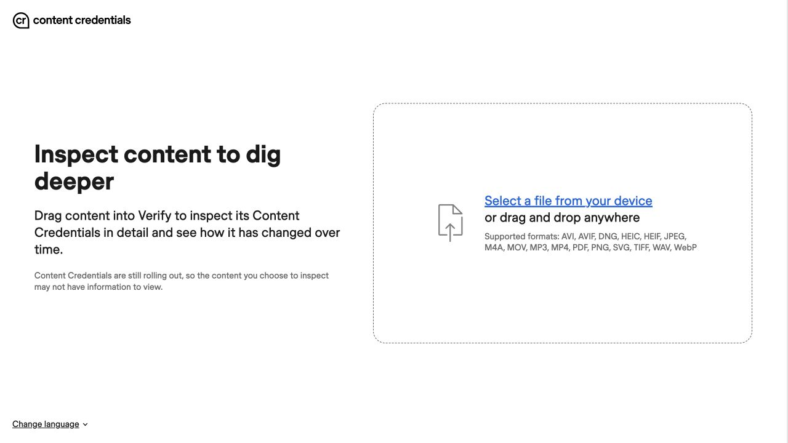
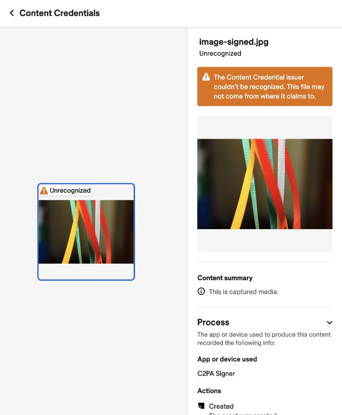
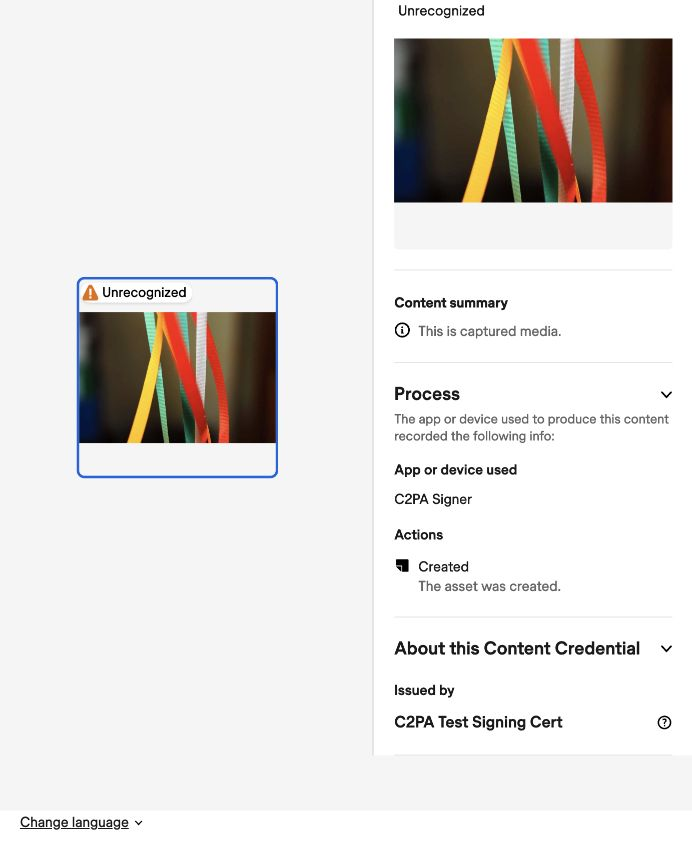

## Validate the signed image with the CAI web validator

You will open `image-signed.jpg` from chapter 3 in the
[Content Authenticity Initiative (CAI) web validator](https://verify.contentauthenticity.org/),
a browser-based tool for inspecting and validating C2PA Content Credentials. The site calls this
tool *Verify*. You will read the recorded provenance and compare the validation results with your
C2PA Tool report from chapter 4.

According to its [open-source project](https://github.com/contentauth/verify-site), the validator uses
WebAssembly to read and validate C2PA data in your browser. The website can still make network
requests, so this does not mean that it operates entirely offline.

## Open the CAI web validator and select the signed asset

1. Open the [CAI web validator](https://verify.contentauthenticity.org/) in your browser. The start page says
   **Inspect content to dig deeper** and lists JPEG among its supported formats.
2. Select **Select a file from your device**, as shown in [Figure 1](#figure-1).
3. Choose `image-signed.jpg` from your `c2pa-demo` directory and open it. You can also drag the file
   onto the page.
4. Wait for the image and its Content Credentials panel to appear.

If you use another computer, copy `image-signed.jpg` without modifying or recompressing it.

## Inspect the validation result

In the Content Credentials panel, look for **Unrecognized** beside `image-signed.jpg`, as shown in
[Figure 2](#figure-2). The orange notice indicates that the CAI web validator does not recognize the credential's issuer under its
trust policy. As explained in [chapter 3](/learning-paths/embedded-and-microcontrollers/c2pa-on-arm/3-add-content-credentials/#understand-the-development-credential),
the built-in signing certificate is for development and does not establish a production identity.

{}
If no Content Credentials appear, check that you selected `image-signed.jpg`, not `image.jpg`.
If you transferred the file, retry with a copy of the original signed output.
{}

## Read the recorded provenance

Scroll through the Content Credentials panel. Read **Content summary**, then expand **Process**
for the recorded action and app or device name. Expand **About this Content Credential** to find
**Issued by**, as shown in [Figure 3](#figure-3).

## Compare with your C2PA Tool report

Open `report.json` and locate the active manifest as described in
[chapter 4](/learning-paths/embedded-and-microcontrollers/c2pa-on-arm/4-inspect-content-credentials/#find-the-active-manifest).
Use its `assertions` and `signature_info` fields for the provenance comparison, and
`validation_results` for signer trust:

| Information | C2PA Tool report | CAI web validator view |
| --- | --- | --- |
| Declared origin | `digitalSourceType` ending in `/digitalCapture` | Content summary: This is captured media. |
| Creation action | `action: "c2pa.created"` | Process → Actions: Created |
| Signing certificate's common name | `signature_info.common_name: "C2PA Signer"` | Process → App or device used: C2PA Signer |
| Signing certificate's issuer | `signature_info.issuer: "C2PA Test Signing Cert"` | About this Content Credential → Issued by: C2PA Test Signing Cert |
| Signer trust | `signingCredential.untrusted` | Unrecognized issuer |

The captured-media summary and **Created** action reflect the declaration you supplied in
[chapter 3](/learning-paths/embedded-and-microcontrollers/c2pa-on-arm/3-add-content-credentials/#create-the-manifest-definition).
**App or device used** shows `C2PA Signer`, matching the development signing certificate's common name,
rather than your custom `Arm Learning Path C2PA Example` label. As that chapter explains, C2PA Tool generated the
claim; it did not capture the photograph.

The web panel displays the image's provenance without separate signature or binding status codes.
As confirmed in [chapter 4](/learning-paths/embedded-and-microcontrollers/c2pa-on-arm/4-inspect-content-credentials/#interpret-the-result),
both checks pass for this image; **Unrecognized** refers to signer trust. In the next chapter, you
will modify a copy of the image to see how a content-binding failure changes the validation result.

As discussed in [chapter 1](/learning-paths/embedded-and-microcontrollers/c2pa-on-arm/1-understand-the-c2pa/#understand-trust-in-content-credentials),
validating Content Credentials on its own does not establish that the depicted scene or the recorded
assertions are true. Successful signature and binding checks show that the signed provenance record
is intact and bound to this image. Establishing credential trust also requires the validator to accept
the signing credential under its trust policy. To decide whether to believe the content, consider
the signer's identity and reliability, the recorded history, and any corroborating evidence.

## What you've accomplished and what's next

You can now read the web validator's provenance summary and interpret its issuer warning alongside
the detailed C2PA Tool results.

Keep `image-signed.jpg` unchanged. In the next chapter, you will modify a separate copy and inspect
the resulting content-binding failure.
