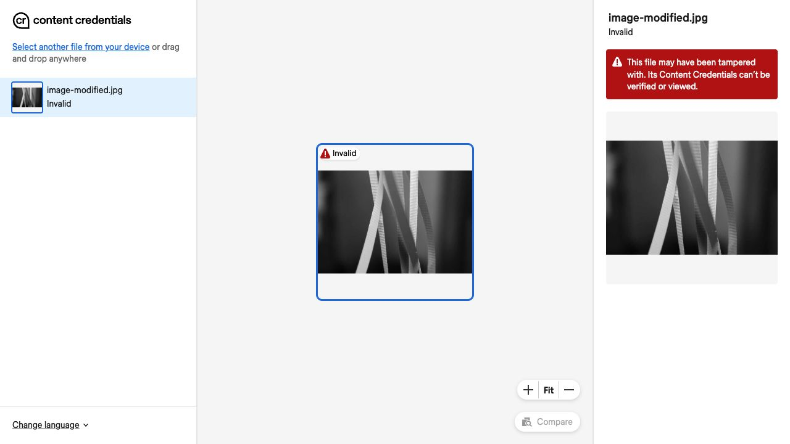

## Confirm jpegtran is available

Run the platform-independent version check:

```console
jpegtran -version
```

The version and build depend on your installed release. The output is similar to:

```output
libjpeg-turbo version 3.1.4.1 (build 20260327)
```

If the command is unavailable, follow the [libjpeg-turbo install guide](/install-guides/libjpeg-turbo/).

## Modify the signed asset

Continue in your `c2pa-demo` directory. Create a grayscale copy of `image-signed.jpg` while keeping
its embedded manifest unchanged:

```console
jpegtran -copy all -grayscale -outfile image-modified.jpg image-signed.jpg
```

- `-grayscale` removes the image's color.
- `-copy all` preserves the metadata, including the embedded C2PA manifest.
- `-outfile` writes the changed image to a separate file without re-signing it.

The command normally prints no output. Open `image-modified.jpg` in an image viewer: the image
should appear in grayscale. Keep `image-signed.jpg` unchanged for comparison.

{}
Keep the input and output filenames different. The command overwrites `image-modified.jpg` if
it already exists. Preserve the manifest with `-copy all`; otherwise, you would be testing
missing metadata instead of a change to the image. Removing the manifest cannot turn a failed
binding check into trusted provenance. See
[Why stripping provenance does not establish trust](/learning-paths/embedded-and-microcontrollers/c2pa-on-arm/1-understand-the-c2pa/#why-stripping-provenance-does-not-establish-trust).
{}

## Inspect the modified image in the web validator

1. Open the [CAI web validator](https://verify.contentauthenticity.org/).
2. Choose **Select a file from your device**, or **Select another file from your device** if
   chapter 5's result is still open.
3. Select `image-modified.jpg` and wait for validation to finish.
4. Open the image's result or **Content Credentials** panel if needed.

Look for the grayscale preview, the **Invalid** status, and the red tampering warning. Compare
this with the **Unrecognized** issuer warning you saw for the original image in chapter 5:



The red warning tells you that the credentials cannot be verified or viewed. Use C2PA Tool next
to identify the failed check.

{}
`jpegtran` preserves stored thumbnails, so some viewers may still show a color thumbnail.
Check the full image to see the grayscale edit.
{}

## Find the content-binding failure

Save a report for the modified image:

```console
c2patool image-modified.jpg > report-modified.json
```

Open `report-modified.json` and find `validation_state`. The expected output is:

```output
"validation_state": "Invalid"
```

Under `validation_results.activeManifest.failure`, find:

```output
"code": "assertion.dataHash.mismatch"
```

This means the image's hash no longer matches the hard-binding assertion. The unchanged manifest
is still present, but it no longer matches the grayscale image.

Under `validation_results.activeManifest.success`, find `claimSignature.validated`. The claim's
signature still verifies because you changed the image rather than the signed claim.

## Compare the original and modified assets

Compare `report-modified.json` with `report.json` from chapter 4 and the web result from chapter 5:

| Check | Original signed image | Modified copy |
| --- | --- | --- |
| Image appearance | Color | Grayscale |
| Embedded manifest | Present | Present; unchanged |
| Claim signature | `claimSignature.validated` | `claimSignature.validated` |
| Asset binding | `assertion.dataHash.match` | `assertion.dataHash.mismatch` |
| Development credential | `signingCredential.untrusted` | `signingCredential.untrusted` |
| Local validation state | `Valid` | `Invalid` |
| Verify status | Unrecognized | Invalid |

The issuer-trust result stays the same. The new failure concerns the binding between the signed
record and the changed image.

## Why replacing the hashes does not restore validity

An attacker might try to alter an image and reuse its Content Credential to present it as the
unchanged original. Replacing the recorded hashes cannot hide the edit: the data-hash assertion, its
reference in the claim, and the claim signature form a chain of integrity checks:

- **Changing the data-hash assertion** can make its stored image hash match the edited asset,
  but changes the assertion itself. The claim still references the original assertion hash,
  so the assertion-reference check fails (`assertion.hashedURI.mismatch`).
- **Changing the assertion reference in the claim** can make that reference match the modified
  assertion, but changes the signed claim. The original signature no longer verifies
  (`claimSignature.mismatch`).

Hashes can be recalculated without a secret. A replacement signature that verifies under the
original signing certificate requires the corresponding private key. Without that key, patching
the assertion and claim cannot make the altered content pass these checks under the original
credential. The protection comes from the signature, not from preventing access to the manifest.

See the [C2PA validation rules](https://spec.c2pa.org/specifications/specifications/2.4/specs/ContentCredentials.html#_validation)
for these checks.

C2PA also supports legitimate edits: a new signed manifest can reference the earlier asset as
an ingredient, linking its signer and provenance record to the edited version. This provenance
chain records the modification rather than concealing it.

## What you've accomplished

You have added Content Credentials to an image on Arm, inspected its embedded provenance with
C2PA Tool and ExifTool, and validated it with the CAI web validator. You then modified the image
while preserving its manifest and traced the resulting warning to a content-binding mismatch.

You can now distinguish asset integrity, claim-signature validity, and signer trust, and explain
how signed provenance makes changes detectable. Content Credentials give you verifiable provenance
signals to help you assess an asset's recorded origin and history.
