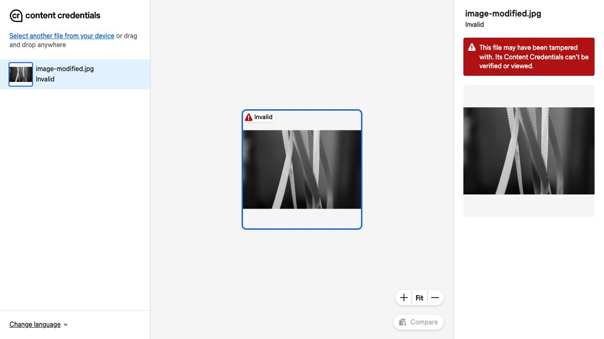

## Confirm jpegtran is available

After validating the signed image, use `jpegtran` from libjpeg-turbo to create a grayscale copy and test its content binding. For installation instructions, see the [libjpeg-turbo install guide](/install-guides/libjpeg-turbo/).

Run the platform-independent version check:

```console
jpegtran -version
```

The version and build depend on your installed release. The output is similar to:

```output
libjpeg-turbo version 3.1.4.1 (build 20260327)
```

## Modify the signed asset

Continue in your `c2pa-demo` directory. 

Create a grayscale copy of `image-signed.jpg` while keeping its embedded C2PA manifest unchanged:

```console
jpegtran -copy all -grayscale -outfile image-modified.jpg image-signed.jpg
```

`-grayscale` removes the color of the image. `-copy all` preserves the metadata, including the embedded C2PA manifest. `-outfile` writes the changed image to a separate file without re-signing it.

The command typically prints no output. 

Open `image-modified.jpg` in an image viewer. The image should appear in grayscale. Keep `image-signed.jpg` unchanged for comparison.

{}
Keep the input and output filenames different. The command overwrites `image-modified.jpg` if
it already exists. 

Preserve the manifest with `-copy all`. Otherwise, you'll be testing
missing metadata instead of a change to the image. Removing the manifest can't turn a failed
binding check into trusted provenance. For more information, see
[Why stripping provenance doesn't establish trust](/learning-paths/embedded-and-microcontrollers/c2pa-on-arm/1-understand-the-c2pa/#why-stripping-provenance-doesnt-establish-trust).
{}

## Inspect the modified image in the web validator

To inspect the modified image in the Content Authenticity Initiative (CAI) web validator:

1. Open the [CAI web validator](https://verify.contentauthenticity.org/).
2. Choose **Select a file from your device** or **Select another file from your device**.
3. Select `image-modified.jpg` and wait for validation to finish.
4. Open the result or **Content Credentials** panel of the image if needed.

Look for the grayscale preview, the **Invalid** status, and the red tampering warning. Compare
this with the **Unrecognized** issuer warning that you saw for the original signed image:



The red warning tells you that the credentials can't be verified or viewed. 

Use C2PA Tool next to identify the failed check.

{}
`jpegtran` preserves stored thumbnails, so some viewers might still show a color thumbnail.
Check the full image to see the grayscale edit.
{}

## Find the content-binding failure

Save a report for the modified image:

```console
c2patool image-modified.jpg > report-modified.json
```

Open `report-modified.json` and find `validation_state`. 

The expected output is:

```output
"validation_state": "Invalid"
```

Under `validation_results.activeManifest.failure`, find:

```output
"code": "assertion.dataHash.mismatch"
```

This means that the image hash no longer matches the hard-binding assertion. The unchanged manifest
is still present, but it no longer matches the grayscale image.

Under `validation_results.activeManifest.success`, find `claimSignature.validated`. The claim
signature still verifies because you changed the image rather than the signed claim.

## Compare the original and modified assets

Compare `report-modified.json` with `report.json` and the web result for the original signed image:

| Check | Original signed image | Modified copy |
| --- | --- | --- |
| Image appearance | Color | Grayscale |
| Embedded manifest | Present | Present; unchanged |
| Claim signature | `claimSignature.validated` | `claimSignature.validated` |
| Asset binding | `assertion.dataHash.match` | `assertion.dataHash.mismatch` |
| Development credential | `signingCredential.untrusted` | `signingCredential.untrusted` |
| Local validation state | `Valid` | `Invalid` |
| Verify status | Unrecognized | Invalid |

The issuer-trust result stays the same. The new failure concerns the binding between the signed
record and the changed image.

## Why replacing the hashes doesn't restore validity

An attacker might try to alter an image and reuse its Content Credential to present it as the
unchanged original. Replacing the recorded hashes can't hide the edit. The data-hash assertion, its
reference in the claim, and the claim signature form a chain of integrity checks:

- Changing the data-hash assertion can make its stored image hash match the edited asset,
  but changes the assertion itself. The claim still references the original assertion hash,
  so the assertion-reference check fails (`assertion.hashedURI.mismatch`).
- Changing the assertion reference in the claim can make that reference match the modified
  assertion, but changes the signed claim. The original signature no longer verifies
  (`claimSignature.mismatch`).

Hashes can be recalculated without a secret. A replacement signature that verifies under the
original signing certificate requires the corresponding private key. Without that key, patching
the assertion and claim can't make the altered content pass these checks under the original
credential. The protection comes from the signature, not from preventing access to the manifest.

{}
The development private key bundled with C2PA Tool is publicly available. Anyone with that key can
re-sign a modified image using the same test credential. You've learned how to detect
an edit made without re-signing. Protection against an attacker re-signing under the original
credential depends on keeping a production private key secret and secure.
{}

For more information about validation checks, see the [C2PA validation rules](https://spec.c2pa.org/specifications/specifications/2.4/specs/ContentCredentials.html#_validation).

C2PA also supports legitimate edits. A new signed manifest can reference the earlier asset as
an ingredient. This links the signer and provenance record of the earlier asset to the edited version. 

This provenance chain records the modification rather than concealing it.

## What you've accomplished

You've modified an image while preserving its manifest, and traced the resulting warning to a content-binding mismatch.

You can now distinguish asset integrity, claim-signature validity, and signer trust. You also understand
how signed provenance makes changes detectable. 

You can extend the Learning Path to assess the recorded origin and history of an asset on Arm with Content Credentials.
