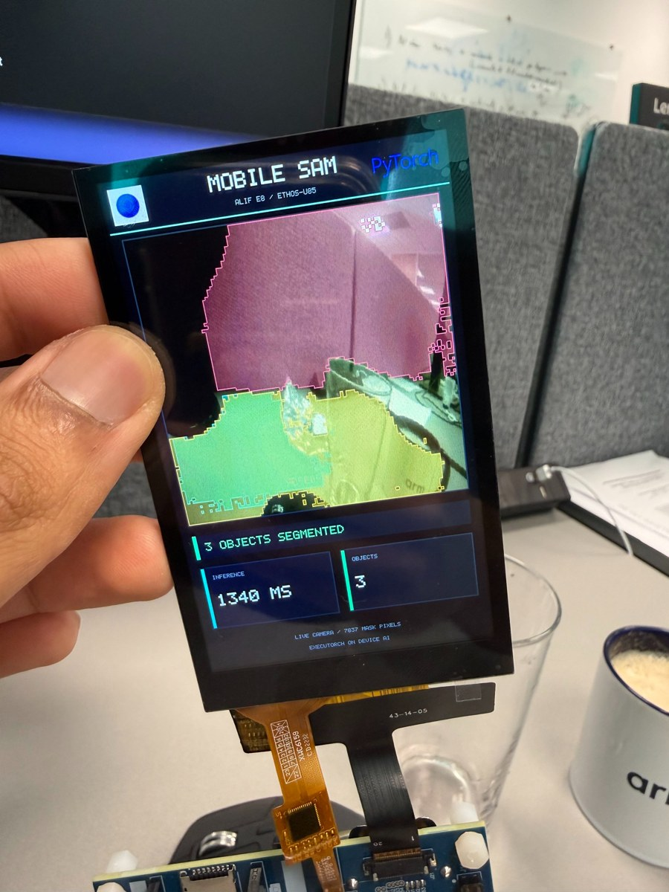

## Run live segmentation on the E8

You'll deploy MobileSAM on an Alif Ensemble E8 Development Kit to capture camera frames, select segmentation masks, and draw them on the board's display. The prompts are fixed during export; the camera image changes at runtime. You'll prepare the supplied source, export the model, build the application, and program the model and firmware separately before validating the live loop.

Zephyr and ExecuTorch run on the board's Cortex-M55 High-Performance (HP) core, with MobileSAM computation delegated to the Ethos-U85-256 neural processing unit (NPU). An MT9M114 selfie camera supplies images. The 480 × 800 display shows the image, colored masks, inference time, and selected-mask count.

{}
This draft describes a working board deployment. The supplied source uses released PyTorch and TorchAO packages for host-side export. Installation and the four-prompt model export have been checked in a fresh Python environment with these releases. A firmware build and hardware run with the released dependency setup have not yet been repeated.
{}

## Follow a frame through the application

The model uses a 384 × 384 input, four independent positive prompts, three candidate masks per prompt, and int8 model input and outputs. The deployed program occupied 13,293,120 bytes in external Octal SPI (OSPI) flash, mapped at `0xC0000000`. The `.pte` is stored separately from firmware, so exporting a new model changes a separately programmed artifact.

Follow one frame through these four tasks:

1. **Capture and prepare the image.** The camera pipeline writes planar RGB into the model input buffer. The CPU normalizes each channel using the exported pixel mean and standard deviation, then applies the exported scale and zero point to produce a `[1, 3, 384, 384]` int8 tensor. Raw camera bytes and quantized model inputs have different meanings, even though both occupy one byte per value.
2. **Run the exported program.** The image encoder produces image embeddings, and the mask decoder combines them with prompt embeddings prepared during export. Quantization uses 8-bit activations and weights (A8W8) globally, with 16-bit activations and 8-bit weights (A16W8) in the image encoder's attention modules to preserve mask quality. The program exposes int8 image input, mask logits, and quality scores; internal attention precision does not change that interface.
3. **Select distinct masks.** Four independent positive prompts sit at `(96, 96)`, `(288, 96)`, `(96, 288)`, and `(288, 288)` in the 384 × 384 image. Each requests three candidates: twelve proposals altogether. The CPU chooses the highest-quality candidate per point, requires quality at least `0.8`, and rejects masks covering less than roughly 0.5% or more than 85% of the mask image. It sorts survivors by quality and removes a proposal when its intersection over union with an already selected mask exceeds `0.75`. At most four masks reach the display. This count describes selected masks, without assigning object categories.
4. **Render and capture again.** The CPU interprets quantized logits, applies the mask threshold, scales the image and overlays for the dashboard, and releases the camera buffer. Camera capture and display share the board's external MIPI route. The application switches that route after capture and restores it before the next frame, so capture and display alternate.

## Keep export and firmware inputs together

Keep the `.pte` and its exporter JSON together. CMake generates `model_metadata.h` from the JSON. Image dimensions, preprocessing, quantization parameters, prompt count, and quality threshold form the firmware contract. Prompt embeddings are constants in the `.pte`; editing JSON coordinates cannot move them. Re-export to change prompts or resolution, regenerate firmware metadata, and program the matching model.

The supplied patch provides the matching live-camera sample and exporter. The main application files are `zephyr/samples/mobilesam-ethosu/src/{main,camera,display}.cpp`, its `CMakeLists.txt`, and `examples/arm/mobilesam_prompt_segmentation_example_ethos_u/model_export/export_mobilesam.py`. Use that source throughout this Learning Path. The separate MobileSAM FVP example uses a 448 × 448 image, floating-point input and output, and a single prompt.

## Interpret the displayed inference time

The example dashboard shows approximately **1.34 seconds** around `method.execute()`. Capture, normalization and quantization, mask selection, and display rendering occur outside that interval. Measure the full loop separately to determine camera-to-display latency.

Advancing frames and changing masks confirm that capture, inference, and display run together. They don't establish segmentation accuracy on new scenes. The validation lesson explains how to check the model contract and distinguish output agreement from scene accuracy.

## What you've learned and what's next

You now know how a camera frame reaches the NPU and display, why prompt coordinates are fixed, and which model and metadata files must agree. Before continuing, explain which artifact changes when you move a prompt, why int8 camera input still needs preprocessing, and why four prompts can yield fewer than four displayed masks.

Next, you'll prepare the matching source and tools and check the board's programming connection.
