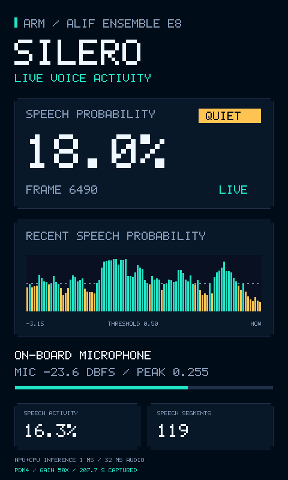

{}
The deterministic 79-window comparison and live microphone response passed on E8 A0 `AE822FA0E5597LS0` with the pinned source and model. Live testing used this application's 50× microphone gain, UART capture-health checks, and an actual E8 framebuffer readback. Repeat both configurations for your build; other silicon revisions require separate validation.
{}

## Detect speech from the on-board microphone

You'll run Silero voice activity detection (VAD) on the Alif Ensemble E8 Development Kit's Cortex-M55 High-Performance (HP) core and Ethos-U85-256 NPU. The default firmware captures the on-board microphone and updates the 480 × 800 display with current speech probability and recent history. VAD estimates whether an audio window contains speech; it does not transcribe speech or identify the speaker.

One application provides two configurations:

| Configuration | Input and behavior | Check |
| --- | --- | --- |
| `validation.conf` | Embedded 2.5-second recording, one 79-window inference run, then a clearly labeled display-only replay | Compare all UART `PROB` values with the matching host reference |
| Default `CONFIG_SILERO_LIVE_AUDIO=y` | On-board PDM microphone, continuous window-by-window inference, and live dashboard | Check speech/quiet response, capture rate, buffer occupancy, and faults |

Build and test the deterministic configuration first. This checks deployment numerics with a known input before microphone capture introduces a different signal. The live configuration uses the same exported program and CPU/NPU operator selection, but it does not embed the recording or emit its 79-value `PROB` sequence.

## Follow one microphone window

The microphone path selects physical **PDM channel 4**, producing **16 kHz mono signed PCM16**. The pinned driver requires `PDM_MODE_HIGH_QUALITY_512_CLK_FRQ` (mode 2) to obtain that rate: assigning `pcm_rate=16000` alone does not select its clock. The application retains the vendor channel phase and FIR coefficients and enables the hardware DC-blocking IIR. It uses **50× linear hardware gain** (`CONFIG_SILERO_MIC_GAIN=50`, register value `0x320`), a local calibration setting that matches the pinned SDK live source's fallback gain. It is not the SDK LE-audio Kconfig default, which is 20×. The setting accepts integer gains from 1 to 255; it conditions microphone input without changing the model or decision threshold. Check quiet response and clipping before changing it.

Each invocation receives **512 new samples plus 64 samples of history**, forming one float32 `[1,576]` input tensor:

1. **Read a block.** Copy one 1,024-byte microphone block, then release its slab allocation before inference. Eight blocks buffer capture. A read timeout, wrong-sized block, or nearly exhausted slab stops the application with an error.
2. **Build the input.** Divide signed samples by 32,768. Prepend the previous 64 waveform samples, starting with zero history on boot, then append the 512 new samples. Retain the final 64 samples for the next call.
3. **Execute the method.** Reuse one loaded ExecuTorch method. Delegated `EthosUBackend` subgraphs execute on the NPU; CPU operators handle quantization, tensor copies, and recurrent-state updates.
4. **Read the probability.** A finite float32 result strictly above `0.5` means speech; a value at or below `0.5` means quiet. Each quiet-to-speech transition starts a new counted segment. There is no additional hangover or minimum-duration smoothing.

The on-board I2S/PDM microphones are on the bottom side of the kit, identified in the [E8 User Guide](https://alifsemi.com/download/AUGD0023). Direct the test sound toward that side when checking acoustic response.

The two forms of streaming state have different owners:

| Information retained between calls | Owner | Initialization |
| --- | --- | --- |
| Previous 64 waveform samples | Application input-framing code | Floating-point zeros before the first window |
| Quantized hidden and cell state | Exported model's mutable int8 buffer | Serialized initial values when the method is loaded |

For this export the state buffer has shape `[2,1,128]`, with hidden-state zero point `-2` and cell-state zero point `19`. Literal zero bytes do not represent its intended initial state. Reloading the method or clearing either history between windows changes the streaming behavior. Reset the application to start a new independent stream.

## Keep capture ahead of display work

The inference thread runs at priority 0. The display worker runs at lower priority 5 and redraws at most ten times per second; capture and inference have no artificial presentation delay. The board keeps the MIPI route selected for the display and does not initialize a camera.

One 512-sample block represents 32 ms of audio, so healthy sustained capture should process approximately **31.25 windows per second**. UART emits one `LIVE` diagnostic every 32 windows, including the elapsed wall time, probability, RMS, peak, inference duration, maximum observed slab occupancy, configured gain, and cumulative clipped-sample count. The clipping count records samples exactly equal to the PCM16 minimum or maximum; nonzero counts show saturation, while zero alone does not establish audio quality. The vendor driver can handle a FIFO overflow internally without an application error, so a low buffer count alone does not prove uninterrupted capture. Compare processed audio duration (`frame × 0.032` seconds) with elapsed wall time as well as checking faults.

The per-window inference duration covers `method.execute()` and output retrieval. It excludes microphone waiting, input conversion, and display rendering. It is not an NPU-only duration or the full application-loop latency.

## Read the live dashboard

The display uses teal speech indicators and amber quiet indicators:

| Field | Meaning |
| --- | --- |
| **SPEECH PROBABILITY**, **SPEECH** or **QUIET** | Latest probability and strict `> 0.5` decision |
| **RECENT SPEECH PROBABILITY** | Rolling 98-window history, approximately 3.1 seconds of captured audio; bars show probability, not an audio waveform |
| **MIC … DBFS / PEAK …** | Normalized microphone RMS expressed in dBFS, and absolute peak amplitude |
| **SPEECH ACTIVITY** | Percentage of processed windows labeled speech since boot |
| **SPEECH SEGMENTS** | Number of quiet-to-speech transitions since boot |
| **NPU+CPU INFERENCE … MS / 32 MS AUDIO** | Latest measured execution/output duration beside the audio-window step |
| **PDM4 / GAIN 50X / … S CAPTURED** | Processed sample count converted to audio duration, not an independent wall clock |

The image below was read from the actual E8 framebuffer after a checked CPU cache clean. Its values describe that instant of the live run:

Live mode is labeled **LIVE VOICE ACTIVITY** and **ON-BOARD MICROPHONE**. The deterministic configuration instead says **PRERECORDED CLIP** and **LOOPING RESULTS / NO MICROPHONE**; that animation replays cached probabilities without new inference or audio playback.

## Make the SRAM model visible to the NPU

The firmware copies the PTE, including command streams and weights, into cache-line-aligned shared SRAM and cleans that range from the CPU data cache. It sets `NPU_QCONFIG=0` and `NPU_REGIONCFG_0=0` to select the matching SRAM route. The driver's external-memory defaults do not match this placement; the initial port exposed that mismatch as an NPU bus abort.

Two delegated subgraphs coexist with CPU operators needed for state updates and tensor conversion. Build both the selected portable/quantized kernels and the Ethos-U backend; requiring one fully delegated partition would reject necessary work.

## Keep the known-input check separate

The deterministic clip contains 40,000 samples, or 2.5 seconds at 16 kHz. It requires `ceil(40000 / 512) = 79` calls. The last call has 64 new samples and 448 padding samples in addition to waveform history. Its final padded boundary is 2.528 seconds.

The quantized host reference uses the same clip, framing, and initialized state. Passing its comparison checks deployment agreement on that input. It does not establish accuracy on unseen speech: calibration and validation audio overlap in this example. Live speech/quiet observations are a separate functional check, not a labeled accuracy benchmark.

## What you've learned and what's next

You can distinguish waveform history from recurrent state, deterministic replay from microphone inference, and captured audio duration from elapsed wall time. Next, prepare the released dependencies and pinned E8 tools, then export one model for both configurations.
