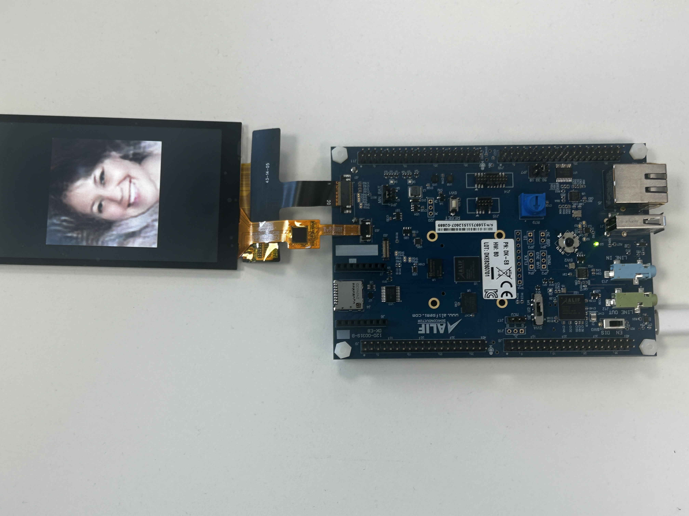

## Open the application console

Keep **SW4** set to **UART4**. In Visual Studio Code (VS Code), open **Serial Monitor** on the serial port exposed through **PRG USB** and use the following settings:

- Baud rate: `115200`
- Data bits: `8`
- Parity: `None`
- Stop bits: `1`

If the port was open before you changed **SW4**, close and reopen it.

## Build and debug the application

To build and debug the application:

1. In the **CMSIS** view, confirm that `DevKit-E8` is active.
2. Select **Build**, then select **Debug**. 
   Keil Studio starts the J-Link GDB server over Serial Wire Debug (SWD) and loads the application into magnetoresistive random-access memory (MRAM).
3. The debugger stops at `main`. Press **F5** to continue. 
   
The firmware initializes the display and NPU, loads the two ExecuTorch methods, and generates a repeatable boot image. The output is similar to:

```output
Ethos-U version info:
    Arch:       v2.0.0
    MACs/cc:    256
ExecuTorch pico-faces (m3_long_cfg, a16w8/a8w8)
Methods:
  dit_step  2 input(s), 1 output(s)
  decode    1 input(s), 1 output(s)
Generating: seed 3, 4 steps, class 1, w 4.0
Image: 128x128x3, CRC32 <export-dependent-value>
Test_result: PASS
```

The LCD displays the 128 x 128 result scaled to 384 x 384 pixels in the center of the screen. The Cyclic Redundancy Check (CRC) depends on the host-side export, so use `Test_result: PASS` and the displayed image as the functional checks.

## Confirm NPU execution

Inspect the two performance lines printed after generation. They report NPU cycles, NPU active time, multiply-accumulate array activity, and AXI reads for `dit_step` and `decode`. These counters come from the Ethos-U performance monitoring unit and confirm that both methods executed on the NPU.

The following is a reference DevKit run of the source project:

| Setting | Reference value |
| --- | --- |
| Processor | Cortex-M55 high-performance core at 400 MHz |
| NPU | Ethos-U85 with 256 MACs per cycle |
| Model | `m3_long_cfg`, `a16w8` DiT and `a8w8` decoder |
| Sample | Seed 3, four steps, class 1, guidance 4.0 |
| Execution model | Bare-metal, single core; thread count and CPU affinity don't apply |
| Observed time | About 78 ms total: about 68 ms for eight `dit_step` calls and 3 ms for `decode` |

These instructions were verified on a Mac using the following versions:

| Software or component | Version |
| --- | --- |
| CMSIS Solution extension | 1.72.0 |
| Alif SETOOLS | 1.112.00 DEV |
| SEGGER J-Link Software | 9.36 |

Treat the timing as a reference measurement rather than a pass threshold. Tool versions, the exported program, and board conditions can change the result.

## Generate more faces

Use the **SW2** joystick after the boot image appears:

- Press toward the left to generate one face with the next seed.
- Press toward the right to start continuous generation. Press in the same direction again to stop.

Each completed joystick generation updates the LCD and prints the following to the console:

- Image number
- Seed
- Class
- Guidance
- Total time

The boot demo prints a CRC. Joystick log lines don't include one.

To check standalone boot, end the debug session and press **RESET (SW1)** while the application is idle. The boot image and `Test_result: PASS` should return.

{}
Stop continuous generation and wait for the current image to finish before restarting a debug session or resetting the board. Resetting through the debugger during active NPU inference can produce a transient inference error and affect the timing sample.
{}

## View an example result

The following image shows a generated face displayed on the DevKit LCD:



## Troubleshoot common problems

Use the following checks if the application doesn't reach the pass marker:

| Symptom | Check |
| --- | --- |
| J-Link connects but execution doesn't stop at `main` | Set **SW4** to **SEUART** and repeat the debug-stub steps from [Prepare the DevKit for debugging](/learning-paths/embedded-and-microcontrollers/generate-faces-alif-e8/prepare-the-board/). |
| Debug remains at **Connecting** | Confirm that the target uses SWD, not JTAG, then power-cycle the board. |
| UART has no application output | Set **SW4** to **UART4**, then close and reopen Serial Monitor. |
| `app-write-mram` receives no response | Set **SW4** to **SEUART**, close programs using the port, and press reset while the tool waits. |
| The build can't find `ai_layer/model_pte.c` | Run **Setup Python virtual environment**, followed by **Create AI layer**. |
| The Python setup task rejects your Python version | Install `uv`, check `uv --version` in the VS Code terminal, then run **Setup Python virtual environment (uv)** with Python `3.12`. |
| SETOOLS reports a missing `utils` directory | Run the command from the extracted SETOOLS directory rather than your home directory. |

## (Optional) Use the Corstone-320 FVP

The same CMSIS solution also includes the `SSE-320-U85` target for the Corstone-320 Fixed Virtual Platform (FVP). On Linux and Windows, the managed tools environment supplies the native FVP. Before selecting **Run** or **Debug**, select `SSE-320-U85` in **Manage Solution**, select **Apply**, and recreate the AI layer.

On macOS, the project runs the FVP in Docker. To use the FVP, follow these additional steps:

{}
These optional steps follow the FVP instructions for the pinned example and are separate from the physical DevKit validation.
{}

1. Install [Docker Desktop for Mac](https://docs.docker.com/desktop/setup/install/mac-install/) and keep it running.
2. In `cmsis-executorch.csolution.yml`, find the `debugger` entry under the `target-set` of the `SSE-320-U85` target. Replace its `model` value with the Docker wrapper for the project:

   ```yaml
   model: "${workspaceFolder}/.vscode/fvp.sh"
   ```

3. Select `SSE-320-U85` in **Manage Solution** and select **Apply**. After the extension generates the debug configuration, open a terminal in the `CMSIS-Executorch` directory and copy the macOS configuration:

   ```bash
   cp .vscode/launch.json.mac .vscode/launch.json
   ```

4. Recreate the AI layer, build, and select **Run** or **Debug**. The first invocation builds the Docker image and downloads the simulator, so it takes longer than subsequent runs.

The FVP writes the raw image to `out/fvp_image.bin`. To return to the board, select `DevKit-E8`, select **Apply**, and recreate its AI layer before building again.

## What you've accomplished

You've exported a generative model through ExecuTorch, loaded it on the Alif Ensemble E8 DevKit, and generated faces with both neural-network methods delegated to Ethos-U85. You also validated the run through the LCD, pass marker, and hardware performance counters.

You can extend the Learning Path workflow to deploy other Generative AI models on a microcontroller with Arm Ethos-U85 acceleration.