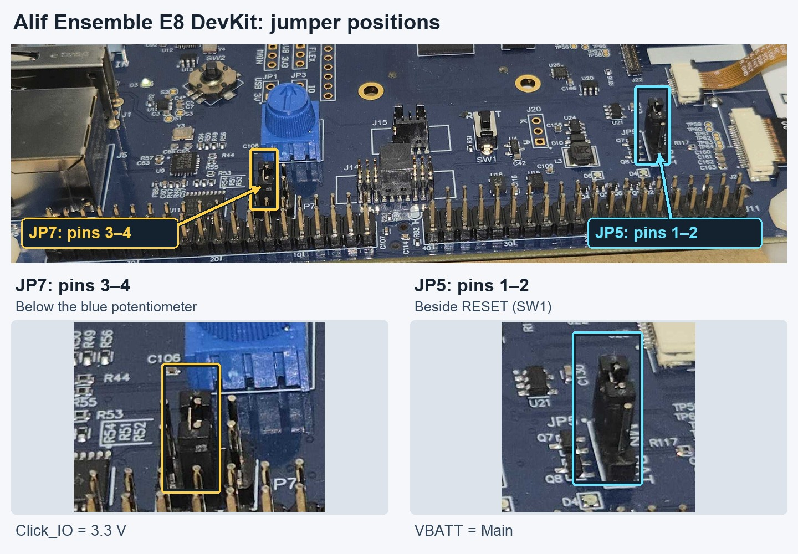

## Install the host tools

Install [Visual Studio Code](https://code.visualstudio.com/) and add these extensions from the Extensions view:

- [Keil Studio Pack](https://marketplace.visualstudio.com/items?itemName=Arm.keil-studio-pack), extension ID `Arm.keil-studio-pack`
- [Python](https://marketplace.visualstudio.com/items?itemName=ms-python.python), extension ID `ms-python.python`

The project tasks need CMSIS Solution extension 1.72.0 or later, which is included with Keil Studio Pack. Accept the project's managed CMSIS-Toolbox 2.15 environment when prompted. Sign in with your Arm account when Keil Studio requests a license. The free Keil MDK Community license supports this example.

Install two tools for the physical DevKit:

1. Download Alif SETOOLS version 1.110.00 or later for your host operating system from the [Alif software and tools page](https://alifsemi.com/support/software-tools/ensemble/). Extract the package. On Linux and macOS, make the SETOOLS programs executable if necessary.
2. Install SEGGER [J-Link Software](https://www.segger.com/downloads/jlink/) version 8.42 or later. The DevKit includes an on-board J-Link probe.

## Configure the SETOOLS path

In VS Code, press **Ctrl+Shift+P** on Linux or Windows, or **Cmd+Shift+P** on macOS, to open the Command Palette. Search for and select **Preferences: Open User Settings (JSON)**. Add `alif.setools.root` inside the existing JSON object and replace the example value with the directory that contains `app-gen-toc` and `app-write-mram`:

```json
"alif.setools.root": "/absolute/path/to/setools"
```

Keep the comma required by your existing JSON properties. The project uses this setting when it installs the Cortex-M55 debug stubs.

## Connect the DevKit

Prepare the board before applying power:

1. Disconnect all USB cables before checking or moving a jumper.
2. Keep **JP5** on pins **1-2** and **JP7** on pins **3-4**.
3. Set **SW4** to **SEUART**, its default position.
4. Connect a USB-C data cable to **PRG USB**, the connector near the corner of the board.
5. Leave **MCU USB** disconnected.

{}
Don't move jumpers while the board is powered. Disconnect **PRG USB** before changing a jumper.
{}

Use the following photo to locate the jumpers. **JP7** is below the blue potentiometer, and **JP5** is beside **RESET (SW1)**. The installed jumper caps connect the required pairs of pins, as shown in the close-ups. See the [Alif DK-E8 User Guide](https://alifsemi.com/download/AUGD0023) for the board layout and pin numbering.



The **PRG USB** connection supplies power and exposes both the on-board J-Link probe and the USB-to-UART bridge. **SW4** selects which UART signal reaches that bridge:

| SW4 position | Connection | Use |
| --- | --- | --- |
| **SEUART** | Secure Enclave UART | SETOOLS and initial board provisioning |
| **UART4** | Application UART4 at 115200 8N1 | Application logs and image requests |

On macOS, accept **Allow accessory to connect** if prompted. If the power LED lights but neither J-Link nor a serial port appears, reconnect **PRG USB** with a known USB data cable and check for that prompt. The macOS serial port name is typically `/dev/cu.usbmodem...`; Linux typically uses `/dev/ttyACM...`, and Windows uses a `COM` port.

## Update the board support firmware

Open a terminal in the extracted SETOOLS directory. Run the tools from that directory because they load configuration and supporting files using relative paths. On Linux or macOS, run:

```bash
./updateSystemPackage -d
```

On Windows, run the corresponding executable:

```powershell
.\updateSystemPackage.exe -d
```

Select the DevKit serial port when prompted. The output is similar to:

```output
[INFO] /dev/ttyACM0 open Serial port success
Bootloader stage: SERAM
[INFO] Detected Device:
Part# AE822FA0E5597LS0 - Rev: A0
Connected target is not the default Revision
Do you want to set this part as default? (y/n): y
Maintenance Mode = Enabled
...
Verify Image
Done
```

The serial port, package names, progress details, and elapsed time can differ. The default revision message is expected during initial setup; answer `y` to make the detected E8 revision the default.

Run J-Link Commander once to update the on-board probe firmware and install its serial drivers. Use `JLinkExe` on Linux or macOS, or `JLink.exe` on Windows.

## What you've accomplished and what's next

You've installed the required host tools, configured the SETOOLS path, and connected the DevKit through **PRG USB**. Next, you'll clone the example and export the diffusion model for Ethos-U85.
