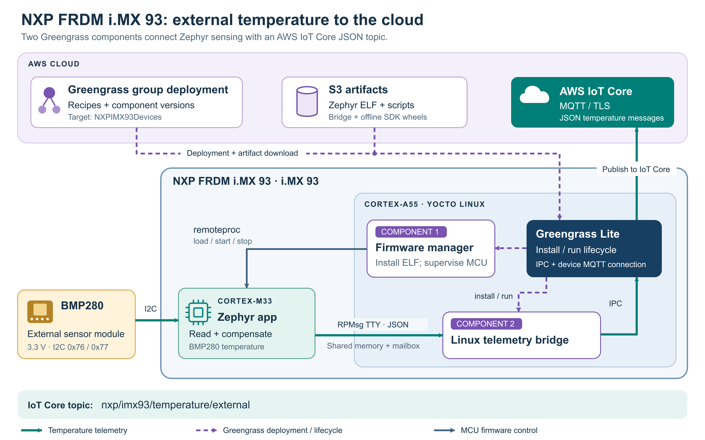

## What we will build

Use the Part 1 Yocto image on Cortex-A55 and the Part 2 Zephyr environment for Cortex-M33. 

In this learning path, we will create, register and deploy two custom AWS Greengrass components:

| Component | Application and lifecycle |
| --- | --- |
| `com.arm.NXPIMX93.ZephyrExternalTemperature` | Downloads the ELF, manager and Linux preflight helper from S3, checks FRDM boot/memory configuration, stages firmware, runs the application MCU, and quiesces/stops it and removes its installed copy on normal termination |
| `com.arm.NXPIMX93.ExternalTemperatureBridge` | Downloads the bridge, lifecycle script and SDK wheels from S3, installs offline, reads MCU telemetry, publishes JSON through Greengrass IPC, and removes its installed Python directory on normal termination |

As our board is running the AWS Greengrass `Lite` variant, we will be deploying the above two components to the AWS Greengrass group `NXPIMX93Devices`. 

JSON messages containing temperature sensor information will be published in AWS IoTCore to the topic: `nxp/imx93/temperature/external`. We will connect the external BMP280 I2C module to our board using our jumper wires.

## Additional details on our integration

Zephyr sends JSON through OpenAMP/RPMsg shared memory and the SoC mailbox. Linux's `rpmsg-tty` driver exposes `/dev/nxp-temperature`. A separate `/dev/nxp-mcore-control` endpoint carries the quiescence handshake, so the firmware manager and bridge do not contend for one serial port. No external UART telemetry jumper is required.

The MCU completes a sample, puts the sensor to sleep, acknowledges `STOP` with `QUIESCED`, and enters WFI. The manager then uses this platform's remoteproc stop operation.

Nucleus Lite 2.3.0 does not provide a recipe `shutdown` lifecycle. Both components therefore run foreground processes in their Greengrass systemd units and handle normal SIGTERM cleanup. Do not detach these applications into separately enabled services.

Here, removing or unpublishing an app from the device means revising every deployment that selects it. Deleting a cloud version or canceling a deployment does not stop its installed app. Greengrass continues to own its artifact cache and work-directory infrastructure.

These source bundles still require a real Yocto build, Zephyr cross-build, and board/AWS acceptance. The later checks require an actual sensor response and deploy → remove → deploy → remove without rebooting.

## Additional Technical References

| Topic | Source |
| --- | --- |
| Board setup and boot | [NXP FRDM i.MX 93 guide](https://www.nxp.com/document/guide/getting-started-with-frdm-imx93:GS-FRDM-IMX93) and [hardware manual](https://www.nxp.com/webapp/Download?colCode=UM12181) |
| Release and machine selection | [NXP BSP manifest](https://github.com/nxp-imx/imx-manifest/blob/07d7cd3f29a18e809f6391eea1be01103b1d6e13/imx-6.12.49-2.2.0.xml) and [machine configuration](https://github.com/nxp-imx/meta-imx/blob/1cfbbb8f9ce1d6071775ea6083b79d98597c8206/meta-imx-bsp/conf/machine/imx93-11x11-lpddr4x-frdm.conf) |
| Kernel and remoteproc | [Linux recipe](https://github.com/nxp-imx/meta-imx/blob/1cfbbb8f9ce1d6071775ea6083b79d98597c8206/meta-imx-bsp/recipes-kernel/linux/linux-imx_6.12.bb), [driver](https://github.com/nxp-imx/linux-imx/blob/df24f9428e38740256a410b983003a478e72a7c0/drivers/remoteproc/imx_rproc.c), and [board DTS](https://github.com/nxp-imx/linux-imx/blob/df24f9428e38740256a410b983003a478e72a7c0/arch/arm64/boot/dts/freescale/imx93-11x11-frdm.dts) |
| Zephyr baseline and RPMsg | [v4.3.0 board sources](https://github.com/zephyrproject-rtos/zephyr/tree/v4.3.0/boards/nxp/frdm_imx93) and [OpenAMP resource-table sample](https://github.com/zephyrproject-rtos/zephyr/tree/v4.3.0/samples/subsys/ipc/openamp_rsc_table) |
| Greengrass Lite packaging | [Pinned Walnascar recipe](https://github.com/aws4embeddedlinux/meta-aws/blob/5d73130967dce143f44fe2f80d65361f6b653c5e/recipes-iot/aws-iot-greengrass/greengrass-lite_2.3.0.bb) and [2.3.0 provisioning](https://github.com/aws-greengrass/aws-greengrass-lite/blob/v2.3.0/docs/Provisioning.md) |
| Component authoring and delivery | [Recipe reference](https://docs.aws.amazon.com/greengrass/v2/developerguide/component-recipe-reference.html), [S3 role permissions](https://docs.aws.amazon.com/greengrass/v2/developerguide/device-service-role.html), and [deployment creation](https://docs.aws.amazon.com/greengrass/v2/developerguide/create-deployments.html) |
| Cloud publishing | [MQTT IPC authorization](https://docs.aws.amazon.com/greengrass/v2/developerguide/ipc-iot-core-mqtt.html) |
| BMP280 | [Bosch datasheet](https://www.bosch-sensortec.com/media/boschsensortec/downloads/datasheets/bst-bmp280-ds001.pdf) |

## What you have learned

You understand how NXP FRDM i.MX93 combines the external sensor, its application MCU, and the Yocto Linux bridge using two Greengrass components for application publication and lifecycle control.