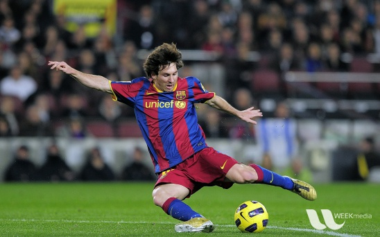

## Create the application directory

Create a directory for the source code, model, labels, and test image:

```bash
cd ~/opencv-kleidicv-lab
mkdir -p static-detection
cd static-detection
```

## Download the YOLOX model

Download the FP32 YOLOX-S model from OpenCV Zoo:

```bash
wget -O object_detection_yolox_2022nov.onnx \
    https://github.com/opencv/opencv_zoo/raw/main/models/object_detection_yolox/object_detection_yolox_2022nov.onnx
```

Verify that Git Large File Storage returned the model rather than its small pointer file:

```bash
ls -lh object_detection_yolox_2022nov.onnx
sha256sum object_detection_yolox_2022nov.onnx
```

The model is approximately 35 MB. The expected SHA-256 value is:

```output
c5c2d13e59ae883e6af3b45daea64af4833a4951c92d116ec270d9ddbe998063  object_detection_yolox_2022nov.onnx
```

{}
The model and the YOLOX files in OpenCV Zoo are licensed under the Apache License 2.0. See the model directory linked in the further reading resources for details.
{}

## Download the COCO class names

The model recognizes 80 classes from the COCO dataset. Download the label file published with this Learning Path:

```bash
wget -O coco.names \
    https://learn.arm.com/learning-paths/embedded-and-microcontrollers/opencv-onnx-kleidicv-static-detection/coco.names
```

If you're following a preview of this Learning Path, replace `https://learn.arm.com` in the attachment download commands with the preview site's origin, including its port if needed. Use the same site when downloading the application source in the next section.

Count the labels:

```bash
wc -l coco.names
```

The expected output is:

```output
80 coco.names
```

## Download a static test image

Download the original football photograph from the OpenCV 4.13.0 sample data:

```bash
wget -O input.jpg \
    https://raw.githubusercontent.com/opencv/opencv/4.13.0/samples/data/messi5.jpg
```

This image has no segmentation overlay. Verify that you downloaded the same image used for the reference measurements:

```bash
sha256sum input.jpg
```

The expected output is:

```output
1d570e49654e84c7a943918537bd9e5e1ef82920152e147c834006e235be97c9  input.jpg
```

Confirm that all three inputs are present:

```bash
file object_detection_yolox_2022nov.onnx coco.names input.jpg
```

The output identifies the ONNX model as data, the labels as text, and `input.jpg` as a JPEG image. You can replace `input.jpg` with your own photograph later.

The supplied image contains a football player and ball:



The image is distributed in the
[OpenCV sample data directory](https://github.com/opencv/opencv/tree/4.13.0/samples/data).
For licensing information, see the
[OpenCV license](https://github.com/opencv/opencv/blob/4.13.0/LICENSE).

## What you've accomplished and what's next

You've prepared a verified YOLOX ONNX model, its 80 COCO labels, and a repeatable input image. Next, you'll compile the static-image application and verify its detection output.
