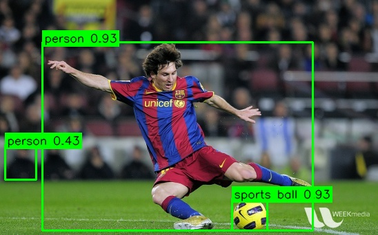

## Download the application source

The example application is stored with this Learning Path. Download the C++ source and CMake project:

```bash
cd ~/opencv-kleidicv-lab/static-detection

wget -O yolox_static.cpp \
    https://learn.arm.com/learning-paths/embedded-and-microcontrollers/opencv-onnx-kleidicv-static-detection/yolox_static.cpp

wget -O CMakeLists.txt \
    https://learn.arm.com/learning-paths/embedded-and-microcontrollers/opencv-onnx-kleidicv-static-detection/cmakelists.txt
```

## Find the pipeline in the source

Use these functions in `yolox_static.cpp` to connect the pipeline stages to their implementation:

| Code | Role |
|---|---|
| `runPipeline()` | Calls the explicit preprocessing operations, then feeds the tensor to `network.setInput()` and runs inference with `network.forward()` |
| `postprocess()` | Decodes the model output, maps boxes to the original image, and applies non-maximum suppression |
| `renderDetections()` | Draws the retained boxes, class labels, and confidence scores |
| `main()` | Loads the inputs, selects the OpenCV CPU backend, runs warm-up and measured iterations, and prints the timing summaries |

Within `runPipeline()`, pairs of `Clock::now()` calls surround each stage and store its elapsed time in `StageTimes`. The inference timer includes input setup and the forward pass. Model loading, image-file decoding, and the final JPEG write are outside these timers.

## Build against the baseline OpenCV installation

Configure the application with the baseline OpenCV package:

```bash
cmake -S . -B app-build-baseline -G Ninja \
    -DCMAKE_BUILD_TYPE=Release \
    -DOpenCV_DIR=$HOME/opencv-kleidicv-lab/install-baseline/lib/cmake/opencv4
cmake --build app-build-baseline
```

Use `Release` for both application builds, not just for the OpenCV libraries. This enables compiler optimization for application code such as output decoding and postprocessing.

Run one measured iteration after two warm-up iterations:

```bash
LD_LIBRARY_PATH=$HOME/opencv-kleidicv-lab/install-baseline/lib \
    ./app-build-baseline/yolox_static \
    --model=object_detection_yolox_2022nov.onnx \
    --image=input.jpg \
    --labels=coco.names \
    --output=result-baseline.jpg \
    --build-name=baseline \
    --warmup=2 \
    --iterations=1
```

The output is similar to:

```output
Build label: baseline
OpenCV version: 4.13.0
OpenCV threads: 12
Warm-up iterations: 2
Measured iterations: 1
Detections: 3
Resize:              mean=    0.503 ms  min=    0.503 ms  stddev=    0.000 ms
Padding:             mean=    0.048 ms  min=    0.048 ms  stddev=    0.000 ms
BGR to RGB:          mean=    0.041 ms  min=    0.041 ms  stddev=    0.000 ms
Uint8 to float32:    mean=    1.154 ms  min=    1.154 ms  stddev=    0.000 ms
Tensor packing:      mean=    1.266 ms  min=    1.266 ms  stddev=    0.000 ms
Preprocessing:       mean=    3.012 ms  min=    3.012 ms  stddev=    0.000 ms
DNN inference:       mean=  356.052 ms  min=  356.052 ms  stddev=    0.000 ms
Postprocessing:      mean=    0.484 ms  min=    0.484 ms  stddev=    0.000 ms
Rendering:           mean=    0.149 ms  min=    0.149 ms  stddev=    0.000 ms
End-to-end:          mean=  359.696 ms  min=  359.696 ms  stddev=    0.000 ms
Output image: result-baseline.jpg
```

Timing values depend on the board and input image. With one measured iteration, the mean and minimum are equal and the standard deviation is zero.

## Inspect the result

The reference output contains three retained detections: two `person` detections and one `sports ball` detection. One person box covers a partially visible person in the background.



Check the generated image:

```bash
file result-baseline.jpg
ls -lh result-baseline.jpg
```

## Build against the KleidiCV installation

Build the same application source against the default KleidiCV OpenCV package:

```bash
cmake -S . -B app-build-kleidicv-default -G Ninja \
    -DCMAKE_BUILD_TYPE=Release \
    -DOpenCV_DIR=$HOME/opencv-kleidicv-lab/install-kleidicv-default/lib/cmake/opencv4
cmake --build app-build-kleidicv-default
```

Run the functional check:

```bash
LD_LIBRARY_PATH=$HOME/opencv-kleidicv-lab/install-kleidicv-default/lib \
    ./app-build-kleidicv-default/yolox_static \
    --model=object_detection_yolox_2022nov.onnx \
    --image=input.jpg \
    --labels=coco.names \
    --output=result-kleidicv-default.jpg \
    --build-name=kleidicv-default \
    --warmup=2 \
    --iterations=1
```

Both builds should report three detections for the supplied image. Open `result-baseline.jpg` and `result-kleidicv-default.jpg` and compare the classes and bounding boxes with the reference image. If your board has no desktop, copy the files to your workstation to view them.

The results should contain two `person` detections and one `sports ball` detection with equivalent bounding boxes. Small numerical and JPEG encoding differences are possible, so byte-for-byte image equality is not required. A matching detection count alone is not a complete correctness check.

## What you've accomplished and what's next

You've run YOLOX static-image detection with both OpenCV builds and checked the labeled output images. Next, you'll compare image-operation and full preprocessing latency and interpret the pipeline-level effect.
