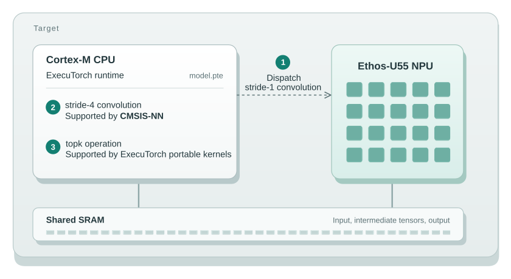
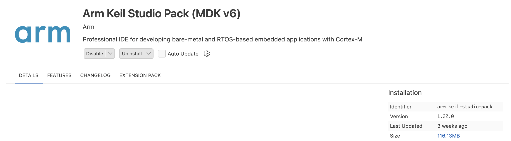
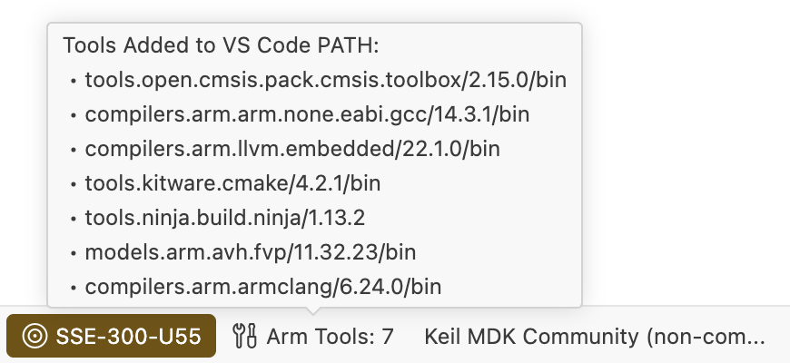
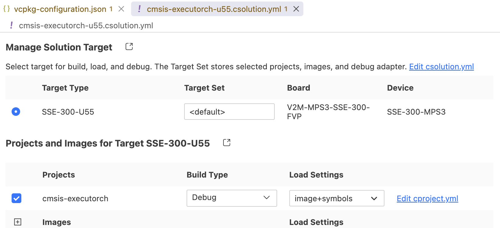
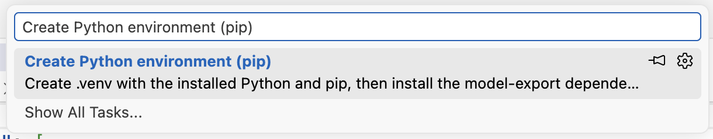

## ExecuTorch for Cortex-M and Ethos-U

ExecuTorch is PyTorch’s runtime for deploying machine learning models on edge devices, including embedded systems. It converts trained models into programs that can run within the limited memory and compute resources of a microcontroller.

Many microcontrollers use Arm Cortex-M CPUs. Some also integrate an Arm Ethos-U NPU to accelerate neural-network operations.

For combined Cortex-M and Ethos-U systems, ExecuTorch lets one model use both processors: supported operations are dispatched to the Ethos-U NPU, while remaining operations run on the Cortex-M CPU.

You will export a model, select CMSIS-NN kernels for its Cortex-M operations, and run a mixed CPU and NPU application on a Corstone-300 FVP. The checks show which implementations the model uses and confirm that inference completes. Measure latency and power on your target hardware to quantify the benefit for your application.

## Choose where each operation runs

The example model uses three execution paths:

| Execution path | What runs there | Why |
| --- | --- | --- |
| [Ethos-U55 NPU](https://www.arm.com/products/silicon-ip-cpu/ethos/ethos-u55) | The stride-1 convolution | The NPU supports this convolution configuration. |
| [CMSIS-NN kernels on Cortex-M](https://arm-software.github.io/CMSIS-NN/latest/index.html) | The stride-4 convolution | Ethos-U55 does not support this configuration, so the CPU runs it with an optimized CMSIS-NN kernel. |
| ExecuTorch portable kernels on Cortex-M | The `topk` operation | This operation uses a general CPU implementation. |

The diagram shows the NPU path alongside the two paths that execute on the Cortex-M CPU:



Fallback here is planned during export. It isn't recovery from an NPU failure
at runtime. The exporter determines which regions the target Ethos-U delegate
supports, then assigns known remaining patterns to the Cortex-M backend.

{}
Ethos-U55 is used because its unsupported stride-4 convolution creates a
predictable fallback region. Ethos-U85 supports more operator configurations,
so it will typically have less CPU fallback than Ethos-U55. The same workflow still
applies when a model contains operations that remain outside the U85 delegate.
{}

In this Learning Path, you will clone a [CMSIS-Executorch example](https://github.com/Arm-Examples/cmsis-executorch) that already contains the needed board support,
runner, memory configuration, and Fixed Virtual Platform (FVP) settings. You
will then inspect and modify it to observe Cortex-M fallback using optimized CMSIS-NN microkernels.

## Check the host tools

VS Code is required for the Keil Studio workflow. Before cloning the project, check that Git and Python 3.10–3.13 are available in your host terminal:


  
git --version
python3 --version
  
  
git --version
python --version
  


If either command is unavailable, install [Git](https://git-scm.com/downloads) or a supported [Python version](https://www.python.org/downloads/) before continuing. Python 3.14 is excluded because the pinned TOSA export dependency has no wheel for it. On Linux, your Python installation must also include `venv` support; install your distribution's matching `python3-venv` package if needed.

{}
The macOS exporter requires Apple silicon and macOS 15 or later. The pinned ExecuTorch and TOSA packages do not provide Intel macOS wheels. Docker supplies the FVP on macOS; the Python exporter runs on the host.
{}

On Windows, enable [long-path support](https://learn.microsoft.com/en-us/windows/win32/fileio/maximum-file-path-limitation) before installing the export dependencies.

## Clone the example project

Clone the CMSIS-Executorch example and select the tested revision:

```console
git clone https://github.com/Arm-Examples/CMSIS-Executorch.git
cd CMSIS-Executorch
git checkout 4002b63dcc3e27eb7444946a0dbf69b9a74d6fc9
```

The `CMSIS-Executorch` directory is the **project root**. Open this folder in VS Code and use it as the working directory for every command below.

## Install the VS Code extensions

In VS Code's **Extensions** view, install the [Keil Studio Pack](https://marketplace.visualstudio.com/items?itemName=Arm.keil-studio-pack) and the [Python extension](https://marketplace.visualstudio.com/items?itemName=ms-python.python). Keil Studio Pack includes Arm Tools Environment Manager and the CMSIS Solution extension used by this project.



## Activate the Arm tools and license

When you open the project folder, Arm Tools Environment Manager automatically activates `vcpkg-configuration.json` by default. If prompted, allow it to download the declared tools. Wait for the **Arm Tools** status-bar indicator to finish loading. Hover over it to check the installed tools, or open **Arm Tools > View Log** to inspect activation errors.



If activation does not start, right-click `vcpkg-configuration.json` in the **Explorer** view and select **Activate Environment**. You can also select **Activate Environment** from the **Arm Tools** status-bar menu when the configuration is detected.

Arm Compiler for Embedded requires an activated license. Select the license indicator next to **Arm Tools**, then choose **Activate Arm Keil MDK Community Edition** for evaluation or non-commercial use, or **Activate or manage Arm licenses** to use your existing license. Confirm that the indicator shows an active license before building. See [Keil Studio license activation](https://mdk-packs.github.io/vscode-cmsis-solution-docs/installation.html#activating-keil-studio) for the available options.

In the **CMSIS** view, select **... > Open Solution in Workspace** and choose `cmsis-executorch-u55.csolution.yml`. Confirm that the active target is `SSE-300-U55`.



## Create the Python environment

Select **Terminal > Run Task > Create Python environment (pip)**.



The task runs `setup_venv.sh` on Linux and macOS, or `setup_venv.bat` on Windows. Both invoke `setup_venv.py`, which:

- Creates `.venv` using the host Python interpreter.
- Installs `requirements.txt`, including ExecuTorch 1.5.1, PyTorch 2.14.0, TorchAO 0.18.0, and Vela 5.1.0.
- Installs `requirements-arm-tosa.txt` with `--no-deps` to preserve the exporter's required serialization versions.
- Checks that the ExecuTorch Arm quantizer imports successfully.

Wait for the task to exit successfully and print a message similar to:

```output
venv ready: .../CMSIS-Executorch/.venv
```

This task installs the Python dependencies for you. Use the setup script when repairing the environment so that both requirements files are installed with the correct options.

If the task selects a different Python version from the supported one you installed, run the setup explicitly from the project root. For example, with Python 3.12 installed:


  
PYTHON=python3.12 ./setup_venv.sh
  
  
py -3.12 setup_venv.py
  


## Open and verify the working terminal

After Arm tool activation and Python setup finish, select **Terminal > New Terminal**. Use a Bash-compatible shell on Linux and macOS, or PowerShell on Windows. This new integrated terminal receives the activated Arm tool environment.

Activate `.venv` in this terminal:


  
source .venv/bin/activate
  
  
.\.venv\Scripts\Activate.ps1
  


Check the working directory and Python interpreter:

```console
python -c "from pathlib import Path; import sys; print('Project:', Path.cwd()); print('Python:', sys.executable)"
```

The output is similar to:

```output
Project: .../CMSIS-Executorch
Python: .../CMSIS-Executorch/.venv/bin/python
```

On Windows, the interpreter path ends in `.venv\Scripts\python.exe`. Both paths must belong to the same project. Keep using this terminal for subsequent commands. Repeat environment activation and this check whenever you open a new terminal.

## Verify the environment

Check the activated Arm tools and Python package versions:

```console
python --version
cbuild --version
armclang --version
python -c "from importlib.metadata import version; print('ExecuTorch', version('executorch')); print('PyTorch', version('torch'))"
```

Confirm that Python is between 3.10 and 3.13, `cbuild` reports 2.15.0 or later, Arm Compiler for Embedded reports 6.24, and the final two lines are:

```output
ExecuTorch 1.5.1
PyTorch 2.14.0
```

{}
If a tool is unavailable or its version differs, reactivate the project's Arm tools and open a new integrated terminal. Activate `.venv` again before repeating these checks. The ExecuTorch Python package and CMSIS Pack versions must match because the embedded runtime loads the program produced by the exporter.
{}

### Set up Docker on macOS

On macOS, install and start [Docker Desktop](https://docs.docker.com/desktop/setup/install/mac-install/). The FVP runs inside a Linux container because there is no native macOS FVP. Check that Docker is running:

```bash
docker info
```

The project's `.vscode/fvp.sh` wrapper mounts the project directory into the container, including when it is outside your home directory. Its first run builds the FVP container image.

## Download the Learning Path assets

Download this Learning Path's example folder from the code examples repository.
The archive is pinned to a commit and includes the fallback model, integration
patch, inspection helpers, and their license. Run the commands from the project root. They create `lp-assets` for the downloaded originals, then copy the four working files into the project root:


  
curl -fL "https://gitlab.arm.com/learning-code-examples/code-examples/-/archive/5eb4e50676d4085c90e926abec1c978f257d1bde/code-examples-5eb4e50676d4085c90e926abec1c978f257d1bde.tar.gz?path=learning-paths/embedded-and-microcontrollers/optimize-executorch-fallback-cortex-m" -o lp-assets.tar.gz
mkdir -p lp-assets
tar -xzf lp-assets.tar.gz -C lp-assets --strip-components=4
cp lp-assets/*.py lp-assets/*.patch .
  
  
curl.exe -fL "https://gitlab.arm.com/learning-code-examples/code-examples/-/archive/5eb4e50676d4085c90e926abec1c978f257d1bde/code-examples-5eb4e50676d4085c90e926abec1c978f257d1bde.tar.gz?path=learning-paths/embedded-and-microcontrollers/optimize-executorch-fallback-cortex-m" -o lp-assets.tar.gz
New-Item -ItemType Directory -Force lp-assets | Out-Null
tar -xzf lp-assets.tar.gz -C lp-assets --strip-components=4
Copy-Item lp-assets\*.py, lp-assets\*.patch .
  


### Keep track of the project files

The working files now have these roles. The `artifacts/` and `out/` directories are created in later chapters; `ai_layer/` already exists in the cloned example and will be regenerated for your model.

```text
CMSIS-Executorch/
├── lp-assets/                       Downloaded originals and license
├── mixed_backend_cnn.py             Model to copy into model/model.py
├── export_cortex_m_fallback.py       Export and inspect both graph variants
├── enable_cortex_m_fallback.patch   Add CMSIS-NN fallback to the project exporter
├── verify_pack_sources.py           Check the build's Pack source paths
├── model/model.py                   Working model used by both exporters
├── .venv/                           Python export environment
├── create_ai_layer.py               Project exporter, patched in chapter 3
├── cmsis-executorch-u55.csolution.yml
├── artifacts/                       Inspection exports from chapters 2 and 3
├── ai_layer/                        Generated model and firmware component list
└── out/                             Compiled firmware and compilation database
```

The inspection script writes its `.pte` and graph-summary `.json` files into `artifacts/`. The firmware embeds `ai_layer/model.pte`, which `create_ai_layer.py` generates in chapter 3. Keep all commands rooted in `CMSIS-Executorch` so these paths continue to refer to the same files.

## Use a simple convolution example

The CMSIS-Executorch repository starts with a TinyCNN model that can be delegated completely to
Ethos-U. You will change this model to one that will demonstrate fallback by retaining its input and output
interface, but adjusting the operations happening inside it.

Replace the original model with the one you have downloaded:


  
cp mixed_backend_cnn.py model/model.py
  
  
Copy-Item .\mixed_backend_cnn.py .\model\model.py
  


The model still accepts one `16 x 16` RGB image in NHWC order and returns ten
values. Keeping that interface means the supplied bare-metal runner needs no
changes.

The important part of `model/model.py` now looks like this:

```python
self.conv1 = nn.Conv2d(
    channels, 4, kernel_size=3, stride=1, padding=1, bias=False
)
self.conv2 = nn.Conv2d(
    4, num_classes, kernel_size=3, stride=4, padding=1, bias=False
)

values = torch.relu(self.conv1(values))
values = self.conv2(values)
values = torch.flatten(values, start_dim=2)
values, _ = torch.topk(values, k=1, dim=-1)
```

The *stride* controls how far a convolution filter moves between positions. A
stride of one visits adjacent positions. A stride of four moves four positions
at a time and produces a smaller output. For this Ethos-U55 target and tensor shape,
the first convolution can be delegated to the NPU, while the stride-4 convolution
remains outside the delegate. `topk` selects the largest spatial response for
each of the ten output channels.

## What you've accomplished and what's next

You now have a pinned Corstone-300 Ethos-U55 project, its matching Python packages, its versioned Arm tools, and a model that will only partially run on an Ethos-U55. Next, you will understand how to optimize supported operators with CMSIS-NN on Cortex-M CPUs in a CPU-only example.
