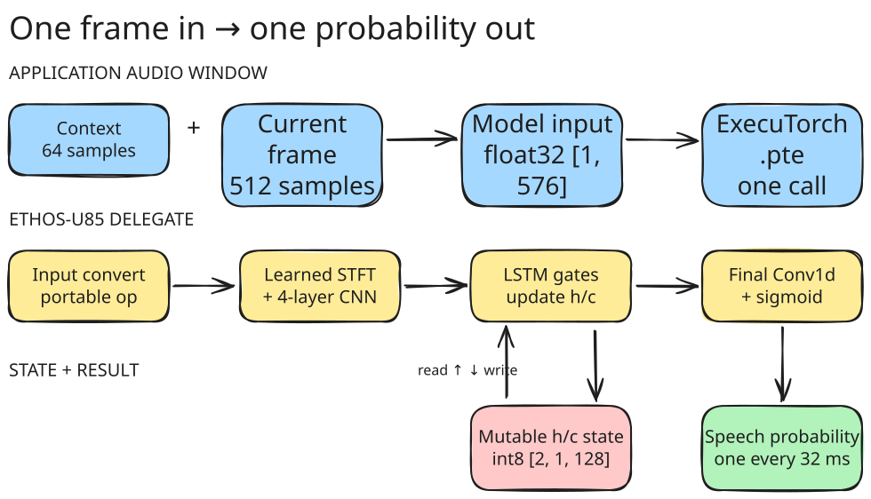

## Prepare to export the model

You prepared the model and validation clip earlier. Now, use the source recording to calibrate Silero VAD and the validation clip to create a host reference.

From the ExecuTorch repository root, activate the environment:

```bash
source .venv/bin/activate
source examples/arm/arm-scratch/setup_path.sh
```

## Export the model

Run the exporter and save its output for the delegation check:

```bash
set -o pipefail

python examples/arm/silero_vad_example_ethos_u/model_export/export_silero_vad_ethos_u.py \
  --jit-model silero-vad/silero_vad.jit \
  --calibration-audio silero-vad/test.wav \
  --validation-audio silero-vad/validation.wav 2>&1 | tee export.log
```

The output is similar to:

```output
Wrote expected probabilities to ./expected_probs.bin
Lowering to Ethos-U85...
Exported model saved to ./silero_vad_ethos_u.pte
```

The default export uses up to 256 calibration frames and all 79 validation frames. It writes the PTE and reference probabilities in the repository root.

Verify the generated outputs and the number of reference probabilities:

```bash
for artifact in \
  silero_vad_ethos_u.pte \
  expected_probs.bin \
  export.log; do
  test -s "$artifact" || {
    echo "Missing export artifact: $artifact" >&2
    exit 1
  }
done

test "$(wc -c < expected_probs.bin)" -eq $((79 * 4)) || {
  echo "Expected 79 float32 reference probabilities" >&2
  exit 1
}

test "$(grep -c 'CPU operators = 0' export.log)" -eq 2 || {
  echo "Expected both Vela subgraphs to contain no CPU operators" >&2
  exit 1
}

echo "Export artifacts and Ethos-U lowering verified."
```

## Understand the streaming model

The application supplies one 512-sample audio frame at a time. The exported program keeps the LSTM hidden and cell state between calls. The program produces one speech probability every 32 ms.



The Vela output contains two subgraphs with no CPU operators: the main VAD network and a smaller state-quantization subgraph. Quantization, layout copies, and recurrent-state writes between delegates run on the CPU.

## What you've accomplished and what's next

You've exported Silero VAD as a stateful ExecuTorch program and saved the host reference output.

Next, you'll build the bare-metal application and run it on the Corstone-320 FVP.
