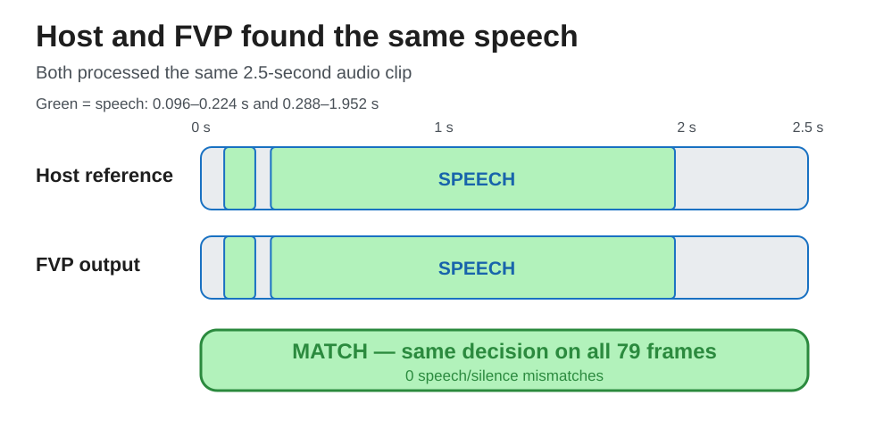

## Inspect the streaming decisions

The application sends one `PROB` line over the simulated UART for every 512-sample frame. It also merges consecutive speech frames into `SEGMENT` lines.

Inspect the first probability records and the detected speech segments:

```bash
grep -Eo 'PROB .*$' \
  fvp.log | head -n 10
grep -Eo 'SEGMENT .*$' \
  fvp.log
```

The output is similar to:

```output
PROB 0.000 0.062716 silence
PROB 0.032 0.105834 silence
...
PROB 0.096 0.936824 speech
...
SEGMENT 0.096 0.224 speech
SEGMENT 0.288 1.952 speech
```

Each `PROB` line contains the frame timestamp in seconds, the probability of speech, and the decision produced with a threshold of `0.5`. Your probability values and speech segments depend on the validation audio.

The validation question is: Did the host and FVP label every frame the same way? In the reference run, both the host and FVP found speech from `0.096` to `0.224` seconds and from `0.288` to `1.952` seconds, with no decision mismatches.



## Compare the host and FVP results

Compare the saved host reference with the probabilities in the FVP serial log:

```bash
source .venv/bin/activate
python examples/arm/silero_vad_example_ethos_u/runtime/compare_vad_probs.py \
  --expected expected_probs.bin \
  --actual-log fvp.log \
  --atol 0.25 \
  --mean-atol 0.02
```

The comparison must report 79 probability values and zero threshold mismatches at `0.500`. The expected final output is:

```output
Validation passed
```

It checks that both outputs contain the same number of finite probabilities, that maximum and mean absolute errors stay within `0.25` and `0.02`, and that every frame has the same speech or silence decision.

The exporter restores the recurrent state after generating the reference, so the host and FVP start from the same state. This checks deployment consistency against the quantized host model. Measuring speech-detection accuracy requires labelled audio.

## What you've accomplished

You've completed an end-to-end streaming audio workflow for Arm Ethos-U. You exported Silero VAD with model-owned recurrent state and built a bare-metal Cortex-M85 application. You ran the application on the Corstone-320 FVP, and validated its speech decisions against a host reference.

You can now replace the example audio with another 16 kHz mono, 16-bit PCM WAV file, or use the runtime integration as a starting point for an Ethos-U85 device.
