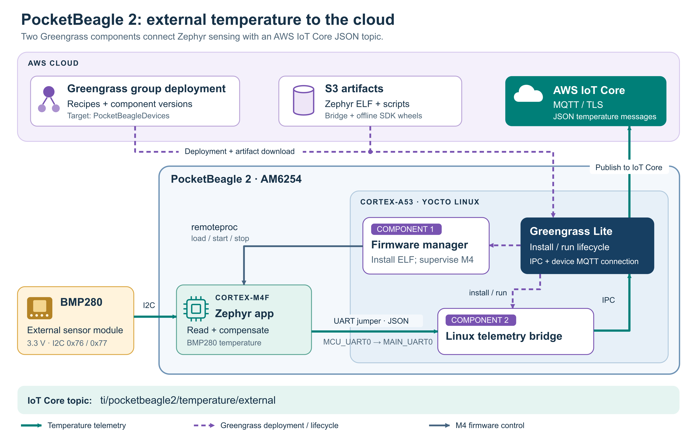

## Extend the first two parts

Use the existing Part 1 Yocto image on the Cortex-A53 and the Part 2 Zephyr toolchain for the AM6254 Cortex-M4F. You will publish two custom components and deploy them to the existing `PocketBeagleDevices` thing group. Linux runs both Greengrass lifecycle supervisors; the first supervisor loads the actual Zephyr ELF onto the M4.

| Component | S3 artifacts | Install lifecycle | Run lifecycle and normal removal |
| --- | --- | --- | --- |
| `com.arm.PocketBeagle2.ZephyrExternalTemperature` | Zephyr ELF and Python firmware manager | Validate and stage firmware | Load and supervise the M4; on termination, stop it through remoteproc, restore its prior firmware filename, and remove the installed copy |
| `com.arm.PocketBeagle2.ExternalTemperatureBridge` | Python bridge, shell lifecycle script, and pinned SDK wheels | Install dependencies offline in component work storage | Read UART frames and publish JSON through Greengrass IPC; on termination, close UART/IPC and remove the installed Python files |

Solid teal arrows show telemetry, dashed purple arrows show Greengrass deployment and lifecycle operations, and slate arrows show M4 firmware control.

The destination topic is exactly `ti/pocketbeagle2/temperature/external`. The bridge adds the thing name and UTC receipt time. It reuses Greengrass's authenticated IoT connection; no device private key is copied into either component.

## Identify the external sensor

This path targets the supplied **Bosch BMP280 module over I2C**, powered at 3.3 V. The firmware accepts one BMP280 at `0x76` or `0x77`, verifies its chip ID, and applies its factory temperature calibration. The pressure channel is disabled for this temperature exercise. The [BMP280 data sheet](https://www.bosch-sensortec.com/media/boschsensortec/downloads/datasheets/bst-bmp280-ds001.pdf) defines the address straps and compensation procedure. Its temperature reading reflects the external module's sensor die and can include PCB heat; it is not a calibrated measurement of free-air temperature.

## Resolve the lifecycle differences

Part 2's heartbeat cannot acknowledge a Linux stop request. This path supplies new firmware that handles the pinned driver's shutdown message and enters WFI before reset. Do not reuse the heartbeat ELF as the temperature artifact.

[Nucleus Lite 2.6.0](https://github.com/aws-greengrass/aws-greengrass-lite/blob/v2.6.0/docs/RECIPE_SUPPORT_CHANGES.md) does not implement a recipe `shutdown` step. These recipes use `install` and foreground `run` processes. Their SIGTERM handling performs cleanup when Lite stops the component's systemd unit. Do not replace the foreground process with `nohup`, a detached daemon, or a separately enabled application service.

Here, **unpublish from the device** means revise every deployment that requests the component so it is no longer selected. Deleting a cloud component version or canceling a deployment does not perform device removal. Installed application files are cleaned during normal stops, removals, and version changes; Greengrass retains ownership of its artifact cache and work-directory infrastructure.

This is a hardware integration example. The firmware, deployment, and cleanup sections describe the board and cloud checks needed to verify the complete path.

## Additional References

| Area | Primary source |
| --- | --- |
| Existing image, provisioning, and M4 baseline | [Part 1](/learning-paths/embedded-and-microcontrollers/ti-pocketbeagle2-yocto-gglite-part1/) and [Part 2](/learning-paths/embedded-and-microcontrollers/ti-pocketbeagle2-yocto-zephyr-part2/) |
| Box contents and header wiring | [PocketBeagle 2 quick start](https://docs.beagleboard.org/boards/pocketbeagle-2/02-quick-start.html) and [expansion tables](https://docs.beagleboard.org/boards/pocketbeagle-2/04-expansion.html) |
| Zephyr M4 target, memory, and mailbox | [v4.3.0 board common DTS](https://github.com/zephyrproject-rtos/zephyr/blob/v4.3.0/boards/beagle/pocketbeagle_2/pocketbeagle_2_m4-common.dtsi), [SoC DTS](https://github.com/zephyrproject-rtos/zephyr/blob/v4.3.0/dts/arm/ti/am62x_m4.dtsi), and [mailbox driver](https://github.com/zephyrproject-rtos/zephyr/blob/v4.3.0/drivers/mbox/mbox_ti_omap.c) |
| GPIO pin groups and open-drain limitation | [v4.3.0 pinctrl groups](https://github.com/zephyrproject-rtos/zephyr/blob/v4.3.0/boards/beagle/pocketbeagle_2/pocketbeagle_2_m4-pinctrl.dtsi) and [DaVinci GPIO driver](https://github.com/zephyrproject-rtos/zephyr/blob/v4.3.0/drivers/gpio/gpio_davinci.c) |
| Linux's enabled UART and aliases | [Pinned PocketBeagle 2 DTS](https://github.com/beagleboard/linux/blob/2eea568f445af33f3280261904bf1027b02512d8/arch/arm64/boot/dts/ti/k3-am62-pocketbeagle2.dts) |
| Shutdown message, acknowledgment, and WFI requirement | [Pinned remoteproc common driver](https://github.com/beagleboard/linux/blob/2eea568f445af33f3280261904bf1027b02512d8/drivers/remoteproc/ti_k3_common.c) and [mailbox constants](https://github.com/beagleboard/linux/blob/2eea568f445af33f3280261904bf1027b02512d8/drivers/remoteproc/omap_remoteproc.h) |
| BMP280 wiring, registers, and temperature compensation | [Bosch BMP280 data sheet, revision 1.26](https://www.bosch-sensortec.com/media/boschsensortec/downloads/datasheets/bst-bmp280-ds001.pdf) |
| Lite lifecycle and removal implementation | [v2.6.0 recipe subset](https://github.com/aws-greengrass/aws-greengrass-lite/blob/v2.6.0/docs/RECIPE_SUPPORT_CHANGES.md), [unit generator](https://github.com/aws-greengrass/aws-greengrass-lite/blob/v2.6.0/modules/recipe2unit/src/unit_file_generator.c), and [stale-component removal](https://github.com/aws-greengrass/aws-greengrass-lite/blob/v2.6.0/modules/ggdeploymentd/src/stale_component.c) |
| Artifact, IPC, and deployment contracts | [Recipe reference](https://docs.aws.amazon.com/greengrass/v2/developerguide/component-recipe-reference.html), [device role / S3 access](https://docs.aws.amazon.com/greengrass/v2/developerguide/device-service-role.html), [MQTT IPC](https://docs.aws.amazon.com/greengrass/v2/developerguide/ipc-iot-core-mqtt.html), and [deployment creation](https://docs.aws.amazon.com/greengrass/v2/developerguide/create-deployments.html) |
| Pinned Python SDK API | [v1.26.0 IPC client](https://github.com/aws/aws-iot-device-sdk-python-v2/blob/v1.26.0/awsiot/greengrasscoreipc/clientv2.py) |

## What you have learned

You have learned how the two Greengrass components connect BMP280 sensing on the Cortex-M4F to AWS IoT Core through a Linux bridge on the Cortex-A53. You also understand why the firmware needs a shutdown handshake and how foreground lifecycle processes handle normal component removal in Nucleus Lite.

