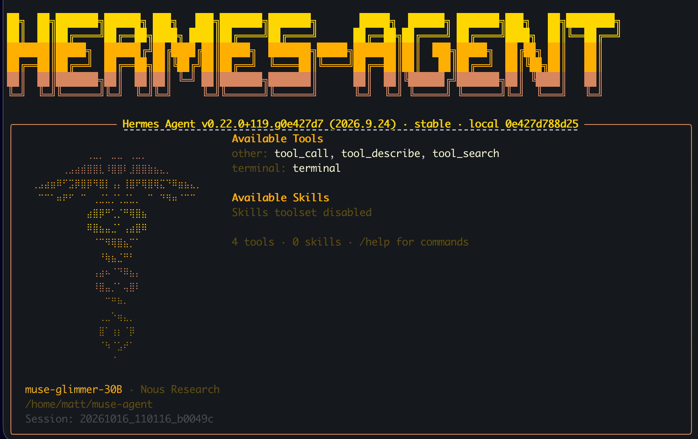

## Install and configure Hermes

Keep the model server running in the first SSH session. Use the second SSH session, where you checked the endpoint, for Hermes.

Use `setup-hermes-cli.sh`, downloaded at the start of the Learning Path, to install Hermes:

```bash
cd ~/muse-agent
bash setup-hermes-cli.sh
~/muse-agent/bin/hermes chat --help
```

Expect `Hermes installed` and the Hermes CLI help output. This confirms that the Hermes CLI launches.

The helper checks Docker access and free disk space, pulls the pinned Arm64 sandbox image by immutable digest, runs the complete official installer at the pinned revision, then configures the local provider and Docker sandbox.

The script writes `~/muse-agent/hermes-home/config.yaml`, defining a custom provider named `spark-local` at `http://127.0.0.1:8000/v1`. It selects `muse-glimmer-30B` as the default model and matches the server's 65,536-token context. The generated `~/muse-agent/bin/hermes` launcher sets `HERMES_HOME` to this configuration directory, so Hermes sends model requests to the local ExecuTorch server using its OpenAI-compatible API.

If setup fails, fix the reported error and rerun `bash setup-hermes-cli.sh`. The helper repeats the upstream installation and image-pull steps. After its first successful configuration, it preserves `hermes-home/config.yaml`.

Verify the model connection and sandbox in the checks that follow.

## Review the tool setup

A sandbox is a restricted environment that limits what a program can access. Here, Hermes runs agent-generated shell commands inside a Docker container with network access disabled and specific host folders mounted. This limits the damage a mistaken command can cause: the agent can edit the exercise files without access to unrelated host files or external services.

| Setup | Effect |
| --- | --- |
| Local provider | Muse Glimmer on `http://127.0.0.1:8000/v1`, with a 65,536-token context |
| Explicit sampling | Temperature 1.0, `top_p` 0.95, `top_k` 64; a null `reasoning_effort` override avoids an unsupported API setting |
| Python CLI | `--cli` selects the terminal interface used in this exercise |
| Docker tool backend | Agent shell commands run inside a container on the Spark |
| No tool-container network | `docker_network: false` prevents outbound access from agent commands |
| Narrow mounts | `/demo/input` is read-only; `/demo/output` is writable |
| No secret forwarding | Host environment credentials are not forwarded to the tool container |

The configuration lives in `~/muse-agent/hermes-home/config.yaml`. Its provider settings configure sampling and tool-call compatibility for the local endpoint.

Enable only the terminal toolset for the exercise. Python can read and write the mounted files through that tool; separate file tools are unnecessary. Do not mount your home directory, SSH keys, or Docker socket. Hermes can request approval for flagged commands, including container commands. Approval prompts do not cover every action; the container and mounts provide the isolation for this task. See [Hermes security guidance](https://hermes-agent.nousresearch.com/docs/guides/secure-hermes-on-a-work-machine).

## Check the connection and sandbox

Start Hermes:

```bash
~/muse-agent/bin/hermes chat --cli --toolsets terminal
```



The following prompt tests the sandbox's network isolation. `1.1.1.1` is Cloudflare's public DNS service address, and port `443` is normally used for HTTPS. Here, it is simply an external TCP destination; the agent is not performing a DNS lookup. The connection should fail because the container has no network access.

Enter:

```text
Use the terminal tool to run pwd and print platform.machine() using Python.
Then try opening a socket to 1.1.1.1:443 with a two-second timeout.
Report the actual tool results. Do not change any settings.
```

The trace should show terminal execution, an Arm architecture (`aarch64`), and a failed external connection. Hermes itself runs on the host and can still reach the model on localhost. Confirm the Docker settings next; a failed connection alone does not prove isolation.

Open another SSH session from your laptop to inspect the container while Hermes remains open. Verify its settings directly:

```bash
docker ps --format 'table {{.ID}}\t{{.Image}}\t{{.Names}}'
```

Find the row whose name starts with `hermes-`. This container appears after Hermes first uses the terminal tool. Copy its ID from the first column and replace `CONTAINER_ID` in the following command:

```bash
docker inspect CONTAINER_ID --format '{{.HostConfig.NetworkMode}} {{json .Mounts}}'
```

Expect network mode `none`. Confirm the input mount is read-only and the output mount is writable, with no unrelated host directories or sockets. Hermes may create its own workspace mounts. If the settings differ, stop before continuing.

The connection test shows that the agent can run commands but cannot reach the external address. Docker inspection confirms that networking is disabled and file access is limited to the exercise and dedicated Hermes folders, with test inputs read-only and outputs writable. Together, these checks verify the sandbox's behaviour and configuration.

## What you've accomplished

Hermes, running on the Arm CPU, can call the local Muse Glimmer 30B ExecuTorch model, running on the NVIDIA Blackwell GPU, and execute commands inside the restricted container. Next, you will give it a broken release checker to diagnose and repair.
