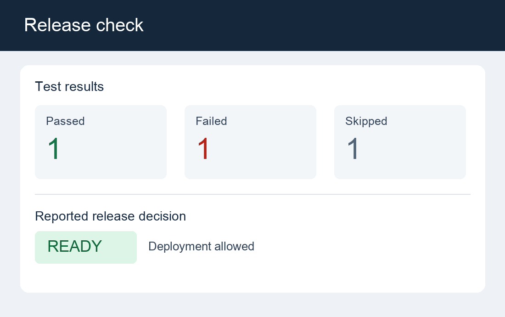

## Prepare a broken release checker

After setting up Hermes, you can prepare a broken release checker and use Hermes and Muse Glimmer to fix it. 

A release checker reads test results and decides whether deployment can proceed. You'll use a broken release checker that can approve a release despite failed tests and return the wrong exit status. The example image is a release-summary dashboard showing an incorrect deployment decision. Ask Hermes to read the image and identify the problem, inspect the code, and repair it so that the tests pass.



Use `release_tool.py` and `test_release_tool.py` that you downloaded earlier. Copy the files into the workspace:

```bash
cd ~/muse-agent
cp test_release_tool.py demo/input/
cp release_tool.py demo/input/release_tool.original.py
cp release_tool.py demo/output/
```

The acceptance tests and original code are visible through the read-only input mount. The agent can edit the working copy and write notes, but it can't change the acceptance tests.

Reproduce the initial failure from your SSH terminal:

```bash
cd ~/muse-agent/demo/output
PYTHONPATH="$PWD" python3 -m unittest discover \
  -s ~/muse-agent/demo/input -p test_release_tool.py -v
```

Expect four failed tests. They cover all-passed, mixed pass and fail, skipped-only, and empty test runs. Their assertions also check the exit status that a deployment pipeline would use.

## Ask Hermes to read the image and repair the checker

Exit the earlier Hermes session with `/quit`. 

Start a new session with the downloaded release-summary image:

```bash
cd ~/muse-agent
~/muse-agent/bin/hermes chat --cli --toolsets terminal \
  --image "$HOME/muse-agent/release-summary.png" \
  -q "Read the image. Report the passed, failed, and skipped counts, the displayed release decision, and whether deployment should proceed. Do not run tools or change files yet."
```

Hermes should report that it's attaching the image natively. This confirms that the image is sent directly to the local model. Expect one passed, one failed, and one skipped test. The image displays `READY`, but the failed test should block deployment. `--image` attaches the file from the DGX Spark.

Keep the Hermes session open and enter the following prompt:

```text
Use the image you just read as context. Use only the terminal tool.
Diagnose and fix /demo/output/release_tool.py.
Run the acceptance tests first:
PYTHONPATH=/demo/output python3 -m unittest discover -s /demo/input -p test_release_tool.py -v
Read the checker and /demo/input/test_release_tool.py together in one call.
Inspect the failures before editing, then make the smallest repair using
standard shell utilities. Do not modify anything under /demo/input.
Run the same tests again. Write a short /demo/output/fix-notes.md in one
command, describing the root cause, changes, and actual test result.
Read back the repaired code and notes, then give a concise final answer.
Group related commands; do not write notes one line per call.
Do not install packages or use the network.
```

Watch the trace for the failed test run, code inspection, edits, and successful rerun. Muse Glimmer selects actions on the GPU, while Hermes and the tools run them on the Arm-based CPU. 

The exact commands and explanation can vary. If Hermes requests approval, inspect the command and its target paths before responding. For this Learning Path, writes should stay under `/demo/output`. Don't approve changes to host or sandbox configuration.

## Verify the repair 

From the SSH session that you used to inspect the Docker container, run the same acceptance tests independently:

```bash
cd ~/muse-agent/demo/output
PYTHONPATH="$PWD" python3 -m unittest discover \
  -s ~/muse-agent/demo/input -p test_release_tool.py -v
cat ~/muse-agent/demo/output/fix-notes.md
diff -u ~/muse-agent/demo/input/release_tool.original.py \
  ~/muse-agent/demo/output/release_tool.py
```

Expect all four tests to pass and `OK`. The diff should show the readiness check and exit-status fixes. `diff` returns exit code `1` when files differ. This is expected. Check that the notes match the code and test output.

## Troubleshoot if the task doesn't finish

The setup helper saves the Hermes configuration in `~/muse-agent/hermes-home/config.yaml`. It calls the local model connection `spark-local`. That entry points to the Muse Glimmer server on Spark.

| Symptom | What to check |
| --- | --- |
| Hermes can't reach Muse Glimmer | Keep the server running in its SSH session. On the Spark, run `curl --fail http://127.0.0.1:8000/health` and check the server terminal for errors. |
| Hermes rejects the context length | Match the export `--max-seq-len 65536`, the server `--max-context 65536`, and `context_length: 65536` in the Hermes configuration. |
| Hermes replies but doesn't run tools | Launch Hermes with `--cli --toolsets terminal`. Check that the server uses `--tool-parser atem`. Ensure that the `spark-local` configuration retains the sampling settings of the helper and null `reasoning_effort` override. |
| Hermes can't process the image | Use the vision export and its `--pos-embed-path`. Check `agent.image_input_mode: native` in the Hermes configuration and the image path on the Spark. |
| The agent can't find the code or tests | Check that the preparation commands copied the files into `~/muse-agent/demo/input` and `demo/output`. Inspect the container mounts and ensure that they appear as `/demo/input` and `/demo/output`. |
| Hermes asks for command approval | Read the command before approving it. Allow edits only under `/demo/output`, and reject changes to host or sandbox settings. |
| Tests still fail after the repair | Give Hermes the failing test output and ask it to revise the working copy. Keep `/demo/input` read-only and rerun the independent host tests. |

## Stop and resume Hermes

Exit Hermes with `/quit`. Stop the model server with **Ctrl+C** in its SSH session. Inspect `docker ps` and stop only the tool container if it remains running. Keep the reusable model export.

To resume, reconnect to Spark, activate the environment, and start the model server:

```bash
cd ~/muse-agent/executorch
export PATH=/usr/local/cuda/bin:$PATH
source ../executorch-venv/bin/activate
python -m executorch.examples.models.muse_glimmer.serving.serve \
  --model-path exports/spark-native-vision-64k/model.pte \
  --data-path exports/spark-native-vision-64k/aoti_cuda_blob.ptd \
  --pos-embed-path exports/spark-native-vision-64k/pos_embed.bin \
  --tokenizer-path exports/tokenizer.json \
  --hf-tokenizer exports \
  --worker-bin cmake-out/examples/models/muse-glimmer/muse_glimmer_worker \
  --model-id muse-glimmer-30B \
  --tool-parser atem \
  --max-context 65536 --host 127.0.0.1 --port 8000
```

Keep the server running. 

In a second SSH session, start the agent:

```bash
cd ~/muse-agent
~/muse-agent/bin/hermes chat --cli --toolsets terminal
```

No repeat export or installation is needed.

## What you've accomplished

You've verified that the agent interpreted the image and reproduced the failure. The agent repaired the checker. The repaired checker passed the read-only tests.

Next, you'll explore ways to extend the agent with Muse Glimmer features and additional Hermes tools.
