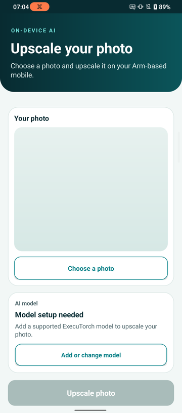

## Connect an Android phone

Enable **Developer options** and **USB debugging** on the phone. Connect the phone to your development computer with USB, unlock it, and accept the debugging authorization prompt.

Verify that your phone is listed in `adb`:

```console
adb devices -l
```

The output lists the authorized phone and its device serial. If the phone reports `unauthorized`, unlock it and accept the debugging prompt. If the phone doesn't appear, see [Run apps on a hardware device](https://developer.android.com/studio/run/device).

Confirm that the phone uses the Arm64 ABI and runs Android 9 (API 28) or later:

```console
adb shell getprop ro.product.cpu.abi
adb shell getprop ro.build.version.sdk
```

The first command should print `arm64-v8a`. The second command should print a version `28` or later.

## Clone the application repository

Clone the repository with Git, then enter the project directory:

```console
git clone https://github.com/arm-education/ai-portal-android-app-photo-upscaling.git
cd ai-portal-android-app-photo-upscaling
```

Run the remaining terminal commands from this project directory.

## Prepare the Arm AI Portal model downloader

The sample repository includes a downloader for its supported Arm AI Portal model packages. The packages are published by Arm and hosted in Arm's Hugging Face repositories.

Create a Python virtual environment and install the package used by the downloader:


  
python3 -m venv .hf-venv
.hf-venv/bin/python -m pip install --upgrade pip huggingface_hub
  
  
python -m venv .hf-venv
.\.hf-venv\Scripts\python.exe -m pip install --upgrade pip huggingface_hub
  


The later commands invoke the environment's Python executable directly, so the PowerShell script-execution policy doesn't need to be changed.

If Python reports that `venv` is unavailable on Debian or Ubuntu, install the `python3-venv` package and rerun the command.

## Build and run the Photo Upscale application

Use the Gradle wrapper to build and lint the debug Android package (APK):


  
chmod +x gradlew
./gradlew :app:assembleDebug :app:lintDebug
  
  
.\gradlew.bat :app:assembleDebug :app:lintDebug
  


You don't need to install Gradle separately because the repository includes the wrapper.

Install the APK and start Photo Upscale:

```console
adb install -r app/build/outputs/apk/debug/app-debug.apk
adb shell am start -n org.arm.learningpath.upscaling/.MainActivity
```

Photo Upscale uses one ExecuTorch adapter for all supported models. Use **Add or change model** to load a model. **Upscale photo** remains unavailable until you import a supported model and choose a saved photo. **Inspect detail** and **Save image** appear after upscaling. Installing with `adb install -r` preserves models imported previously. On a first installation, the app reports **Model setup needed**.



## What you've accomplished and what's next

You've connected an Arm-based Android phone, prepared the model downloader, and confirmed that Photo Upscale builds and starts.

Next, you'll download an optimized upscaling model from the Arm AI Portal and upscale a saved photo.
