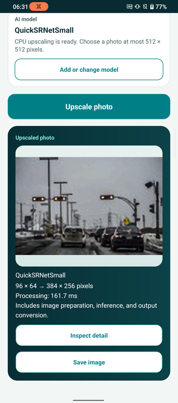

## Run QuickSRNetSmall with ExecuTorch

After building and running Photo Upscaler, import upscaling models from Arm AI Portal.

Start with QuickSRNetSmall, using the ExecuTorch runtime. You can use another supported model after completing the workflow. Run the commands from the project directory in the same terminal session that you used during setup.

{}
Arm AI Portal models are hosted on Hugging Face. The `download_model.py` script uses `huggingface_hub` and connects to `https://huggingface.co` by default.
{}

Set `MODEL_ID` to the repository ID for the default QuickSRNetSmall model:


  
export MODEL_ID="Arm/qai-quicksrnetsmall-int8-xnnpack-executorch-vivo-x300"
  
  
$MODEL_ID = "Arm/qai-quicksrnetsmall-int8-xnnpack-executorch-vivo-x300"
  


Download the model:


  
export MODEL_FILE="$(.hf-venv/bin/python download_model.py \
  --repo-id "$MODEL_ID" \
  --print-path)"

printf 'Model file: %s\n' "$MODEL_FILE"
  
  
$MODEL_FILE = .\.hf-venv\Scripts\python.exe download_model.py `
  --repo-id "$MODEL_ID" `
  --print-path

Write-Output "Model file: $MODEL_FILE"
  


The downloader retrieves the pinned `model.pte`, verifies its SHA-256 checksum, and copies it to `quicksr.pte`. The upstream QuickSRNetSmall and SESR-M5 programs are both named `model.pte`, so the downloader gives them distinct filenames.

Copy the model to the phone **Downloads** directory:

```console
adb push "$MODEL_FILE" /sdcard/Download/
```

## Copy the sample image to Android

The application repository includes `samples/photo.jpg`, a 96 × 64 copy of the sample street photo of the RealESR-general-x4v3 package. It contains traffic signals, vehicle edges, poles, and road texture to inspect. The source is [Rue Bouvier, Quebec City (17)](https://commons.wikimedia.org/wiki/File:Rue_Bouvier,_Quebec_City_(17).jpg) by Wilfredor, licensed under [CC0 1.0](https://creativecommons.org/publicdomain/zero/1.0/). Attribution and the pinned source are recorded in `samples/README.md`.

Copy the image to the phone:

```console
adb push samples/photo.jpg /sdcard/Download/
```

To use a different JPEG or PNG image, replace `samples/photo.jpg` in the `adb push` command with its path. You can also skip the copy command and select an image already stored on the phone or emulator. Use a photo with dimensions at most 512 × 512 pixels.

## Run photo upscaling

In Photo Upscale:

1. Select **Add or change model** and choose `quicksr.pte` from **Downloads**. Keep the application open until it reports **QuickSRNetSmall ready · ExecuTorch CPU**.
2. Select **Choose a photo** and choose `photo.jpg` from **Downloads**.
3. Select **Upscale photo**.

The importer identifies the supported model by its checksum and copies it to application-specific storage. You can delete the `.pte` from **Downloads** after import. The imported file remains until you uninstall the application or clear its storage.

The application reports tile progress. It then displays the original and upscaled image, input and output dimensions, model name, and processing time. The sample produces **96 × 64 → 384 × 256**. This 4× upscaling gives sixteen times as many pixels. 

**Processing time** covers RGB preparation, inference of every tile, blending, and conversion to the output bitmap. It excludes model import, loading and the validation warm-up, photo decoding, screen rendering, and saving. It's a full-image measurement.



## Inspect detail and save the image

To inspect image detail and save the image:

1. Select **Inspect detail**.
2. Pinch to zoom and drag to pan, then use **Showing upscaled · switch to original** to compare the same region at the same displayed size. 
3. Use **Reset zoom** returns to the fitted view. 

  Look at traffic signals, vehicle edges, and textures. With photos larger than 128 pixels in either dimension, also check for visible joins between tiles. More pixels don't guarantee more accurate detail because the model can smooth or invent texture.

4. Select **Close detail**, then **Save image**. Android opens the document picker with a suggested `.png` filename. 
5. Choose a location such as **Downloads**, change the filename if needed, and select **Save**.

Open the saved PNG in an image viewer. Verify the following details:

- Image dimensions are **384 × 256**
- Image orientation and colors match the source
- Image detail matches the displayed output

Choose a second, visibly different photo and run again to confirm that the output follows the input.

## Use another supported model

Photo Upscale also supports the following Arm AI Portal model packages:

| Model | Runtime | Repository ID | Import this file | Processing profile |
| --- | --- | --- | --- | --- |
| [QuickSRNetSmall INT8](https://developer.arm.com/ai/models/hugging-face/Arm/qai-quicksrnetsmall-int8-xnnpack-executorch-vivo-x300/quicksrnetsmall-int8-pte) (default) | ExecuTorch CPU or XNNPACK | `Arm/qai-quicksrnetsmall-int8-xnnpack-executorch-vivo-x300` | `quicksr.pte` | RGB `[0,1]`, 128 × 128 → 512 × 512, 4×, 8-pixel overlap |
| [SESR-M5 INT8](https://developer.arm.com/ai/models/hugging-face/Arm/sesr-m5-int8-xnnpack-executorch-vivo-x300/sesr-m5-int8-pte) | ExecuTorch CPU or XNNPACK | `Arm/sesr-m5-int8-xnnpack-executorch-vivo-x300` | `sesr.pte` | RGB `[0,1]`, 128 × 128 → 512 × 512, 4×; app chooses 8-pixel overlap |
| [RealESR-general-x4v3 INT8](https://developer.arm.com/ai/models/hugging-face/Arm/realesr-general-x4v3-int8-xnnpack-executorch-vivo-x300/realesr-general-x4v3-int8-pte) | ExecuTorch CPU or XNNPACK | `Arm/realesr-general-x4v3-int8-xnnpack-executorch-vivo-x300` | `realesr.pte` | RGB `[0,1]`, 128 × 128 → 512 × 512, 4×, 8-pixel overlap |

To use one of these models, set `MODEL_ID` to a repository ID from the table. After updating the ID, repeat the download and import workflow. Select **Add or change model** and import its file. The single ExecuTorch adapter detects the matching profile automatically. The selected photo stays in place, and the previous result is cleared. Select **Upscale photo** again, compare the same details, and save under a different filename.

Each model needs only its `.pte` file. INT8 describes quantized operations inside the model. All three models accept and return float32 RGB tensors.

## What you've accomplished and what's next

You've imported QuickSRNetSmall, upscaled a saved photo locally on Android, inspected its detail, and saved a PNG. You can use the same workflow with SESR-M5 and RealESR-general-x4v3.

Next, you'll understand how Photo Upscale works.
