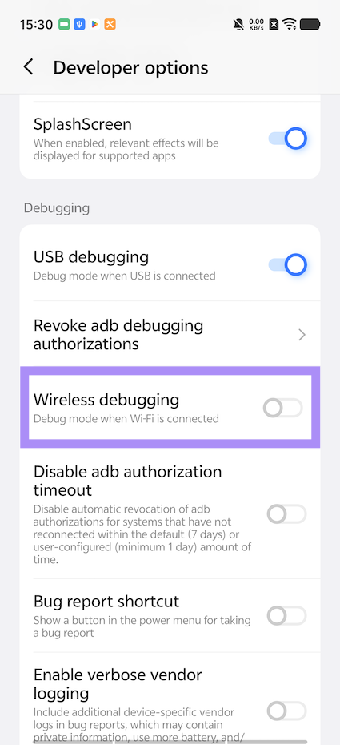
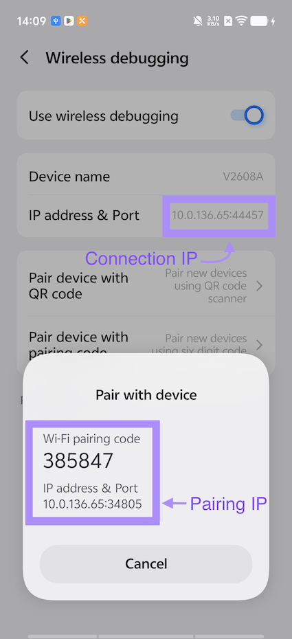

# Enable wireless debugging
Android Debug Bridge (adb) lets you communicate with an Android device over USB or Wi-Fi. You’ll use it to deploy applications and collect telemetry from the device. An advantage of wireless connection is that it avoids USB charging, which can distort power measurements during performance monitoring.

Before connecting your Android device, disable mDNS auto-connect on the host to prevent adb from creating duplicate wireless connections:
```bash
export ADB_MDNS_AUTO_CONNECT=0
adb kill-server
adb start-server
```

On the target device, navigate to **Developer options** and enable **Wireless debugging**.



{}
Use the search bar in the Settings application to find the **Developer options** page.
If **Developer options** isn’t available, enable _developer mode_.
{}

After you enable wireless debugging, the device will request to connect to a Wi-Fi network if it isn't already. Connect the device to the same Wi-Fi network as your host machine.

When the Wi-Fi connection is established, you'll be able to pair your host machine. Select **Pair device with pairing code**. Note the pairing IP address, pairing port, and pairing code shown on the device, then run:



``` bash { output_lines = "2-3" }
adb pair PAIRING_IP_ADDRESS:PAIRING_PORT
Enter pairing code: PAIRING_CODE
Successfully paired to PAIRING_IP_ADDRESS:PAIRING_PORT [guid=<device GUID>]
```
{}
VPNs can cause connection issues with wireless pairing. Ensure that both devices have direct peer-to-peer network access.
{}

# Connect to the target device
Connect to the target device using the connection IP address:
```bash { output_lines = "2" }
adb connect DEVICE_IP_ADDRESS:CONNECTION_PORT
connected to DEVICE_IP_ADDRESS:CONNECTION_PORT
```
Successful connection is indicated by the device IP followed by an expected `device` state. Verify the connection:
```bash { output_lines = "2-3" }
adb devices
List of devices attached
DEVICE_IP_ADDRESS:CONNECTION_PORT    device
```

# What you've accomplished
At this stage, you have established and verified a wireless connection to an Android device using Android Debug Bridge. Next, you will install a modified reference application as well as a LiteRT-LM model over this wireless connection.