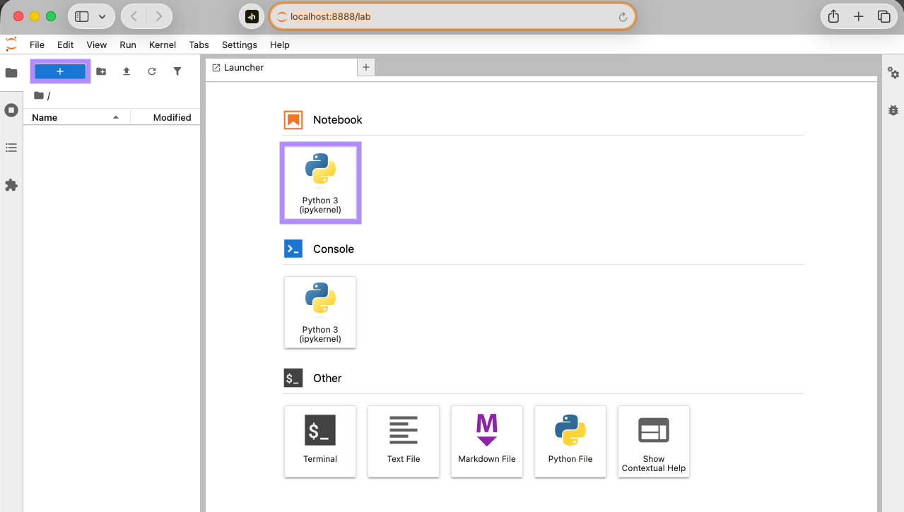

# Download a monitoring script
Download the monitoring script that the Jupyter Notebook will call to collect device data for a specified duration over wireless `adb`. Review the comments in the script to understand each section.

Download the script:
```bash
cd $WORK
curl -fL -O "$BASE_URL/run-device-monitor.sh"
```

# Download the monitoring configuration and queries
Without explicit instructions, the Perfetto tracing daemon doesn't know what to capture, where to store it, or how to manage memory.

Download the following `.cfg` file to configure your Perfetto trace:
```bash
cd  $WORK
curl -fL -O "$BASE_URL/device-monitor-perfetto.cfg"
```

After monitoring is complete, the Bash script will create a `.pftrace` file on the device and automatically extract it into `$WORK/data/`. You can use SQL queries to extract memory and power measurements from the Perfetto trace.

Download these queries into `$WORK/sql/`:
```bash
mkdir -p $WORK/sql
cd  $WORK/sql
curl -fL -O "$BASE_URL/monitor-memory.sql"
curl -fL -O "$BASE_URL/power-battery.sql"
```

# Start up JupyterLab
From your working directory, start up a local JupyterLab server and create a new notebook file:
```bash
cd  $WORK
jupyter lab
```
Create a new notebook and rename it to something appropriate.


# Initiate device monitoring
In your notebook, create a section titled 'Runtime Monitoring' and add the following code:
```python
from pathlib import Path
from datetime import datetime
import os
import shlex
import subprocess

ROOT = Path.cwd().resolve()
DATA_DIR = ROOT / "data"
MONITOR_SCRIPT = ROOT / "run-device-monitor.sh"
DURATION_SECONDS = 60

# Update if multiple devices are connected to the host machine
MULTIPLE_DEVICES = False
DEVICE_SERIAL = "" # You can find this using `adb devices`

run_output = DATA_DIR / (
    f"runtime-perf-{datetime.now():%Y%m%d-%H%M%S}"
)
command = ["sh", str(MONITOR_SCRIPT)]
if MULTIPLE_DEVICES:
    command.extend(["--serial", DEVICE_SERIAL])
command.extend([str(DURATION_SECONDS), str(run_output)])
environment = os.environ.copy()

print(shlex.join(command))
print(f"Results: {run_output}")
subprocess.run(command, cwd=ROOT, env=environment, check=True)
```
This cell monitors the target device for the specified number of seconds. The monitoring script collects the following data:
- LLM inference measurements (Prefill, Decode, Time to first token (TTFT))
- Power measurements
- Memory measurements
- Temperature measurements

Set `DURATION_SECONDS=10`, then run the monitoring cell to perform a short smoke test. After ten seconds, a timestamped results directory should appear in `$WORK/data`.

The directory should contain:
- Perfetto trace and logs
- CSV files containing inference, memory, power, and temperature data
- Text files containing job information, including a summary

If any files are missing, review the output below the monitoring cell for errors and confirm that you completed the previous steps correctly.

{}
You will not see any data in the LLM performance CSV file as you have not performed any inference as part of this smoke test.
{}

# What you've accomplished
You have now prepared and tested the necessary monitoring assets for your performance analysis pipeline. Continue to the next section, where you will initiate a full monitoring run and collect some data from your device.
