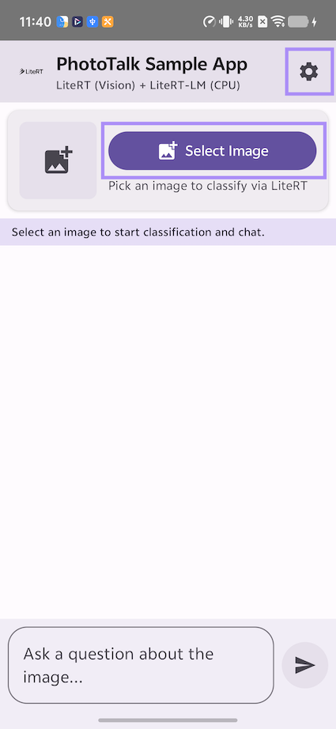
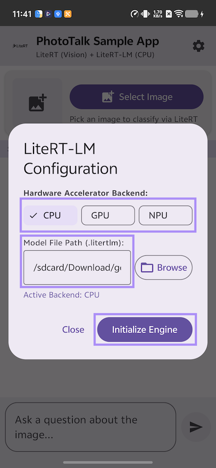

## Configure model backend
Now that you have all of the monitoring assets in place, you are ready to capture some real performance data.

On your target device, open PhotoTalk and tap the **Select Image** button. This is where you will come to upload an image to the chat during the benchmark. Confirm that you have at least one non-sensitive image available to upload.



You can access the settings menu by tapping the cog icon in the UI. Open the settings and verify that the application has detected the model you pushed. You should see the following path under **Model File Path (.litertlm)**: `/sdcard/Download/gemma-4-E2B-it.litertlm`.

{}
The application will display a warning if it cannot find a model at the specified model path. If the warning appears, double check that you have pushed the model and that it is labelled correctly.
{}

In this menu you can also select from the following hardware backends:
- CPU
- GPU
- NPU

Select CPU, or try GPU if your device supports it. NPU requires compatible hardware, a specialised model, and additional build setup, so don’t select it for this Learning Path. Tap **Initialize Engine**.



## Capture performance data
Update the duration inside your 'Runtime Monitoring' notebook section to five minutes as shown here:
```python
DURATION_SECONDS = 300
```

Run the cell and carry out the following benchmark manually for the five-minute duration:
1. Open the application on your target device.
2. Upload a picture to the chat.
3. Ask the model a question about the image.
4. Repeat step 3 or upload a new picture to the chat and continue asking questions.

{}
This Learning Path uses a manual benchmark. For longer tests, automate application use with a script or by modifying the application source code.
{}

After five minutes, the script saves the extracted data in `$WORK/data/`.

## What you've accomplished and what's next
You have captured performance data from a five-minute manual benchmark. The data describes how the hardware of your target device was performing during the benchmark. Next, you will visualise the data to interpret the results.