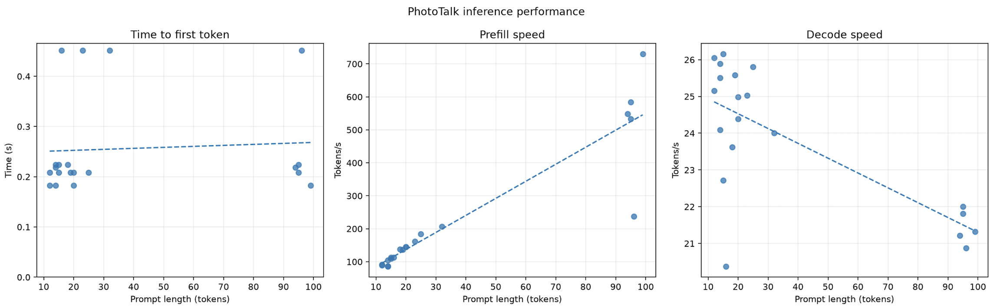
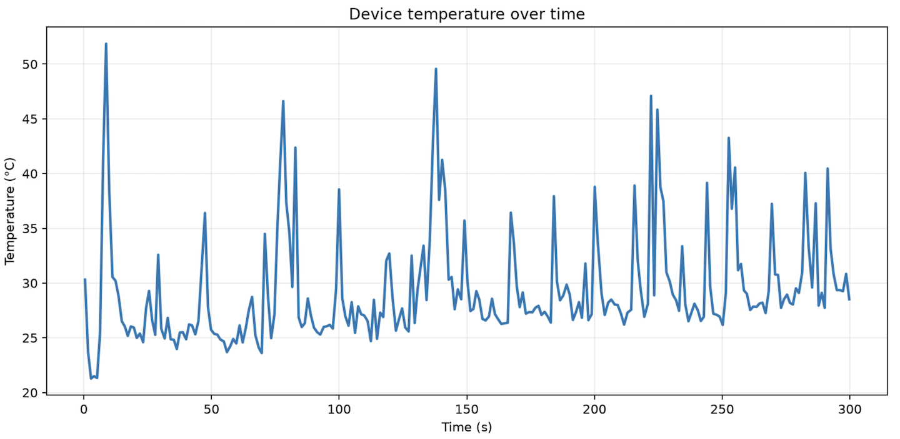
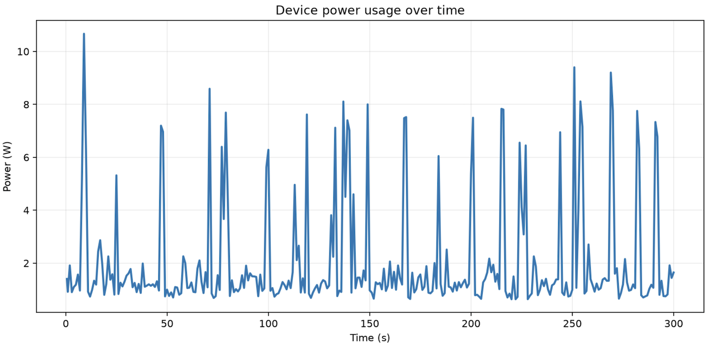
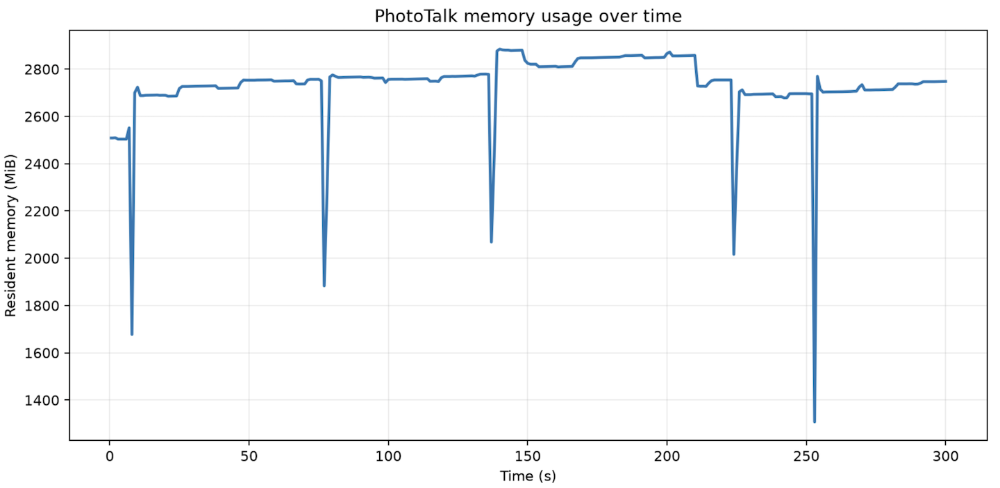

## Interpret the results
The final step of performance analysis is to interpret the results of your benchmark. This guide uses its own reference data but you can use this as an example when reviewing your own results.

The following reference data was collected from a five-minute runtime benchmark of the PhotoTalk application which included five separate conversations with varied question lengths to give a better idea of LLM performance with respect to prompt length.

### LLM performance

The figure shows three different plots relating to time to first token, prefill and decode speed respectively. The line of best fit gives a rough estimate of the trend of each measure in relation to prompt length.

For PhotoTalk, time to first token (TTFT) is typically 0.25 seconds and you can see a slight upward trend as the prompt increases in length.

When a new conversation is created in the application by uploading another image, the first inference must prefill the system instruction plus initial prompt. As a result, there is a vertical cluster of five points ~95 tokens in length which corresponds to the five images used during the benchmark.

Subsequent chat messages reuse the conversation’s key-value (KV) cache, so only the user message (roughly 11–15 tokens) is prefetched. You can see this clustering across all three graphs in the figure.

Prefill speed increases with prompt length in this run, but does the same trend appear across repeated runs with similar prompts? Prefill can be compute-intensive because it uses parallel matrix multiplications, while memory bandwidth can also affect performance. For deeper analysis, consider also measuring CPU core scheduling and memory bandwidth utilisation.

Decode speed varies across the measurements. This variation could reflect changes in workload or device conditions, including thermal throttling. To further investigate you could compare the timing of the measurements with temperature and power data.

### Compare temperature and power
The temperature and power plots let you investigate whether device conditions coincide with changes in LLM performance. Do higher temperature or power spikes align with lower decode speeds at the same time? The CSV logs you collected in `$WORK/data/` contain timestamps to help you correlate hardware events and verify this. Repeat the benchmark to check whether any relationship appears consistently before attributing the variation to throttling.

### Inspect memory usage
The resident set size stays fairly constant during this run, except for five sharp troughs that coincide with temperature and power spikes.

Do these troughs align with the timestamps at which new conversations started? In `llm-perf.csv` you can align the `elapsedSeconds` field of each inference with the time axis of the plot. The number of troughs alone does not establish a relationship. Record the conversation start times and repeat the benchmark to check whether the pattern occurs consistently.

You should draw your own conclusions about the data you have collected as it might look slightly different depending on the device and backend you have chosen.

## What you've accomplished and what's next
You now have the skills to interpret the data from your runtime performance analysis. At this point you have a full performance analysis pipeline from data gathering to result interpretation. Going forward you might choose to make this process more detailed and efficient by adding in new measurements or automating application usage.
