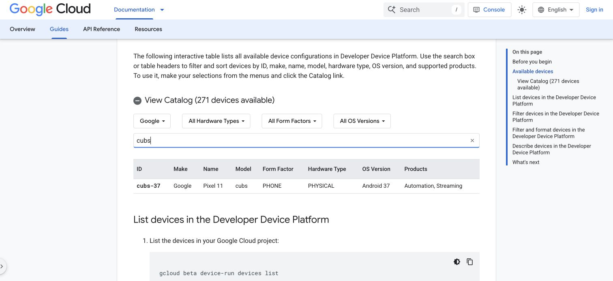

## Verify the account, project, and ADC

In the workspace terminal from setup, check the active account, project, and Application Default Credentials (ADC):

```bash
gcloud auth list --filter=status:ACTIVE --format='value(account)'
gcloud config get-value project
gcloud auth application-default print-access-token >/dev/null
```

Check that the first two commands show your intended account and project. The final command should exit successfully; its output is deliberately discarded so an access token doesn't appear in your terminal or screenshots. This checks that ADC can obtain a token, rather than just that a credential file exists.

CLI authentication, ADC authentication, and project permissions are separate checks. Successful sign-in doesn't grant new roles.

## Verify the enabled services

List the APIs enabled in your project:

```bash
gcloud services list --enabled --project="$PROJECT_ID" \
  --format='value(config.name)'
```

The output must include `devicerun.googleapis.com`, `devicestreaming.googleapis.com`, and `testing.googleapis.com`. Other enabled APIs can also appear.

## Find the Pixel 11 configuration

Query the device catalog and filter the results to Pixel 11. Select a few fields to keep the output readable:

```bash
gcloud beta device-run devices list \
  --project="$PROJECT_ID" \
  --filter='displayName~"^Pixel 11$"' \
  --format='table(name.segment(-1):label=ID,displayName:label=NAME,modelCode:label=MODEL,hardwareType:label=HARDWARE_TYPE,products():label=PRODUCTS)'
```

The output is similar to:

```output
ID       NAME      MODEL  HARDWARE_TYPE  PRODUCTS
cubs-37  Pixel 11  cubs   PHYSICAL       Automation, Streaming
```

This example identifies a physical Pixel 11 with model code `cubs` and streaming support. On the next page, the agent looks up the current configuration for you, so you don't need to copy catalog IDs or Android API levels into your prompt. Catalog results can change; if no row appears, remove `--filter` to inspect other configurations and review an alternative with your agent.

Use the [interactive device catalog](https://docs.cloud.google.com/developer-device-platform/device-catalog) to inspect the same information visually. The example below shows **Pixel 11**, model `cubs`, API level `37`, with physical hardware and streaming support:



Inspect that entry from the CLI if it's currently available:

```bash
gcloud beta device-run devices describe cubs-37 \
  --project="$PROJECT_ID" --format=json > results/device-catalog.json
python3 -m json.tool results/device-catalog.json
```

The catalog ID is `cubs-37`; the session request uses model code `cubs` and API level `37` separately. The CLI description can omit the OS version, so retain the catalog's OS value too. Check that the entry includes `arm64-v8a` and `DEVICE_STREAMING`. Availability and supported configurations can change.

The catalog helps you select a device and OS configuration. After connecting, the agent also checks the Arm features available to applications, including SVE2, before choosing the model's optimized kernel path. Keep the catalog selection, runtime feature check, and kernel execution check as separate observations in the report.

## What you've accomplished and what's next

You've checked authentication, project configuration, service activation, and catalog access, and identified the Pixel 11 configuration. Next, you'll give these working tools to the agent and have it connect to the chosen phone.
