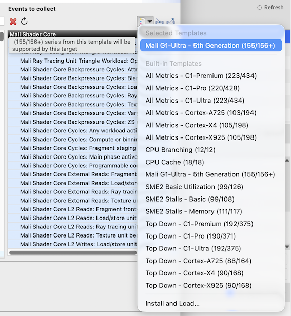
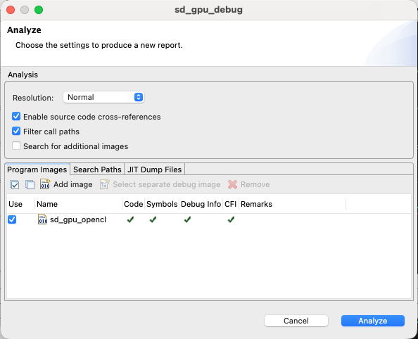
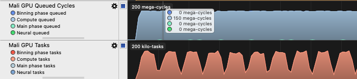
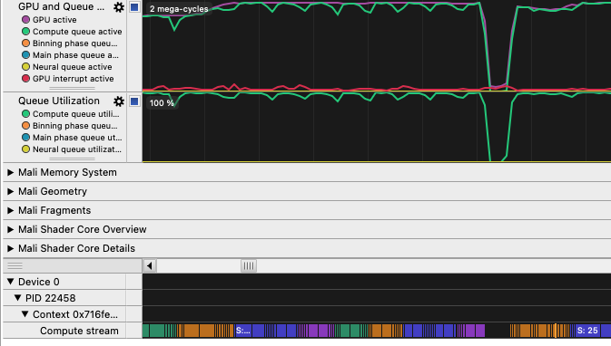
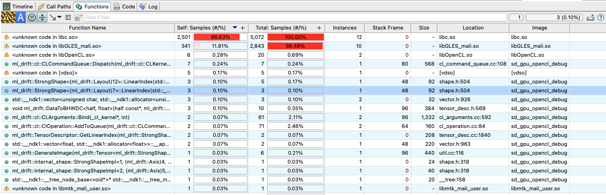

ML Drift’s unified shaders let you reuse computation across supported GPU backends, while performance still depends on the GPU architecture, driver, and workload. In this section, use Arm Streamline to see how the OpenCL sample uses Mali GPU resources.

## Build with debug symbols

Build the Android arm64 sample with release optimizations and debug symbols. This preserves runtime performance while providing function names and source mappings for Streamline analysis.

```bash
bazel build -c opt --config=android_arm64 \
  --copt=-g \
  --strip=never \
  //ml_drift/samples/stable_diffusion:sd_gpu_opencl
```

Copy the debug executable to your Android device then make it runnable:

```bash
adb push bazel-bin/ml_drift/samples/stable_diffusion/sd_gpu_opencl \
  /data/local/tmp/sd_gpu_opencl

adb shell chmod +x /data/local/tmp/sd_gpu_opencl
```

## Deploy the profiling agent

Set `STREAMLINE` to your Streamline installation directory. This example uses macOS; on x86 Linux, replace the path with your installation directory:

```bash
export STREAMLINE="/Applications/Arm Performance Studio 2026.5/streamline"
```

Copy the Android arm64 profiling agent, `gatord`, to your device and make it runnable:

```bash
adb push "$STREAMLINE/bin/android/arm64/gatord" /data/local/tmp/
adb shell chmod +x /data/local/tmp/gatord
```

From the streamline GUI under the Configure Capture in the start menu, click `select counters` and use the pre-made template for specific Mali GPU as per the image below. Export the configuration for your specific Mali GPU with the export button.



Copy the exported counter configuration to your Android device. Replace the first `configuration.xml` with the path to your exported file:

```bash
adb push configuration.xml /data/local/tmp/configuration.xml
```

Finally enable the Android GPU driver perfetto tracing.

```bash
adb shell setprop debug.graphics.gpu.profiler.perfetto 1
```

## Capture idle and generation activity

In **Terminal 1** on your host, start the sample on the Android device. Wait for the `Enter phrase:` prompt:

```bash
adb shell -t 'cd /data/local/tmp && ./sd_gpu_opencl'
```

In **Terminal 2** on your host, start `gatord` on the Android device to profile the running sample with your exported counter configuration:

```bash
adb shell 'cd /data/local/tmp && ./gatord \
  -c configuration.xml \
  -o sd_gpu_debug.apc \
  -i "$(pidof sd_gpu_opencl)"'
```

Wait a few seconds to capture idle activity. Then, in **Terminal 1**, enter the image description and diffusion step count when prompted:

```text
image of a cat in space
10
```

When `Enter phrase:` returns press **Ctrl+C** in **Terminal 1** to exit the sample and automatically terminate the capture. Copy the capture to your host’s Streamline data directory:

```bash
mkdir -p "$HOME/Documents/Streamline"
adb pull /data/local/tmp/sd_gpu_debug.apc "$HOME/Documents/Streamline/"
```

## Inspect GPU activity

Open `sd_gpu_debug` in Streamline’s **Streamline Data** view. If the capture is not listed, add `~/Documents/Streamline` to the data locations. In the **Analyze** dialog, add the exact executable used for the capture. For the optimized build with debug symbols created earlier, select `<path-to-ml-drift>/bazel-out/arm64-v8a-opt/bin/ml_drift/samples/stable_diffusion/sd_gpu_opencl`. Select its **Use** checkbox to enable symbol loading, then start the analysis.



### Timeline view

### Timeline view

Use the Timeline view to explore how Mali GPU activity changes during image generation. Its charts provide a closer look at GPU components, including the programmable shader cores, arithmetic units, and memory system. These measurements help you understand how the workload uses the GPU.



### Mali Timeline

Select **Mali Timeline** in the details panel below the charts to inspect GPU workload scheduling. Events are grouped by device, process, context, and stream.



For this OpenCL sample, expand the application's **Compute stream** to see recorded GPU workloads.

### Functions view

Use the Functions view to see where sampled CPU execution occurs in ML Drift. Function names, sample counts, and source locations help you identify frequently sampled code and choose where to investigate further. This source attribution applies to CPU code, not the shaders executing on the GPU.



## Summary

You built and ran ML Drift’s Stable Diffusion sample on an Android device using the OpenCL backend. ML Drift combines portable, unified shaders with GPU-specific optimizations to support high-performance inference across platforms. Its tensor virtualization separates logical tensor access from GPU storage.

You used Streamline to confirm sustained Mali GPU activity during image generation and inspect how the workload uses GPU resources.

In a future Learning Path, you will go deeper into authoring your own portable GPU kernels with Unified Compute Language (UCL), integrating them as custom operations in ML Drift, and profiling their performance on Mali GPUs.
