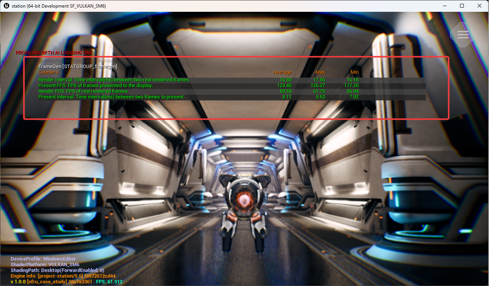
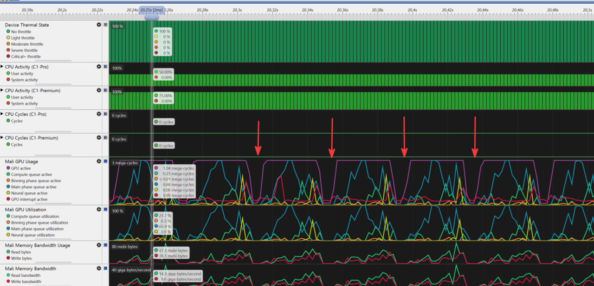

## NFRU frame pacing

NFRU increases the presentation cadence by generating an intermediate frame between valid consecutive rendered frames. When the base render rate and presentation pacing are stable, the display can receive frames more often without requiring the engine to render each one. 

The sustainable uplift depends on both the interpolation workload and when the real and generated frames are submitted and shown. This makes frame pacing an important part of realizing the smoothness benefit.

When profiling NFRU frame pacing, observe render FPS and present FPS. Check whether idle gaps are caused by pacing waits or by actual GPU workload limits. 

The NFRU pace adjuster converts available GPU and neural processing budget into a stable target by moving between sustainable FPS levels instead of chasing an unstable peak. This conversion helps NFRU deliver smoother and more consistent gameplay.

## Evaluate render FPS versus present FPS

To monitor NFRU performance in real-time, use the console command:

```console
stat framegen
```

This command displays four key counters that provide insights into NFRU operation:



There are two FPS values to distinguish:

| Metric           | Meaning                                                 |
|------------------|---------------------------------------------------------|
| Render FPS       | Real frames produced by the engine                      |
| Present FPS      | Plugin presentation-timing counter, including generated frames |
| Render Interval  | Time between real rendered frames                       |
| Present Interval | Interval reported by the plugin presenter                           |

The plugin derives Present FPS from its presenter timings. This counter does not independently verify physical display cadence or unique frames reaching the panel. Use a separate presentation or display measurement when you need that evidence.

Consider the following presentation scenario:

```text
Render FPS       = 30 FPS
Render interval  = 33.3 ms

Present FPS      = 60 FPS
Present interval = 16.6 ms
```

With one generated frame between two real frames, the display can receive frames twice as often.

Render timeline:
```text
R0 ---------------- R1
       33.3 ms
```

Present timeline:
```text
R0 -------- G0 -------- R1
   16.6 ms    16.6 ms
```

So when NFRU is generating and presenting each intermediate frame, render FPS might stay the same, while present FPS increases.

## Why frame pacing is needed

Frame pacing controls when frames are submitted or presented. High FPS alone does not guarantee smoothness. If frames arrive unevenly, the result can still feel stuttery.

Bad pacing:

```text
P0 -- P1 -------- P2 - P3 ---------- P4
```
Good pacing:

```text
P0 ---- P1 ---- P2 ---- P3 ---- P4
```

### Frame pacing behavior and GPU idle time

In Streamline captures, frame-pacing waits often appear as gaps between GPU workloads. These gaps can happen when real rendered frames are produced unevenly. The pacing system waits before submitting or presenting the next real or generated frame to keep the output aligned with the target cadence. 

During that wait, the GPU might be idle:



These idle gaps are important to identify because they can indicate that presentation timing, rather than pure render cost, is limiting the observed FPS uplift:

- GPU idle time: The GPU has no queued work while the pacing system waits for the next frame timing slot.
- Lower measured throughput: Present FPS might be limited by pacing or display timing even when the GPU has spare capacity.
- Uneven workload distribution: Bursts of rendering work followed by idle gaps can make frame delivery harder to interpret in profiling captures.
- Power behavior changes: Idle periods might reduce instantaneous GPU activity, while bursts can still create short load spikes.

Proper frame pacing keeps presentation intervals stable, but it can intentionally introduce waiting. For profiling, distinguish between idle time caused by pacing and idle time caused by missing render work or synchronization problems.

This is especially important for NFRU because the output alternates between real and generated frames:

```text
R0 ---- G0 ---- R1 ---- G1 ---- R2
```

If these frames aren't presented at regular intervals, the motion might look uneven even though more frames are being produced.

## Control frame pacing for comparable profiling

Choose a presentation target supported by the device and keep it identical across comparison runs. Record the accepted target and the observed render and present counters. Don't assume that disabling VSync or the engine FPS cap removes Android frame pacing.

On an Android device that supports a 120 FPS target, run the following after configuring the feature toggles:

```console
r.NFRU.PaceAdjuster 0
r.VSync 0
t.MaxFPS 0
r.SetFramePace 120
```

Disabling the pace adjuster can restore its saved default target, so apply the requested frame pace afterward. Confirm the accepted value in the device logs. A 120 FPS target is not a measured 120 FPS result.

Keep Android Swappy pacing at the project's normal setting for the comparison. Changing `a.UseSwappyForFramePacing` is a separate experiment that can affect presentation behavior. Likewise, don't treat `r.SetFramePace 0` as a portable way to remove all limits; behavior depends on the platform frame pacer.

When you investigate idle gaps, compare timing traces with the accepted target. Pacing waits, synchronization, display behavior, and workload limits can all affect throughput. Keep interpolated-only output and debug views disabled for normal presentation measurements in development builds.

## Understand the achievable FPS uplift

A common target is:

```text
60 render FPS + NFRU = 120 present FPS
```

A workload with a lower base render rate can still increase its presentation rate:

```text
45 render FPS + NFRU = 90 present FPS
```
The displayed result can also be capped by the display:

```text
45 render FPS + NFRU = 90 possible present FPS
60 Hz display cap     = 60 actual present FPS
```
This can happen because NFRU output is still constrained by:

- Display refresh rate
- VSync
- Hardware or platform frame pacing
- Swappy pacing on Android
- NFRU processing cost
- The selected custom frame pace target

NFRU also has its own GPU cost, including optical flow, frame interpolation, resource copies, and presentation handling. Therefore, the actual uplift reflects the complete workload rather than a fixed 2x guarantee. Even when the theoretical maximum isn't reached, generated intermediate frames can still provide a noticeable improvement in presentation smoothness.

## How the NFRU pace adjuster works

The NFRU pace adjuster is an optional adaptive frame pacing controller provided by the ArmNG Unreal plugin. It runs on the NFRU custom-present path of the plugin and chooses a sustainable presentation FPS target while NFRU is running. 

The pace adjuster doesn't make Unreal render more real frames, and it doesn't change interpolation quality. Instead, it adjusts the frame pace target so real and generated frames are presented at a rate the current workload can sustain.

When enabled, the NFRU custom presenter monitors frame timing during presentation. If frames consistently finish with enough spare time, the adjuster raises the target to the next available FPS level. If frames are late, it lowers the target to the previous FPS level. The selected target is applied through `r.SetFramePace`.

Enable it with:

```console
r.NFRU.PaceAdjuster 1
```

```text
Renderer + NFRU
      |
      v
Custom presenter measures frame timing
      |
      v
Enough spare time? -> raise FPS target
Late frames?       -> lower FPS target
      |
      v
Apply:
r.SetFramePace <CustomFPS>
```

The goal is to find a stable FPS target instead of always aiming for the highest possible value.

### FPS adjustment settings

The pace adjuster moves between stable FPS levels derived from the platform frame pace, such as `30 -> 40 -> 60 -> 120`. It changes only one level at a time to avoid sudden jumps. If several frames have enough spare time, it raises the target to the next FPS level. If several frames are late, it lowers the target to the previous FPS level.

`r.NFRU.UpAdjustFrameCount` controls how many consecutive good frames are required before increasing the target FPS. Its default value is `40`, which makes the adjuster cautious before moving up. 

`r.NFRU.DownAdjustFrameCount` controls how many consecutive late frames are required before decreasing the target FPS. Its default value is `20`, so the adjuster reacts faster when the current target can't be sustained. In practice, this means NFRU increases FPS slowly for stability and decreases FPS faster to reduce visible stutter.

You can tune these two values to fit your content and target device. Lower values make the pace adjuster react faster to changing workload conditions. However, it can also cause more frequent FPS target changes. 

Higher values make the adjuster more stable. However, it might take longer to move up when headroom is available or move down when the selected target becomes too expensive.

## What you've accomplished

You've now analyzed NFRU performance by comparing render FPS and present FPS. You've also learned about the NFRU pace adjuster and how it works. 

You've completed a case study workflow for NFRU with Project Moku.

NFRU is one of the most approachable entry points into neural graphics: the model and engine integration are provided, no new content-authoring pipeline is required, and you can evaluate the benefit quickly in representative gameplay. Project Moku shows how you can use neural-accelerated hardware to present smoother motion while retaining the measurement, debugging, and pacing controls needed to meet your quality bar. 

Use this case study as a baseline, then bring that opportunity to your own Unreal Engine content. Start with a repeatable test scene. Then, capture runs with NFRU disabled and enabled, measure the smoothness and performance benefit, and inspect any localized differences that affect your quality target. Use Streamline to select a sustainable presentation rate for the workload.
