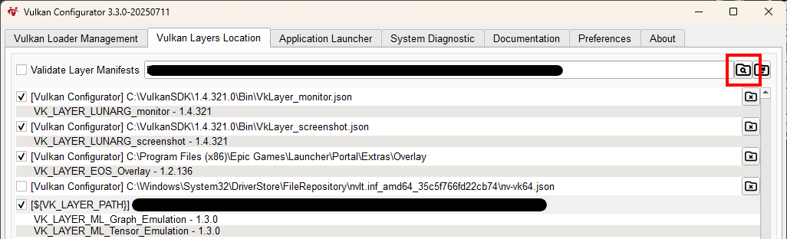
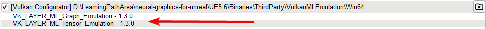
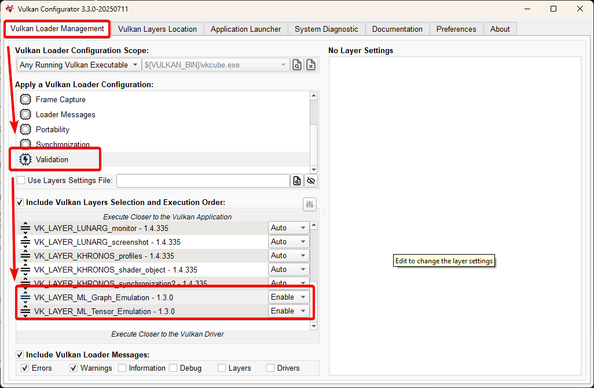

## Install the required tools and dependencies

To use Neural Frame Rate Upscaling (NFRU) in your Unreal Engine project, install the tools and plugin listed here. You'll use them to build and test NFRU with ML extensions for Vulkan.

You will install the following:

- **Vulkan SDK 1.4.321.0 or later**. The SDK includes Vulkan Configurator, which you use to activate the ML emulation layers on Windows.
- **Git and Git LFS**. Use them to clone the plugin repository, its submodules, and large binary assets.
- **Python 3**. The plugin's emulation-layer download script requires Python 3 and internet access.
- **Arm Neural Graphics Plugin 1.1.1**. The plugin is hosted in the [neural-graphics-for-unreal repository](https://github.com/arm/neural-graphics-for-unreal). Its included `DownloadEmulationLayer.bat` script downloads the compatible ML Emulation Layer for Vulkan.

## Install the Vulkan SDK

Go to the [Vulkan SDK page](https://vulkan.lunarg.com/sdk/home) and install Vulkan SDK version 1.4.321.0 or later for Windows.

The Vulkan SDK supplies development tools and headers. NFRU also needs a Vulkan implementation that exposes the plugin's ML extensions for Vulkan. The optical-flow path needs `VK_ARM_data_graph_optical_flow`, alongside tensor and data graph support for neural inference.

If your Windows GPU driver doesn't support these extensions, use the ML Emulation Layer for Vulkan downloaded by `DownloadEmulationLayer.bat`. NFRU needs `VK_ARM_data_graph_optical_flow` for its optical-flow stage.

## Clone neural-graphics-for-unreal

Clone the [neural-graphics-for-unreal repository](https://github.com/arm/neural-graphics-for-unreal):

```console
git lfs install
git clone https://github.com/arm/neural-graphics-for-unreal.git
cd neural-graphics-for-unreal
```

Check out the revision for the specified plugin version. Then initialize its submodules and download the Git LFS assets:

```console
git submodule sync --recursive
git submodule update --init --recursive
git lfs pull
git submodule foreach --recursive "git lfs pull"
```

Keep the cloned `neural-graphics-for-unreal` directory intact. You will copy this complete plugin folder into your Unreal project's `Plugins` directory in the next section.

## Download the ML Emulation Layer for Vulkan

In the cloned `neural-graphics-for-unreal` folder, double-click `DownloadEmulationLayer.bat`, or run it from a terminal in that folder:

```bat
.\DownloadEmulationLayer.bat
```

The script reads the compatible emulation-layer version from `Source\NG-SDK\docs\compatibility_matrix.md`. It installs the Windows x64 Graph and Tensor DLLs and Vulkan manifests in `Binaries\ThirdParty\VulkanMLEmulation\Win64` inside the plugin folder. Activate the layers in Vulkan Configurator.

## Configure the Vulkan ML emulation layers

Vulkan Configurator is installed with the Vulkan SDK. Use it to activate the emulation layers before you run Standalone Game or a packaged Windows build.

1. Launch **Vulkan Configurator** from the Windows **Start** menu.

2. Add a **user-defined Vulkan layer path** that points to the downloaded runtime directory inside the plugin:

    ```text
    <plugin-root>\Binaries\ThirdParty\VulkanMLEmulation\Win64
    ```

    

3. Verify that these layers appear in the list:

    - `VK_LAYER_ML_Graph_Emulation`
    - `VK_LAYER_ML_Tensor_Emulation`

    

4. Switch to the **Vulkan Loader Management** tab. Place the Graph layer before the Tensor layer, enable both, and apply the configuration.

    

{}
Keep Vulkan Configurator running with this configuration active whenever you launch NFRU in Standalone Game or a packaged Windows build.
{}

With the Vulkan requirements in place, you can install the plugin in your Unreal Engine project.
