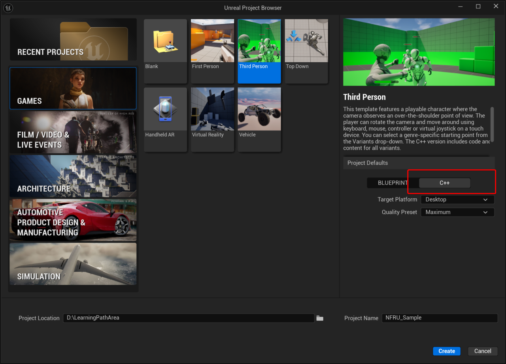
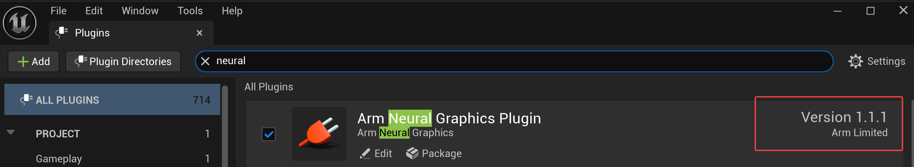
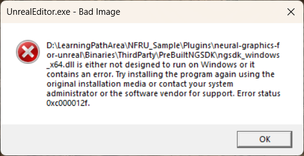
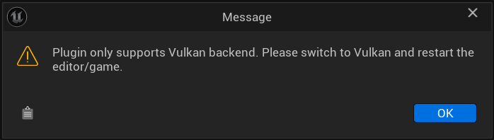
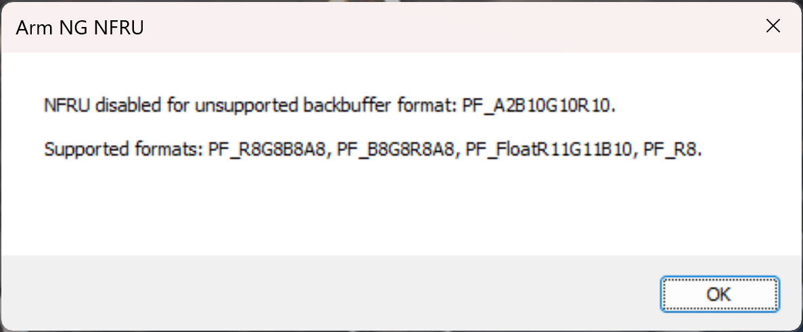

## Install neural-graphics-for-unreal

1. Open Unreal Engine 5.4 or 5.6 and create a new **Third Person** template project using the **C++** option.

    

2. Close Unreal Editor.

3. Create a `Plugins` directory in the project root if it does not already exist.

4. Copy the complete cloned `neural-graphics-for-unreal` folder into the project's `Plugins` directory. Include the `Binaries\ThirdParty\VulkanMLEmulation\Win64` directory populated by `DownloadEmulationLayer.bat`. Do not copy selected subdirectories or create a symbolic link.

    The resulting directory structure starts as follows:

    ```text
    <project-root>\
    ├── <project-name>.uproject
    └── Plugins\
        └── neural-graphics-for-unreal\
    ```

5. Right-click the project's `.uproject` file and select **Generate Visual Studio project files**.

6. Open the generated solution in Visual Studio. Select **Development Editor** and **Win64**, then build the solution.

7. Start the project in Unreal Editor. If Unreal Engine prompts you to rebuild missing modules, accept the prompt and wait for the build to finish.

## Use Vulkan as the rendering hardware interface

Unreal Engine uses DirectX by default on Windows. NFRU requires Vulkan:

1. Open **Edit > Project Settings**.
2. Go to **Platforms > Windows > Targeted RHIs > Default RHI**.
3. Select **Vulkan**.
4. Restart Unreal Editor to apply the change.

    

## Set a supported backbuffer format

NFRU does not support Unreal Engine's 10-bit RGB, 2-bit alpha backbuffer format (`PF_A2B10G10R10`). In **Edit > Project Settings > Engine > Rendering**, set **Frame Buffer Pixel Format** to **8-bit RGBA**. This sets `r.DefaultBackBufferPixelFormat=0` and selects a supported backbuffer format.

Alternatively, add the setting to the project's `Config/DefaultEngine.ini` under the renderer settings section:

```ini
[/Script/Engine.RendererSettings]
r.DefaultBackBufferPixelFormat=0
```

Restart Unreal Editor after changing the setting. If the renderer settings section already exists, add only the `r.DefaultBackBufferPixelFormat=0` line to it.

## Enable Arm Neural Graphics Plugin

To enable the plugin:

1. Open **Edit > Plugins**.
2. Search for **Arm Neural Graphics Plugin**.
3. Enable the plugin if it is not already enabled, and restart Unreal Editor if prompted.



## Configure NFRU project settings

Open **Edit > Project Settings > Plugins > Neural Graphics 1.1.1** to view and configure the NFRU settings stored with the project.

These project settings persist with your project. You can use the `r.NFRU.*` console variables to inspect or change NFRU behavior in Standalone Game or a packaged build.

## Troubleshoot issues with setup

If NFRU doesn't start, check the following setup issues.

### "Bad Image" error for ngsdk_windows_x64.dll

If Windows reports a "Bad Image" error for `ngsdk_windows_x64.dll`, check that you copied the complete `neural-graphics-for-unreal` folder from the cloned repository. Do not mix plugin files from different revisions or Unreal Engine versions.



Replace any incomplete plugin copy with the complete folder from the clone, regenerate the Visual Studio project files, and rebuild the solution.

### Vulkan backend support error

If you see a "Plugin only supports Vulkan backend" error, confirm that Vulkan is selected under **Platforms > Windows > Targeted RHIs > Default RHI**, then restart Unreal Editor.



### Unsupported backbuffer format



If NFRU reports `PF_A2B10G10R10` as an unsupported backbuffer format, confirm that **Frame Buffer Pixel Format** is set to **8-bit RGBA** (`r.DefaultBackBufferPixelFormat=0`). Relaunch Standalone Game after applying the setting, or package the game again with the updated project configuration.

### Missing Vulkan ML extensions

If the project starts but NFRU is unavailable, check that `DownloadEmulationLayer.bat` completed successfully. In Vulkan Configurator, point the layer path to the plugin's `Binaries\ThirdParty\VulkanMLEmulation\Win64` directory. Enable both layers, place Graph before Tensor, and keep Vulkan Configurator running. The Vulkan environment must expose `VK_ARM_data_graph_optical_flow` for NFRU's optical-flow stage.

You have now installed and configured the plugin. Next, run Standalone Game or package a Windows game build to validate NFRU.
