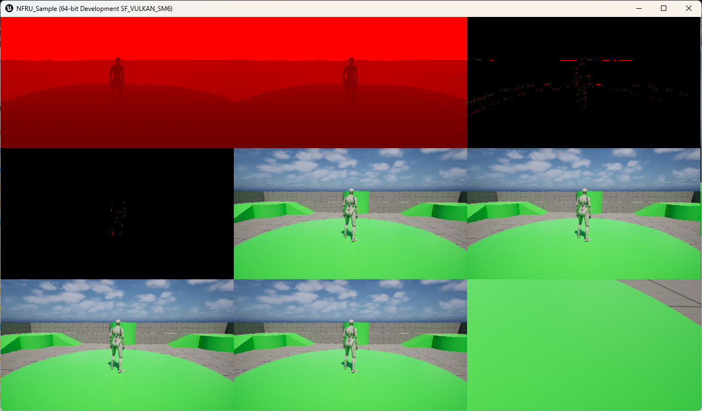
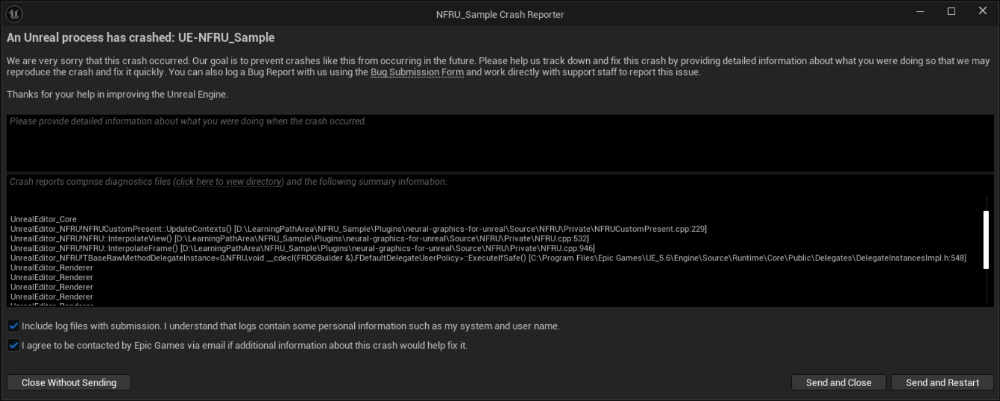

## Understand where NFRU runs

NFRU does not run in the Unreal Editor viewport or **Play In Editor (PIE)**. Test it in **Standalone Game** or a packaged Windows game. Select Standalone Game from the Editor's **Play** menu to launch a separate game process.

### Test in Standalone Game

1. Open the project in Unreal Editor.
2. Open the **Play** options menu and select **Standalone Game**.
3. In the Standalone Game window, open the console and use the NFRU verification commands.

### Test in a packaged Windows game

1. In **Edit > Project Settings > Packaging**, select the **Development** build configuration so the game console is available.
2. In the Editor toolbar, select **Platforms > Windows > Package Project** and choose an output directory. Wait for packaging to complete.
3. Run the game executable from the packaged output directory, then open its console and use the NFRU verification commands.

Packaging builds the game and cooks its content for Windows. Use Standalone Game for quick checks. Use a packaged build to validate the output you'll distribute.

## Verify NFRU in Standalone Game or a packaged build

Open the console in the running game and enter:

```console
r.NFRU.Enable 1
r.NFRU.ShowDebugView 1
stat FrameGen
```

`r.NFRU.ShowDebugView 1` displays the NFRU intermediate-buffer grid. If the grid updates during gameplay, NFRU is generating frames. Use `stat FrameGen` to check frame generation and presentation pacing.



Enter `r.NFRU.ShowDebugView 0` when you want to disable the debug grid.

## Know when to rebuild or package again

Standalone Game uses the current project. Relaunch it after changing settings or content. Package the game again after changing code, settings, shaders, or assets.

## Troubleshooting

### NFRU does not start

Select **Standalone Game** from the Editor's **Play** menu or launch the packaged game executable. **Selected Viewport** and **New Editor Window (PIE)** do not run NFRU.

Also confirm that:

- Arm Neural Graphics Plugin is enabled.
- Vulkan is the project's default RHI.
- Vulkan Configurator is running with the Graph layer before the Tensor layer.
- The active Vulkan implementation exposes `VK_ARM_data_graph_optical_flow`.

### The game crashes after NFRU is enabled

A crash after enabling NFRU can indicate a missing or incorrectly ordered Vulkan emulation layer.



In Vulkan Configurator, check that the layer path points to the plugin's `Binaries\ThirdParty\VulkanMLEmulation\Win64` directory. Enable both layers, place Graph before Tensor, and restart the game.

You have now run NFRU in Standalone Game or a packaged Windows build and verified it with the debug view and frame-generation statistics. Next, use the project settings and console variables to tune NFRU.
