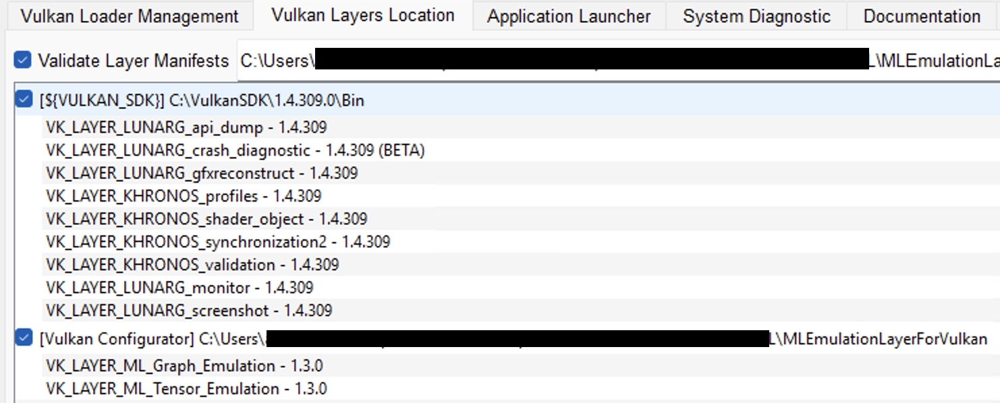
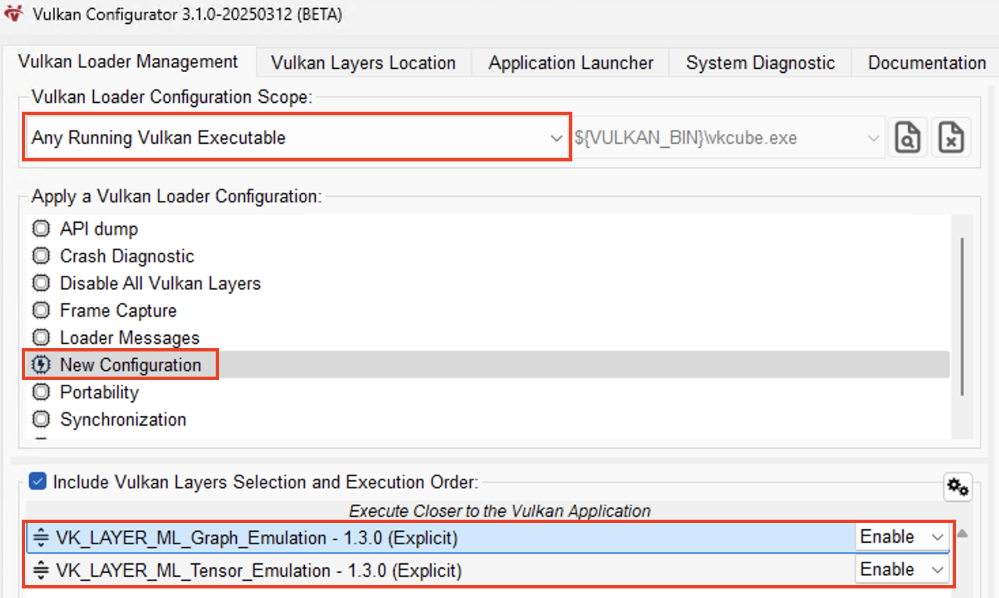

## Install dependencies

The clone and emulation layer script in this section apply to Unreal Engine 5.4 and 5.6. For Unreal Engine 4.27, use the [UE 4.27 plugin branch](https://github.com/arm/neural-graphics-for-unreal/tree/ue4.27) and follow its README for the matching SDK and installation steps.

To run NSS in your Unreal Engine project, you will need to install and configure the following:

- **Vulkan SDK version 1.4.321.0 or later**: Required for developing applications that use Vulkan and for accessing Vulkan Configurator. Vulkan Configurator sets up the emulation layers used for running ML extensions for Vulkan workloads.
- **ML Emulation Layer for Vulkan**: The plugin download script installs the version required by its bundled ArmNG SDK. Its Graph and Tensor layers run ML workloads through Vulkan's compute backend.
- **Arm Neural Graphics Plugin 1.1.1 for Unreal Engine 5.4 and 5.6**: Clone the plugin in this section, then run its emulation layer download script.

These components allow you to run NSS in Unreal Engine, using ML emulation layers for Vulkan for development and testing.

{}
For the steps below, use Windows 11, Unreal Engine 5.6, Visual Studio 2022 17.14, Vulkan SDK 1.4.321.0, the plugin-provided ML Emulation Layer for Vulkan, and Arm Neural Graphics Plugin 1.1.1. These versions follow the [UE5.6 development requirements](https://dev.epicgames.com/documentation/en-us/unreal-engine/setting-up-visual-studio-development-environment-for-cplusplus-projects-in-unreal-engine?application_version=5.6) and [plugin setup instructions](https://github.com/arm/neural-graphics-for-unreal/tree/ue5).

In Visual Studio Installer, enable **Desktop development with C++**, **Game development with C++**, and **.NET desktop development**, including MSVC v143 14.38 and Windows SDK 10.0.22621.0. Source builds also require Git with Git LFS, Python 3, and CMake 3.21–3.31 on **PATH**.
{}

## Install Vulkan Software Development Kit

Go to the [Vulkan SDK landing page](https://vulkan.lunarg.com/sdk/home) and download version 1.4.321.0 or later of the SDK installer for Windows. After you run the installer, continue to the next step.

## Clone the Arm Neural Graphics Plugin

Use the Arm Neural Graphics Plugin 1.1.1 source, including its SDK submodules and Git LFS assets, to set up NSS for Unreal Engine.

[**Arm Neural Graphics Plugin** → GitHub repository](https://github.com/arm/neural-graphics-for-unreal/tree/ue5)

With Git and Git LFS installed, run the following in **PowerShell** to download the source and its dependencies. GitHub's automatically generated source ZIP omits the submodule contents.

```powershell
git lfs install
git clone --branch ue5 --recurse-submodules https://github.com/arm/neural-graphics-for-unreal.git
cd neural-graphics-for-unreal
git lfs pull
git submodule foreach --recursive "git lfs pull"
```

The `ue5` branch contains `NG.uplugin` at the repository root.

## Download the emulation layers

From the cloned plugin repository root, run:

```powershell
.\DownloadEmulationLayer.bat
```

The script reads the required version from the bundled [ArmNG SDK](https://github.com/arm/neural-graphics-sdk-for-game-engines) compatibility matrix and installs these files in `Binaries\ThirdParty\VulkanMLEmulation\Win64`:

- `VkLayer_Graph.dll` and `VkLayer_Graph.json`
- `VkLayer_Tensor.dll` and `VkLayer_Tensor.json`

Run the script before configuring Vulkan Configurator. If the download fails, check that Python 3 is on **PATH** and that GitHub is reachable.

## Configure Vulkan Layers

Use Vulkan Configurator to make the downloaded Graph and Tensor layers available to Unreal Engine.

To emulate the ML extensions for Vulkan:

1. Launch the **Vulkan Configurator** (bundled with the Vulkan SDK) from the Windows **Start** menu.
2. In the **Apply a Vulkan Loader Configuration** list, right-click and choose **Create a new Configuration**. You can give the new configuration any name, for example `NSS`.
3. Navigate to the **Vulkan Layers Location** tab.
4. Append a user-defined path pointing to the layers downloaded by the plugin script:

   ```text
   <path-to-neural-graphics-for-unreal>\Binaries\ThirdParty\VulkanMLEmulation\Win64
   ```

   

5. Confirm that `VK_LAYER_ML_Graph_Emulation` and `VK_LAYER_ML_Tensor_Emulation` appear in the layer list.

6. Switch back to the **Vulkan Loader Management** tab. Set **Vulkan Loader Configuration Scope** to **Any Running Vulkan Executable** and select your `NSS` configuration under **Apply a Vulkan Loader Configuration**. Select **Include Vulkan Layers Selection and Execution Order**, set both ML emulation layers to **Enable**, and place Graph *above* Tensor.

   

{}
Confirm that both layers are enabled, Graph is above Tensor, and your `NSS` configuration is selected. Keep Vulkan Configurator running in the background as you go through the next steps. If you change the configuration while Unreal Editor is open, restart the editor before testing NSS.
{}

With the ML emulation layers configured, Vulkan can run machine learning workloads through the ML extensions for Vulkan. This enables neural inference to execute alongside the graphics pipeline during development, without requiring access to hardware with dedicated neural accelerators.

The next step is to integrate Neural Super Sampling into an Unreal Engine project. You’ll do this by adding the cloned plugin and creating a simple example game that lets you verify the setup and visualize the upscaling in action.
