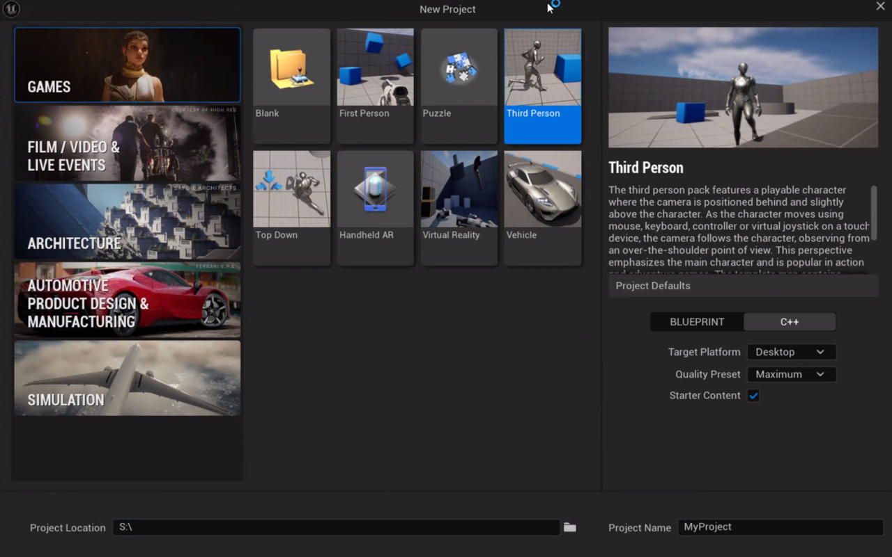
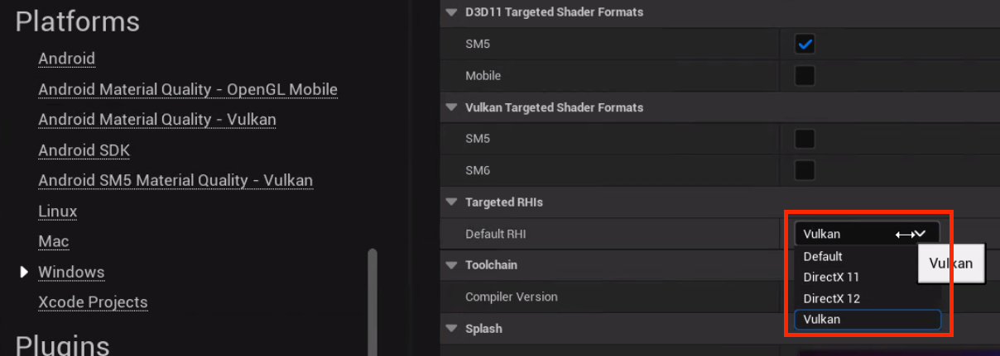
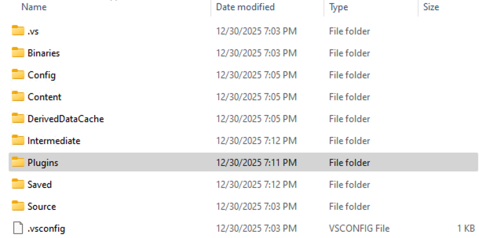

## Download the Arm Neural Graphics Plugin

Use the Arm Neural Graphics Plugin 1.1.0 source, including its SDK submodules and Git LFS assets, to set up NSS for Unreal Engine.

[**Arm Neural Graphics Plugin 1.1.0** → GitHub repository](https://github.com/arm/neural-graphics-for-unreal/tree/v1.1.0)

With Git and Git LFS installed, run the following in **PowerShell** to download the source and its dependencies. GitHub's automatically generated source ZIP omits the submodule contents.

```powershell
git lfs install
git clone --branch v1.1.0 --recurse-submodules https://github.com/arm/neural-graphics-for-unreal.git
cd neural-graphics-for-unreal
git lfs pull
git submodule foreach --recursive "git lfs pull"
```

For this example, use the downloaded `UE5.6` folder. If you use another engine version, follow the instructions in the matching plugin folder.

## Create the example project

1. Open Unreal Engine and create a new **Third Person** template project using the **C++** option.



2. Save the project and close Unreal Editor. Open the project's `.sln` file in **Visual Studio**, select **Development Editor** and **Win64**, then right-click your game project in **Solution Explorer** and select **Build**. Confirm in **Output > Build** that the `<YourProjectName>Editor` target builds without errors.

After the build is finished, open your project in Unreal Engine.

{}
If a solution build reports failures in `AutomationTool`, `Gauntlet`, or other `*.Automation` projects, build your game project separately. Continue only when its editor target succeeds. For game-project failures, inspect the first error in **Output > Build** and check the Visual Studio components listed in the development setup notice.
{}

## Change Unreal’s Rendering Interface to Vulkan

By default, Unreal uses DirectX. Instead, you need to choose Vulkan as the default RHI:
1. Go to **Edit > Project Settings > Platforms > Windows > Targeted RHIs > Default RHI**.
2. Select **Vulkan**.
3. Restart Unreal Engine to apply the change.



## Create the Plugins directory

Open your project directory in Windows explorer, and create a new folder called `Plugins`.



## Enable the plugin

The engine-specific `UE5.6` folder contains the plugin descriptor `NG.uplugin` and its source.

1. Close Unreal Editor and copy the `UE5.6` folder into your project's `Plugins` directory. The descriptor should be at `<YourProject>\Plugins\UE5.6\NG.uplugin`, with `Shaders` and `Source` alongside it. Confirm that `Source\NG-SDK` contains the SDK source.
2. Reopen Unreal Engine, allowing it to rebuild missing modules if prompted. Open **Edit > Plugins**, search for **Arm Neural Graphics Plugin**, and select its checkbox. Save and close the editor before the Visual Studio build.
3. Close Visual Studio if it is open. Right-click the `.uproject` file and select **Generate Visual Studio project files** (under **Show more options** on Windows 11). Open the regenerated solution, select **Development Editor** and **Win64**, and build your game project. Confirm that its editor target succeeds before continuing.
4. Reopen Unreal Engine and confirm that **Arm Neural Graphics Plugin** is enabled in **Edit > Plugins**. Restart the editor if prompted.

If the plugin is missing from the list, first check the `NG.uplugin` path above. If the build fails in `BuildSDK.py`, check that Python and CMake are on **PATH** and that the SDK submodules and LFS assets were downloaded.

With the emulation layers and Arm Neural Graphics Plugin configured, you're ready to run Neural Super Sampling in Unreal Engine. Continue to the next section to test the integration.
